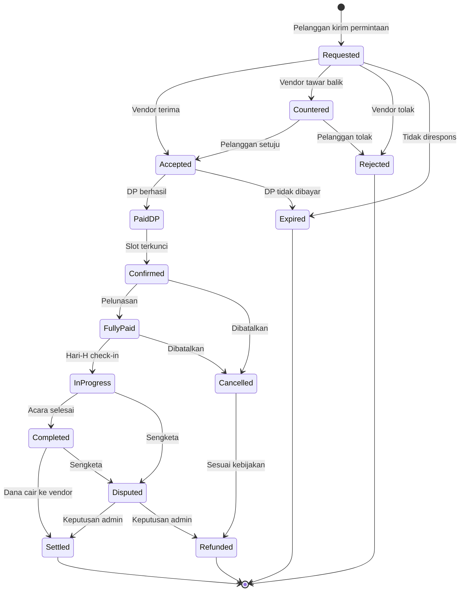
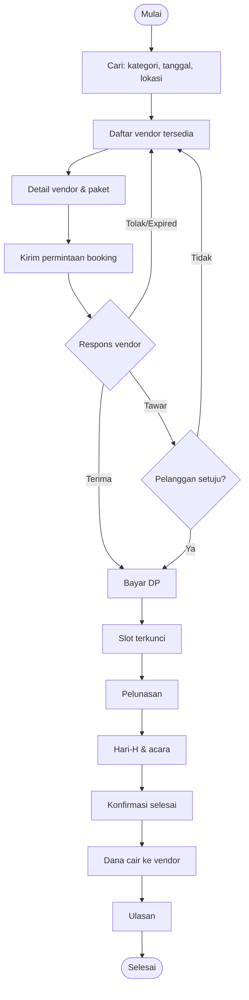
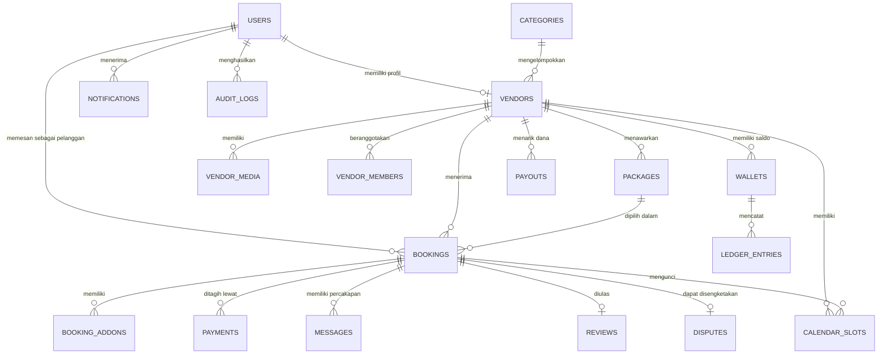

# PRD — Aplikasi Booking Hiburan Pantura

> **Nama Kerja Aplikasi:** [Nama Aplikasi, mis. "PanturaStage" / "Tanggap Hiburan"]
> **Versi Dokumen:** 1.0
> **Status:** Draft
> **Tanggal Dibuat:** 07-10-2026
> **Penulis / Product Owner:** [Nama]
> **Stakeholder:** [Pemilik produk, perwakilan grup hiburan, tim pengembang]

### Riwayat Perubahan

| Versi | Tanggal | Penulis | Perubahan |
|-------|---------|---------|-----------|
| 1.0 | 07-10-2026 | [Nama] | Draft awal |

> **Keputusan awal yang sudah dikonfirmasi:** marketplace multi-vendor · platform Flutter (Android + iOS) · pembayaran DP + pelunasan via payment gateway · kategori: Tarling/Tarling Dangdut, Organ Tunggal/Dangdut, Seni Tradisi, dan Pendukung Acara.
> Item bertanda **[ASUMSI]** perlu divalidasi dengan survei lapangan.

---

## Daftar Isi

1. [Overview](#1-overview)
2. [Requirements](#2-requirements)
3. [Core Features](#3-core-features)
   - [Fase 1 — Fondasi Marketplace & Booking](#fase-1--fondasi-marketplace--booking)
   - [Fase 2 — Pembayaran & Kepercayaan](#fase-2--pembayaran--kepercayaan)
   - [Fase 3 — Operasional Vendor & Wawasan](#fase-3--operasional-vendor--wawasan)
   - [Fase 4 — Pertumbuhan & Ekosistem](#fase-4--pertumbuhan--ekosistem)
4. [User Flow](#4-user-flow)
5. [Architecture](#5-architecture)
6. [Database Schema](#6-database-schema)
7. [Tech Stack](#7-tech-stack)
8. [Lampiran](#lampiran)

---

## 1. Overview

### 1.1 Ringkasan Produk
Aplikasi mobile marketplace yang mempertemukan **penyelenggara acara** (tuan rumah hajatan, panitia desa, instansi) dengan **grup hiburan dan vendor pendukung acara** di wilayah Pantura (Indramayu, Cirebon, Subang, Majalengka, Brebes, Tegal, Karawang, dan sekitarnya). Pengguna dapat mencari, membandingkan, memeriksa ketersediaan jadwal, memesan, dan membayar DP secara aman, tanpa harus mencari kontak dari mulut ke mulut.

### 1.2 Latar Belakang & Masalah

Pemesanan hiburan di Pantura umumnya masih manual:

| Masalah di Pihak Penyelenggara | Masalah di Pihak Grup/Vendor |
|--------------------------------|------------------------------|
| Sulit menemukan grup dan membandingkan harga | Jadwal dicatat manual (buku/WhatsApp), rawan **bentrok** |
| Tidak tahu apakah grup tersedia di tanggal acara | Calon pelanggan hanya dari relasi, jangkauan terbatas |
| Tidak ada jaminan: DP hilang, grup batal, atau tidak sesuai janji | Pelanggan batal sepihak atau tidak melunasi |
| Harga tidak transparan, negosiasi panjang | Tidak ada portofolio digital yang mudah dibagikan |
| Sulit menilai kualitas sebelum memesan | Pencatatan keuangan DP/pelunasan tidak rapi |

Musim ramai (musim hajatan setelah panen, bulan Besar/Maulid, 17 Agustusan, sedekah bumi/laut/nadran) membuat masalah bentrok jadwal dan kehabisan vendor semakin sering.

### 1.3 Tujuan Proyek
- **Tujuan utama:** Menjadi platform booking hiburan nomor satu di Pantura dengan jadwal yang terpercaya dan pembayaran yang aman.
- **Tujuan sekunder:**
  - Mendigitalkan jadwal dan portofolio grup hiburan lokal.
  - Menurunkan kasus bentrok jadwal dan pembatalan sepihak.
  - Membuka sumber pendapatan baru bagi seniman lokal.
  - Melestarikan seni tradisi dengan memberi panggung digital.

### 1.4 Ruang Lingkup (Scope)

**Termasuk (In Scope):**
- Katalog grup dan vendor dengan 4 kategori (Tarling & Tarling Dangdut, Organ Tunggal/Dangdut, Seni Tradisi, Pendukung Acara)
- Pencarian, filter, dan pengecekan ketersediaan jadwal
- Booking, negosiasi sederhana (penawaran), dan pembayaran DP/pelunasan lewat payment gateway
- Kalender dan manajemen jadwal vendor
- Chat, notifikasi, ulasan dan rating
- Panel admin untuk verifikasi vendor, pencairan dana, dan penanganan sengketa
- Aplikasi mobile Flutter (Android + iOS) dan panel admin web

**Tidak Termasuk (Out of Scope, rilis awal):**
- Tiket penonton / penjualan tiket konser
- Streaming/live acara
- Penyewaan kendaraan, penginapan, atau katering (selain yang terdaftar sebagai vendor pendukung)
- Integrasi pajak otomatis (e-Faktur)
- Wilayah di luar Jawa Barat–Jawa Tengah bagian utara

### 1.5 Target Pengguna

| Persona | Deskripsi | Kebutuhan / Pain Point | Keahlian Teknis |
|---------|-----------|------------------------|-----------------|
| **Penyelenggara Acara** | Warga/keluarga yang punya hajat (nikah, sunatan), panitia desa/RT/RW, EO kecil, instansi | Cepat menemukan hiburan yang cocok, harga jelas, aman dari penipuan | Rendah–Menengah |
| **Vendor / Grup Hiburan** | Pimpinan grup tarling, pemilik organ tunggal, dalang/seniman tradisi, penyedia sound/tenda/MC | Dapat order baru, jadwal rapi, DP terjamin | Rendah (banyak yang gaptek) |
| **Admin Platform** | Tim operasional | Verifikasi vendor, kontrol kualitas, selesaikan sengketa | Menengah |
| **Anggota Grup / Kru** *(Fase 3)* | Penyanyi, pemain musik, kru panggung | Info jadwal manggung dan lokasi | Rendah |

**Karakteristik pengguna Pantura [ASUMSI]:**
- Mayoritas memakai **Android kelas menengah ke bawah** dan kuota terbatas.
- Sinyal bisa lemah di desa, sehingga aplikasi harus ringan dan tahan koneksi buruk.
- Kebiasaan komunikasi utama adalah **WhatsApp**, jadi perlu integrasi/notifikasi WA.
- Bahasa sehari-hari: Indonesia, Jawa Cirebonan/Dermayon, dan Sunda. UI perlu bahasa sederhana.

### 1.6 Metrik Keberhasilan (Success Metrics)

| Metrik | Kondisi Saat Ini | Target (6 bulan setelah rilis) | Cara Pengukuran |
|--------|------------------|---------------------------------|-----------------|
| Jumlah vendor terverifikasi | 0 | ≥ 150 | Dashboard admin |
| Booking sukses (selesai) per bulan | 0 | ≥ 100 | Database transaksi |
| Persentase bentrok jadwal pada booking via aplikasi | n/a | < 1% | Laporan sengketa |
| Waktu dari pencarian ke booking terkirim | n/a | < 5 menit | Analytics |
| Rating rata-rata platform | n/a | ≥ 4,3 / 5 | Ulasan |
| Tingkat pembatalan sepihak | tidak terukur | < 5% | Database booking |
| Vendor aktif memperbarui kalender | n/a | ≥ 60% | Analytics |

### 1.7 Glosarium

| Istilah | Definisi |
|---------|----------|
| **Tarling** | Seni musik khas Indramayu–Cirebon (gitar dan suling) yang berkembang menjadi **Tarling Dangdut** |
| **Organ Tunggal** | Hiburan keyboard/organ dengan penyanyi, umum di hajatan |
| **Seni Tradisi** | Sandiwara, wayang golek/kulit, sisingaan, kuda lumping, jaipong, dll. |
| **Hajatan** | Acara pesta keluarga (pernikahan, khitanan, syukuran) |
| **Nadran / Sedekah Bumi/Laut** | Tradisi syukuran masyarakat pesisir/agraris |
| **DP** | Uang muka booking |
| **Escrow / Dana Ditahan** | Dana pelanggan ditahan platform dan dicairkan ke vendor setelah acara selesai |
| **Vendor** | Grup hiburan atau penyedia jasa pendukung acara |
| **Paket** | Penawaran layanan vendor (durasi, personel, fasilitas, harga) |
| **Rider** | Daftar kebutuhan teknis/akomodasi vendor (listrik, panggung, konsumsi) |
| **Komisi** | Persentase biaya layanan platform dari nilai transaksi |

---

## 2. Requirements

### 2.1 Functional Requirements

> **Prioritas (MoSCoW):** **Must** wajib · **Should** penting · **Could** opsional · **Won't** tidak untuk rilis ini

#### Akun & Onboarding
| ID | Requirement | Prioritas | Fase |
|----|-------------|-----------|------|
| FR-001 | Pengguna dapat mendaftar/login dengan **nomor HP + OTP** (WhatsApp/SMS) | Must | 1 |
| FR-002 | Pengguna memilih peran: Penyelenggara atau Vendor | Must | 1 |
| FR-003 | Vendor mengajukan verifikasi (KTP pimpinan, foto grup, sampel video/audio, alamat basis) | Must | 1 |
| FR-004 | Admin dapat menyetujui/menolak verifikasi vendor dengan alasan | Must | 1 |
| FR-005 | Login opsional via Google | Could | 3 |

#### Katalog & Pencarian
| ID | Requirement | Prioritas | Fase |
|----|-------------|-----------|------|
| FR-010 | Vendor membuat profil: nama, kategori, deskripsi, area layanan, galeri foto, video, audio | Must | 1 |
| FR-011 | Vendor membuat satu atau lebih **paket** (durasi, jumlah personel, fasilitas, harga dasar) | Must | 1 |
| FR-012 | Pelanggan mencari berdasarkan kategori, lokasi acara, tanggal, rentang harga, rating | Must | 1 |
| FR-013 | Halaman detail vendor menampilkan paket, portofolio, ulasan, dan status ketersediaan | Must | 1 |
| FR-014 | Hasil pencarian hanya menampilkan vendor yang **tersedia di tanggal** yang dipilih | Must | 1 |
| FR-015 | Favorit/simpan vendor | Should | 2 |
| FR-016 | Bandingkan hingga 3 vendor | Could | 3 |
| FR-017 | Rekomendasi "populer di kecamatan/kabupaten Anda" | Could | 4 |

#### Kalender & Ketersediaan
| ID | Requirement | Prioritas | Fase |
|----|-------------|-----------|------|
| FR-020 | Vendor mengelola kalender: tandai tanggal **tersedia / diblokir / sudah dipesan** | Must | 1 |
| FR-021 | Booking yang disetujui otomatis mengunci tanggal pada kalender vendor | Must | 1 |
| FR-022 | Sistem mencegah **double booking** pada slot yang sama | Must | 1 |
| FR-023 | Vendor dapat memasukkan **job offline** (di luar aplikasi) agar kalender tetap sinkron | Must | 1 |
| FR-024 | Mendukung beberapa sesi dalam sehari (siang / malam) | Should | 2 |
| FR-025 | Sinkronisasi ke Google Calendar | Could | 4 |

#### Booking
| ID | Requirement | Prioritas | Fase |
|----|-------------|-----------|------|
| FR-030 | Pelanggan mengirim **permintaan booking**: tanggal, jam, lokasi (peta + alamat), jenis acara, estimasi tamu, catatan | Must | 1 |
| FR-031 | Vendor **menerima / menolak / menawar balik** dalam batas waktu (mis. 24 jam) | Must | 1 |
| FR-032 | Booking kedaluwarsa otomatis jika vendor tidak merespons | Must | 1 |
| FR-033 | Biaya transport dihitung otomatis berdasarkan **jarak** dari basis vendor ke lokasi acara | Should | 2 |
| FR-034 | Add-on paket (tambah durasi, tambah penyanyi, sound tambahan) | Should | 2 |
| FR-035 | Kontrak/ringkasan kesepakatan digital (PDF) otomatis dibuat | Should | 2 |
| FR-036 | Pesanan multi-vendor dalam satu acara (mis. organ + sound + MC) | Could | 3 |
| FR-037 | Pelanggan dapat mengajukan perubahan jadwal (reschedule) | Should | 3 |

#### Pembayaran
| ID | Requirement | Prioritas | Fase |
|----|-------------|-----------|------|
| FR-040 | Pelanggan membayar **DP** (persentase yang ditentukan vendor/platform) via QRIS, VA bank, e-wallet | Must | 2 |
| FR-041 | Pelanggan membayar **pelunasan** sebelum/sesudah acara sesuai kebijakan | Must | 2 |
| FR-042 | Dana **ditahan** platform dan dicairkan ke vendor setelah acara terkonfirmasi selesai | Must | 2 |
| FR-043 | Platform memotong **komisi** otomatis | Must | 2 |
| FR-044 | Kebijakan pembatalan & refund otomatis sesuai aturan | Must | 2 |
| FR-045 | Vendor menarik saldo ke rekening bank (payout) | Must | 2 |
| FR-046 | Invoice dan bukti pembayaran dapat diunduh/dibagikan | Should | 2 |
| FR-047 | Voucher/kode promo | Could | 4 |

#### Komunikasi & Kepercayaan
| ID | Requirement | Prioritas | Fase |
|----|-------------|-----------|------|
| FR-050 | Chat dalam aplikasi antara pelanggan dan vendor (teks, foto, lokasi) | Must | 2 |
| FR-051 | Push notification untuk setiap perubahan status booking | Must | 1 |
| FR-052 | Notifikasi/pengingat via WhatsApp (H-7, H-1, hari-H) | Should | 2 |
| FR-053 | Ulasan dan rating (teks + foto) hanya dari pelanggan yang menyelesaikan booking | Must | 2 |
| FR-054 | Vendor dapat membalas ulasan | Should | 3 |
| FR-055 | Lencana vendor: Terverifikasi, Responsif, Favorit Pantura | Could | 3 |
| FR-056 | Laporkan vendor/pengguna dan ajukan sengketa | Must | 2 |

#### Operasional Vendor
| ID | Requirement | Prioritas | Fase |
|----|-------------|-----------|------|
| FR-060 | Dashboard vendor: order masuk, jadwal, saldo, performa | Should | 3 |
| FR-061 | Manajemen anggota grup dan penugasan ke job | Could | 3 |
| FR-062 | Rider teknis digital (kebutuhan listrik, panggung, konsumsi) yang terlampir pada booking | Should | 3 |
| FR-063 | Check-in lokasi pada hari-H (GPS) sebagai bukti kehadiran | Should | 3 |
| FR-064 | Laporan pendapatan bulanan | Should | 3 |

#### Admin
| ID | Requirement | Prioritas | Fase |
|----|-------------|-----------|------|
| FR-070 | Panel admin web: kelola pengguna, vendor, kategori, booking | Must | 1 |
| FR-071 | Moderasi konten (foto, video, ulasan) | Must | 2 |
| FR-072 | Penanganan sengketa dan keputusan refund/pencairan | Must | 2 |
| FR-073 | Pengaturan komisi, kebijakan DP, dan wilayah layanan | Must | 2 |
| FR-074 | Laporan keuangan dan analitik platform | Should | 3 |
| FR-075 | Audit log aksi admin | Should | 3 |

### 2.2 Non-Functional Requirements

| ID | Kategori | Requirement | Target |
|----|----------|-------------|--------|
| NFR-001 | Performa | Waktu muat layar utama pada 4G | < 3 detik |
| NFR-002 | Performa | Ukuran aplikasi Android | < 40 MB |
| NFR-003 | Kompatibilitas | Android 8.0+ (API 26), iOS 13+ | Wajib |
| NFR-004 | Koneksi lemah | Data yang sudah dimuat bisa dibuka offline (kalender, booking aktif); aksi tulis masuk antrean dan dikirim ulang saat online | Wajib |
| NFR-005 | Kuota hemat | Gambar dikompres otomatis, lazy loading, video diputar on-demand | Wajib |
| NFR-006 | Keamanan | HTTPS/TLS, token JWT berumur pendek + refresh, data sensitif terenkripsi | Wajib |
| NFR-007 | Keamanan pembayaran | Tidak menyimpan data kartu; memakai payment gateway tersertifikasi PCI-DSS | Wajib |
| NFR-008 | Privasi | Mematuhi UU Pelindungan Data Pribadi (UU PDP); KTP vendor disimpan terenkripsi dengan akses terbatas | Wajib |
| NFR-009 | Ketersediaan | Uptime backend | ≥ 99,5% |
| NFR-010 | Skalabilitas | Mendukung lonjakan musim hajatan | 10× trafik normal |
| NFR-011 | Usability | Teks besar dan kontras jelas, alur maksimal 3 langkah per tugas inti, ikon yang mudah dipahami | Wajib |
| NFR-012 | Lokalisasi | Bahasa Indonesia (default); istilah lokal; opsi Jawa/Sunda sederhana (Fase 4); mata uang IDR; zona waktu WIB | Wajib |
| NFR-013 | Aksesibilitas | Mengikuti prinsip dasar WCAG 2.1 AA untuk kontras dan ukuran sentuh | Should |
| NFR-014 | Backup | Backup database harian, retensi 30 hari | Wajib |
| NFR-015 | Observabilitas | Crash reporting dan logging terpusat | Wajib |
| NFR-016 | Integritas data | Transaksi booking-kalender-pembayaran bersifat atomik, dengan penguncian slot terhadap kondisi balapan (race condition) | Wajib |

### 2.3 Asumsi
- Vendor bersedia memakai aplikasi jika proses onboarding dibantu (pendampingan langsung/WhatsApp). **[ASUMSI]**
- Penyelenggara nyaman membayar DP lewat QRIS/VA bila ada jaminan dana aman. **[ASUMSI]**
- Mayoritas booking dibuat 2 minggu hingga 3 bulan sebelum acara. **[ASUMSI]**
- Komisi platform 8–12% dapat diterima vendor. **[ASUMSI]**
- Payment gateway mendukung split payment/payout atau dapat dikombinasikan dengan layanan disbursement.

### 2.4 Batasan & Dependensi
- **Batasan:** anggaran dan tim awal terbatas; literasi digital vendor beragam; musim ramai bersifat musiman; regulasi pembayaran (izin payment gateway pihak ketiga, bukan membuat sendiri).
- **Dependensi:** payment gateway (Midtrans/Xendit/DOKU), penyedia OTP WhatsApp/SMS, Google Maps Platform, Firebase (FCM), layanan penyimpanan media.

### 2.5 Risiko

| ID | Risiko | Dampak | Kemungkinan | Mitigasi |
|----|--------|--------|-------------|----------|
| R-01 | Vendor enggan memakai aplikasi / gaptek | Tinggi | Tinggi | Onboarding tatap muka, tim "agen lapangan", UI sederhana, bantuan input kalender oleh admin |
| R-02 | Kalender vendor tidak diperbarui, sehingga bentrok | Tinggi | Tinggi | Pengingat rutin, konfirmasi ulang H-30, penalti/lencana, input job offline |
| R-03 | Bypass platform (transaksi di luar aplikasi untuk menghindari komisi) | Tinggi | Sedang | Nilai tambah (jaminan dana, ulasan), komisi wajar, sensor nomor HP di chat sebelum DP |
| R-04 | Pelanggan menipu / vendor menipu | Tinggi | Sedang | Verifikasi vendor, dana ditahan, sistem ulasan, mekanisme sengketa |
| R-05 | Sengketa kualitas ("tidak sesuai janji") sulit dibuktikan | Sedang | Tinggi | Deskripsi paket detail, kontrak digital, check-in GPS, foto/video bukti dari pelanggan |
| R-06 | Sinyal buruk di lokasi acara | Sedang | Tinggi | Mode offline, antrean sinkronisasi, konfirmasi via SMS/WA |
| R-07 | Lonjakan trafik musim hajatan | Sedang | Sedang | Autoscaling, caching, load testing sebelum musim |
| R-08 | Masalah regulasi (perizinan, pajak hiburan daerah) | Sedang | Rendah | Konsultasi hukum, ketentuan layanan jelas |
| R-09 | Kebocoran data pribadi (KTP, nomor HP) | Tinggi | Rendah | Enkripsi, kontrol akses, audit log, pembatasan akses data |

---

## 3. Core Features

### Ringkasan Fase

| Fase | Nama | Fokus | Estimasi Durasi |
|------|------|-------|-----------------|
| 1 | Fondasi Marketplace & Booking | MVP: akun, katalog vendor, kalender, permintaan booking | 8–10 minggu |
| 2 | Pembayaran & Kepercayaan | Pembayaran DP/pelunasan, dana ditahan, chat, ulasan, sengketa | 8–10 minggu |
| 3 | Operasional Vendor & Wawasan | Dashboard vendor, kru, rider teknis, laporan, check-in | 6–8 minggu |
| 4 | Pertumbuhan & Ekosistem | Promo, rekomendasi, multi-bahasa, paket kombinasi, ekspansi | 6–8 minggu |

> Estimasi durasi bersifat kasar untuk tim kecil (2–4 developer) dan perlu dikonfirmasi setelah estimasi teknis.

---

### Fase 1 — Fondasi Marketplace & Booking

**Tujuan:** Penyelenggara dapat menemukan vendor yang tersedia dan mengirim permintaan booking. Vendor dapat mengelola profil, paket, dan kalender.

| Fitur | Deskripsi | Prioritas |
|-------|-----------|-----------|
| Registrasi & OTP | Login dengan nomor HP, pilih peran | Must |
| Verifikasi Vendor | Unggah dokumen dan sampel karya, persetujuan admin | Must |
| Profil & Portofolio Vendor | Foto, video, audio, deskripsi, area layanan | Must |
| Paket Layanan | Nama paket, durasi, personel, fasilitas, harga | Must |
| Kategori | Tarling/Tarling Dangdut, Organ Tunggal, Seni Tradisi, Pendukung Acara | Must |
| Pencarian & Filter | Kategori, tanggal, lokasi, harga, rating | Must |
| Kalender Ketersediaan | Tersedia / diblokir / terpesan, input job offline | Must |
| Permintaan Booking | Form acara, lokasi di peta, catatan | Must |
| Respons Vendor | Terima, tolak, atau tawar balik dengan batas waktu | Must |
| Notifikasi Push | Perubahan status booking | Must |
| Panel Admin Dasar | Kelola pengguna, vendor, kategori, booking | Must |

**User Stories:**
- Sebagai **penyelenggara**, saya ingin mencari grup tarling yang kosong di tanggal hajatan saya agar tidak kecewa karena bentrok.
- Sebagai **penyelenggara**, saya ingin melihat video dan ulasan grup agar yakin sebelum memesan.
- Sebagai **vendor**, saya ingin menandai tanggal yang sudah terisi agar tidak menerima dua job di waktu yang sama.
- Sebagai **vendor**, saya ingin menerima atau menawar harga booking agar sesuai jarak dan kebutuhan.
- Sebagai **admin**, saya ingin memverifikasi vendor agar platform terhindar dari penipuan.

**Acceptance Criteria:**
- [ ] Pengguna dapat mendaftar dengan OTP dan memilih peran dalam ≤ 2 menit.
- [ ] Hasil pencarian untuk tanggal tertentu tidak menampilkan vendor yang sudah terpesan/diblokir.
- [ ] Dua pelanggan tidak dapat memesan slot yang sama secara bersamaan (diuji dengan skenario konkuren).
- [ ] Vendor menerima notifikasi booking baru ≤ 1 menit.
- [ ] Booking yang tidak direspons dalam batas waktu berstatus *expired* dan slot kembali tersedia.
- [ ] Aplikasi tetap menampilkan data terakhir saat offline.

**Di luar cakupan fase ini:** pembayaran online, chat, ulasan.

---

### Fase 2 — Pembayaran & Kepercayaan

**Tujuan:** Booking menjadi **pasti** melalui pembayaran DP, dan kedua pihak terlindungi lewat dana ditahan, chat, ulasan, serta penanganan sengketa.

| Fitur | Deskripsi | Prioritas |
|-------|-----------|-----------|
| Pembayaran DP | QRIS, VA bank, e-wallet via payment gateway | Must |
| Pelunasan | Jadwal dan pengingat pelunasan | Must |
| Dana Ditahan (Escrow) | Dana cair ke vendor setelah acara selesai/terkonfirmasi | Must |
| Komisi & Payout | Potongan komisi otomatis, penarikan saldo vendor | Must |
| Kebijakan Pembatalan & Refund | Aturan berjenjang berdasarkan waktu pembatalan | Must |
| Chat Dalam Aplikasi | Teks, foto, lokasi | Must |
| Pengingat WhatsApp | H-7, H-1, hari-H | Should |
| Ulasan & Rating | Setelah acara selesai | Must |
| Kontrak Digital | Ringkasan kesepakatan PDF | Should |
| Biaya Transport Otomatis | Berdasarkan jarak | Should |
| Add-on Paket | Tambahan durasi/personel/sound | Should |
| Sengketa & Laporan | Ajukan komplain dengan bukti | Must |
| Moderasi Konten | Admin meninjau media dan ulasan | Must |
| Favorit | Simpan vendor | Should |
| Invoice | Unduh/bagikan | Should |

**Contoh Kebijakan Pembatalan (dapat diatur admin) [ASUMSI]:**

| Waktu Pembatalan oleh Pelanggan | Refund DP |
|----------------------------------|-----------|
| > 30 hari sebelum acara | 100% (dikurangi biaya payment gateway) |
| 14–30 hari | 50% |
| < 14 hari | 0% (DP diteruskan ke vendor) |

| Pembatalan oleh Vendor | Konsekuensi |
|------------------------|-------------|
| Kapan pun | Refund 100% ke pelanggan + penalti/penurunan peringkat vendor; bantuan rekomendasi vendor pengganti |

**User Stories:**
- Sebagai **penyelenggara**, saya ingin membayar DP lewat QRIS agar jadwal saya terkunci dan uang saya aman.
- Sebagai **vendor**, saya ingin DP pelanggan terjamin agar saya berani menolak job lain di tanggal itu.
- Sebagai **penyelenggara**, saya ingin menulis ulasan setelah acara agar orang lain tahu kualitasnya.
- Sebagai **penyelenggara**, saya ingin mengajukan komplain jika vendor tidak hadir agar uang saya dikembalikan.

**Acceptance Criteria:**
- [ ] Status pembayaran tersinkron otomatis via webhook (tanpa upload bukti manual).
- [ ] Slot terkunci hanya setelah DP berhasil; DP gagal/kedaluwarsa melepas slot.
- [ ] Dana tidak dapat ditarik vendor sebelum status acara *completed*.
- [ ] Refund diproses sesuai kebijakan dan tercatat di riwayat.
- [ ] Ulasan hanya dapat ditulis oleh pelanggan dengan booking selesai.
- [ ] Sengketa membekukan pencairan dana sampai ada keputusan admin.

---

### Fase 3 — Operasional Vendor & Wawasan

**Tujuan:** Membantu vendor menjalankan bisnis lebih rapi dan memberi admin wawasan operasional.

| Fitur | Deskripsi | Prioritas |
|-------|-----------|-----------|
| Dashboard Vendor | Order masuk, jadwal minggu ini, saldo, performa | Should |
| Manajemen Anggota Grup | Daftar kru, penugasan per job | Could |
| Rider Teknis Digital | Kebutuhan listrik, panggung, konsumsi, akomodasi | Should |
| Check-in Hari-H | Konfirmasi kehadiran via GPS | Should |
| Reschedule | Pengajuan ubah jadwal dengan persetujuan | Should |
| Booking Multi-Vendor | Satu acara, beberapa vendor | Could |
| Balas Ulasan | Vendor menanggapi ulasan | Should |
| Lencana Vendor | Terverifikasi, Responsif, Favorit Pantura | Could |
| Perbandingan Vendor | Maks. 3 vendor | Could |
| Laporan Pendapatan | Bulanan, ekspor PDF/Excel | Should |
| Analitik Admin | GMV, konversi, vendor aktif, area terlaris | Should |
| Audit Log | Aksi admin dan perubahan penting | Should |
| Login Google | Alternatif OTP | Could |

**User Stories:**
- Sebagai **vendor**, saya ingin melihat pendapatan bulan ini agar bisa mengatur keuangan grup.
- Sebagai **vendor**, saya ingin mengirim rider teknis ke pelanggan agar kebutuhan panggung disiapkan.
- Sebagai **admin**, saya ingin melihat area dan kategori dengan permintaan terbanyak agar bisa merekrut vendor yang tepat.

**Acceptance Criteria:**
- [ ] Dashboard memuat < 3 detik dan menampilkan data real-time.
- [ ] Check-in hanya valid dalam radius yang ditentukan dari lokasi acara.
- [ ] Laporan dapat diekspor tanpa selisih terhadap data transaksi.

---

### Fase 4 — Pertumbuhan & Ekosistem

**Tujuan:** Memperluas jangkauan, meningkatkan retensi, dan memperkuat identitas lokal.

| Fitur | Deskripsi | Prioritas |
|-------|-----------|-----------|
| Promo & Voucher | Diskon musim hajatan, kode referral | Could |
| Rekomendasi Cerdas | Berdasarkan lokasi, jenis acara, riwayat | Could |
| Paket Kombinasi | "Paket Hajatan Lengkap" (organ + sound + MC + dekor) | Could |
| Bahasa Daerah | Opsi UI Jawa Cirebon/Sunda | Could |
| Sinkron Google Calendar | Impor/ekspor jadwal | Could |
| Program Loyalitas | Poin untuk pelanggan dan vendor | Could |
| Event Publik | Pengumuman pentas/festival seni lokal | Could |
| Kemitraan Desa/Pemda | Akun institusi untuk panitia desa | Could |
| Ekspansi Wilayah | Tambah kabupaten/kota baru | Could |
| API Mitra | Integrasi dengan EO/pihak ketiga | Could |

**Acceptance Criteria:**
- [ ] Voucher tidak dapat dipakai melebihi kuota/masa berlaku.
- [ ] Penambahan wilayah baru cukup lewat konfigurasi admin, tanpa rilis kode.

---

### Backlog (Di Luar Fase)
- Penjualan tiket pentas
- Live streaming acara
- Fitur lelang/penawaran terbuka ("buka lelang acara")
- Asuransi pembatalan acara
- Mode pelatihan vendor (tutorial video singkat)

---

## 4. User Flow

### 4.1 Alur Utama

**Alur 1 — Registrasi & Verifikasi Vendor**
```
Buka Aplikasi → Input No. HP → OTP → Pilih Peran "Vendor"
→ Isi Profil Grup & Kategori → Unggah KTP, Foto, Sampel Video/Audio
→ Buat Paket Layanan → Kirim Pengajuan → Admin Review
   ├─ Disetujui → Profil Tayang → Atur Kalender
   └─ Ditolak   → Notifikasi Alasan → Perbaiki & Ajukan Ulang
```

**Alur 2 — Pelanggan Mencari & Booking**
```
Buka Aplikasi → Pilih Kategori → Isi Tanggal & Lokasi Acara
→ Lihat Daftar Vendor Tersedia → Buka Detail (paket, video, ulasan)
→ Pilih Paket → Isi Detail Acara → Kirim Permintaan Booking
→ Tunggu Respons Vendor (≤ 24 jam)
   ├─ Diterima → Bayar DP → Slot Terkunci → Booking Terkonfirmasi
   ├─ Tawar Balik → Pelanggan Setuju/Tolak → (lanjut ke bayar DP)
   ├─ Ditolak → Rekomendasi Vendor Serupa
   └─ Kedaluwarsa → Slot Dilepas → Rekomendasi Vendor Serupa
```

**Alur 3 — Pelaksanaan Acara & Pelunasan**
```
H-7 Pengingat Pelunasan → Pelanggan Bayar Pelunasan
→ H-1 Pengingat ke Vendor & Pelanggan → Hari-H: Vendor Check-in (GPS)
→ Acara Berlangsung → Selesai → Pelanggan Konfirmasi (atau otomatis setelah 24 jam)
→ Dana Dicairkan ke Saldo Vendor (dikurangi komisi) → Pelanggan Beri Ulasan
```

**Alur 4 — Pembatalan & Sengketa**
```
Pembatalan oleh Pelanggan/Vendor → Hitung Refund Sesuai Kebijakan → Proses Refund
Komplain Hari-H → Pelanggan Ajukan Sengketa + Bukti → Dana Dibekukan
→ Admin Tinjau (chat, check-in, bukti) → Keputusan: Refund / Cair ke Vendor / Sebagian
```

### 4.2 Diagram (Mermaid)





### 4.3 Skenario Error & Edge Case

| Skenario | Perilaku yang Diharapkan |
|----------|--------------------------|
| Dua pelanggan memesan slot sama bersamaan | Slot dikunci per transaksi; pelanggan kedua diberi pesan "tanggal baru saja dipesan" dan rekomendasi alternatif |
| Pelanggan tidak membayar DP | Slot dilepas otomatis setelah batas waktu (mis. 2 jam–24 jam) |
| Pembayaran berhasil tapi webhook terlambat | Status disinkronkan ulang berkala; pelanggan tidak ditagih dua kali |
| Vendor tidak hadir | Pelanggan ajukan sengketa; refund penuh + penalti vendor |
| Hujan/force majeure | Opsi reschedule tanpa penalti dengan persetujuan kedua pihak |
| Pelanggan tidak mengonfirmasi selesai | Konfirmasi otomatis 24 jam setelah acara jika tidak ada sengketa |
| Koneksi terputus saat mengirim booking | Disimpan di antrean lokal dan dikirim ulang saat online, dengan penanda *pending* |
| Vendor menolak pada menit akhir | Sistem merekomendasikan vendor pengganti dan menginformasikan pelanggan |
| Nomor HP berganti | Verifikasi ulang via OTP dan dokumen identitas |
| Acara lebih dari satu hari | Booking dipecah menjadi beberapa slot dengan satu kontrak |
| Vendor offline mengambil job di luar aplikasi | Vendor menandai tanggal diblokir, atau admin membantu update |

### 4.4 Wireframe / Mockup
- Link desain (Figma): [URL]
- **Layar Pelanggan:** Beranda, Pencarian & Filter, Hasil, Detail Vendor, Form Booking, Pembayaran, Daftar Pesanan, Detail Pesanan, Chat, Ulasan, Profil
- **Layar Vendor:** Beranda/Dashboard, Order Masuk, Kalender, Kelola Paket, Profil & Portofolio, Saldo & Penarikan, Chat, Ulasan
- **Panel Admin (web):** Dashboard, Verifikasi Vendor, Booking, Transaksi & Payout, Sengketa, Moderasi, Pengaturan

### 4.5 Matriks Hak Akses

| Fitur / Modul | Penyelenggara | Vendor | Anggota Grup | Admin |
|---------------|:-------------:|:------:|:------------:|:-----:|
| Cari & lihat vendor | ✅ | ✅ | ✅ | ✅ |
| Booking | ✅ | ❌ | ❌ | Lihat |
| Terima/tolak booking | ❌ | ✅ | ❌ | Override |
| Kelola kalender | ❌ | ✅ | Lihat | Lihat |
| Kelola profil & paket | ❌ | ✅ | ❌ | ✅ |
| Bayar DP/pelunasan | ✅ | ❌ | ❌ | ❌ |
| Tarik saldo | ❌ | ✅ | ❌ | ❌ |
| Chat | ✅ | ✅ | ❌ | Lihat (sengketa) |
| Tulis ulasan | ✅ | ❌ | ❌ | ❌ |
| Balas ulasan | ❌ | ✅ | ❌ | ✅ |
| Verifikasi vendor | ❌ | ❌ | ❌ | ✅ |
| Putuskan sengketa | ❌ | ❌ | ❌ | ✅ |
| Pengaturan platform | ❌ | ❌ | ❌ | ✅ |

---

## 5. Architecture

### 5.1 Gambaran Umum

```
┌────────────────────┐       HTTPS        ┌───────────────────────┐
│ Mobile App (Flutter)│ ────────────────► │   API Gateway / Backend│
│ Pelanggan & Vendor  │ ◄──────────────── │   (REST + WebSocket)   │
└────────────────────┘                    └───────────┬───────────┘
┌────────────────────┐       HTTPS                    │
│ Admin Panel (Web)  │ ──────────────────────────────►│
└────────────────────┘                                │
                     ┌────────────┬───────────┬───────┴─────┬──────────────┐
                     ▼            ▼           ▼             ▼              ▼
              ┌──────────┐ ┌──────────┐ ┌──────────┐ ┌───────────┐ ┌─────────────┐
              │PostgreSQL│ │  Redis   │ │ Object   │ │ Job Queue │ │ Layanan     │
              │ (+PostGIS)│ │ cache/   │ │ Storage  │ │ (BullMQ / │ │ Eksternal   │
              │          │ │ lock     │ │ (media)  │ │ worker)   │ │             │
              └──────────┘ └──────────┘ └──────────┘ └───────────┘ └──────┬──────┘
                                                                          │
                       Payment Gateway · OTP WA/SMS · FCM · Google Maps · Email
```

### 5.2 Komponen

| Komponen | Tanggung Jawab |
|----------|----------------|
| Mobile App (Flutter) | UI pelanggan dan vendor, cache offline, antrean aksi, push notification |
| Admin Panel (Web) | Verifikasi, moderasi, sengketa, laporan, pengaturan |
| Backend API | Autentikasi, logika booking, kalender, pembayaran, notifikasi |
| Database (PostgreSQL + PostGIS) | Data utama; PostGIS untuk pencarian berbasis jarak/radius |
| Redis | Cache, rate limiting, **distributed lock** pada pemesanan slot |
| Object Storage + CDN | Foto, video, audio portofolio, dokumen |
| Worker / Job Queue | Expire booking, pengingat, rekonsiliasi pembayaran, kompres media |
| Layanan Eksternal | Payment gateway, OTP, FCM, Maps, email |

### 5.3 Pola Arsitektur
- **Pola:** *Modular monolith* (modul: Auth, Vendor, Catalog, Calendar, Booking, Payment, Chat, Review, Dispute, Notification, Admin) agar cepat dikembangkan oleh tim kecil dan mudah dipecah ke layanan terpisah nanti.
- **Komunikasi:** REST (JSON) + WebSocket untuk chat dan status real-time; webhook untuk payment gateway.
- **Alasan:** Kompleksitas operasional rendah, biaya hosting hemat, konsistensi transaksi lebih mudah (penting untuk booking + pembayaran).

### 5.4 Desain API (Ringkasan)

| Method | Endpoint | Deskripsi | Auth |
|--------|----------|-----------|------|
| POST | `/api/v1/auth/otp/request` | Minta OTP | Publik |
| POST | `/api/v1/auth/otp/verify` | Verifikasi OTP & login | Publik |
| POST | `/api/v1/auth/refresh` | Perbarui token | Ya |
| GET | `/api/v1/categories` | Daftar kategori | Publik |
| GET | `/api/v1/vendors` | Cari vendor (kategori, tanggal, lokasi, harga) | Publik |
| GET | `/api/v1/vendors/:id` | Detail vendor | Publik |
| POST | `/api/v1/vendors` | Daftar sebagai vendor | Ya |
| PUT | `/api/v1/vendors/:id` | Ubah profil vendor | Vendor |
| POST | `/api/v1/vendors/:id/packages` | Tambah paket | Vendor |
| GET | `/api/v1/vendors/:id/availability` | Cek ketersediaan | Publik |
| PUT | `/api/v1/vendors/:id/calendar` | Atur kalender | Vendor |
| POST | `/api/v1/bookings` | Buat permintaan booking | Pelanggan |
| GET | `/api/v1/bookings` | Daftar booking saya | Ya |
| GET | `/api/v1/bookings/:id` | Detail booking | Ya |
| POST | `/api/v1/bookings/:id/respond` | Terima/tolak/tawar | Vendor |
| POST | `/api/v1/bookings/:id/cancel` | Batalkan | Ya |
| POST | `/api/v1/bookings/:id/checkin` | Check-in hari-H | Vendor |
| POST | `/api/v1/bookings/:id/complete` | Konfirmasi selesai | Pelanggan |
| POST | `/api/v1/payments` | Buat tagihan DP/pelunasan | Pelanggan |
| POST | `/api/v1/webhooks/payment` | Webhook payment gateway | Signature |
| POST | `/api/v1/payouts` | Ajukan penarikan | Vendor |
| GET | `/api/v1/chats/:bookingId/messages` | Riwayat chat | Ya |
| POST | `/api/v1/reviews` | Tulis ulasan | Pelanggan |
| POST | `/api/v1/disputes` | Ajukan sengketa | Ya |
| GET | `/api/v1/admin/vendors/pending` | Antrean verifikasi | Admin |
| POST | `/api/v1/admin/disputes/:id/resolve` | Putuskan sengketa | Admin |

### 5.5 Logika Kunci

**Pencegahan double booking:**
- Setiap slot `(vendor_id, tanggal, sesi)` memiliki constraint unik pada status aktif.
- Saat DP dibayar, dilakukan *transaction* dengan kunci baris (`SELECT … FOR UPDATE`) dan/atau lock Redis; yang kalah balapan mendapat refund/otomatis dibatalkan.
- *Hold* sementara slot selama pembayaran (mis. 30–60 menit).

**Dana ditahan (escrow):**
- Dana masuk ke rekening penampung platform → dicatat pada **ledger** (double-entry sederhana) → dicairkan setelah status `completed` (+ masa tunggu sengketa, mis. 24 jam).
- Seluruh perubahan saldo harus lewat ledger, tidak ada update saldo langsung.

**Perhitungan harga:**
```
Total = Harga Paket + Add-on + Biaya Transport (jarak × tarif/km, di atas radius gratis)
Biaya Layanan Pelanggan = [x]%  (opsional)
Komisi Vendor           = [y]% dari (Harga Paket + Add-on)
Diterima Vendor         = Total − Komisi − Biaya Gateway (sesuai kebijakan)
```

### 5.6 Keamanan
- **Autentikasi:** OTP nomor HP, JWT access token singkat + refresh token, pembatasan percobaan OTP
- **Otorisasi:** RBAC (customer, vendor, vendor_member, admin) + pengecekan kepemilikan resource
- **Proteksi:** HTTPS, rate limiting, validasi input, proteksi injection/XSS, verifikasi tanda tangan webhook, idempotency key pada pembayaran
- **Data sensitif:** KTP dan data bank dienkripsi, akses via signed URL berumur pendek, masking nomor rekening
- **Anti-bypass:** nomor HP dan kontak disembunyikan di chat sebelum DP, deteksi pola kontak di pesan
- **Kepatuhan:** UU PDP — persetujuan eksplisit, hak hapus data, retensi terbatas

### 5.7 Integrasi Pihak Ketiga

| Layanan | Fungsi | Pilihan |
|---------|--------|---------|
| Payment gateway | QRIS, VA, e-wallet, refund | Midtrans / Xendit / DOKU |
| Disbursement | Payout ke rekening vendor | Xendit Disbursement / Midtrans Iris |
| OTP & notifikasi WA | OTP, pengingat | WhatsApp Business API (via penyedia resmi) + SMS cadangan |
| Push notification | Notifikasi aplikasi | Firebase Cloud Messaging |
| Peta & jarak | Lokasi acara, hitung jarak | Google Maps Platform (atau OSM/Mapbox) |
| Crash & analytics | Pemantauan | Firebase Crashlytics, Sentry |
| E-mail | Invoice & laporan | Resend / SES |

### 5.8 Deployment & Infrastruktur

| Lingkungan | Tujuan | URL |
|------------|--------|-----|
| Development | Pengembangan lokal | localhost |
| Staging | Uji sebelum rilis (sandbox payment) | [URL] |
| Production | Pengguna akhir | [URL] |

- **Hosting:** [VPS / cloud lokal Indonesia / AWS Jakarta region] — disarankan region Indonesia untuk latensi dan kepatuhan data
- **CI/CD:** GitHub Actions (lint, test, build, deploy; build APK/AAB otomatis)
- **Monitoring & Logging:** Sentry, Grafana/Prometheus atau layanan terkelola
- **Backup:** Database harian + point-in-time recovery; media direplikasi
- **Rollback:** Deploy bertahap, migrasi database *backward compatible*

---

## 6. Database Schema

### 6.1 Jenis Database
- **Database:** PostgreSQL 15+ dengan ekstensi **PostGIS** (pencarian radius) dan `btree_gist` (exclusion constraint untuk slot).
- **Alasan:** Relasional kuat untuk transaksi keuangan dan booking; dukungan geospasial.

### 6.2 ERD



### 6.3 Definisi Tabel

#### `users`
| Kolom | Tipe | Constraint | Keterangan |
|-------|------|------------|------------|
| id | UUID | PK | |
| phone | VARCHAR(20) | UNIQUE, NOT NULL | Format E.164 |
| name | VARCHAR(100) | | |
| email | VARCHAR(150) | UNIQUE, NULL | |
| role | ENUM | NOT NULL | customer, vendor, admin |
| avatar_url | TEXT | | |
| fcm_token | TEXT | | Token push |
| language | VARCHAR(5) | DEFAULT 'id' | id, jv, su |
| is_active | BOOLEAN | DEFAULT true | |
| last_login_at | TIMESTAMPTZ | | |
| created_at / updated_at | TIMESTAMPTZ | | |

#### `categories`
| Kolom | Tipe | Constraint | Keterangan |
|-------|------|------------|------------|
| id | SMALLINT | PK | |
| parent_id | FK → categories.id | NULL | Untuk sub-kategori |
| slug | VARCHAR(50) | UNIQUE | tarling, organ-tunggal, seni-tradisi, pendukung-acara |
| name | VARCHAR(100) | NOT NULL | |
| icon_url | TEXT | | |
| sort_order | INT | | |

#### `vendors`
| Kolom | Tipe | Constraint | Keterangan |
|-------|------|------------|------------|
| id | UUID | PK | |
| user_id | FK → users.id | UNIQUE, NOT NULL | Pemilik/pimpinan |
| category_id | FK → categories.id | NOT NULL | |
| name | VARCHAR(150) | NOT NULL | Nama grup/usaha |
| slug | VARCHAR(160) | UNIQUE | |
| description | TEXT | | |
| base_address | TEXT | | |
| base_location | GEOGRAPHY(Point) | | Titik basis (PostGIS) |
| service_radius_km | INT | | Radius layanan |
| free_radius_km | INT | DEFAULT 0 | Radius bebas biaya transport |
| transport_fee_per_km | DECIMAL(12,2) | DEFAULT 0 | |
| min_dp_percent | SMALLINT | DEFAULT 30 | |
| verification_status | ENUM | DEFAULT 'pending' | pending, approved, rejected, suspended |
| verification_note | TEXT | | |
| ktp_url_encrypted | TEXT | | Terenkripsi |
| rating_avg | DECIMAL(3,2) | DEFAULT 0 | |
| rating_count | INT | DEFAULT 0 | |
| response_rate | DECIMAL(5,2) | | |
| is_active | BOOLEAN | DEFAULT true | |
| created_at / updated_at | TIMESTAMPTZ | | |

#### `vendor_service_areas`
| Kolom | Tipe | Constraint | Keterangan |
|-------|------|------------|------------|
| vendor_id | FK → vendors.id | PK (komposit) | |
| region_code | VARCHAR(20) | PK (komposit) | Kode kab/kota (mis. Indramayu, Cirebon) |

#### `vendor_media`
| Kolom | Tipe | Constraint | Keterangan |
|-------|------|------------|------------|
| id | UUID | PK | |
| vendor_id | FK → vendors.id | NOT NULL | |
| type | ENUM | NOT NULL | photo, video, audio |
| url | TEXT | NOT NULL | |
| thumbnail_url | TEXT | | |
| caption | VARCHAR(200) | | |
| status | ENUM | DEFAULT 'pending' | pending, approved, rejected (moderasi) |
| sort_order | INT | | |

#### `vendor_members` *(Fase 3)*
| Kolom | Tipe | Constraint | Keterangan |
|-------|------|------------|------------|
| id | UUID | PK | |
| vendor_id | FK → vendors.id | NOT NULL | |
| user_id | FK → users.id | NULL | |
| name | VARCHAR(100) | NOT NULL | |
| role_title | VARCHAR(50) | | Penyanyi, pemain suling, kru sound, dll. |

#### `packages`
| Kolom | Tipe | Constraint | Keterangan |
|-------|------|------------|------------|
| id | UUID | PK | |
| vendor_id | FK → vendors.id | NOT NULL | |
| name | VARCHAR(150) | NOT NULL | |
| description | TEXT | | |
| duration_minutes | INT | NOT NULL | |
| personnel_count | INT | | |
| inclusions | JSONB | | Alat, kostum, sound, dll. |
| price | DECIMAL(15,2) | NOT NULL | |
| is_active | BOOLEAN | DEFAULT true | |

#### `package_addons`
| Kolom | Tipe | Constraint | Keterangan |
|-------|------|------------|------------|
| id | UUID | PK | |
| package_id | FK → packages.id | NOT NULL | |
| name | VARCHAR(100) | NOT NULL | Tambah 1 jam, tambah penyanyi, dll. |
| price | DECIMAL(15,2) | NOT NULL | |
| unit | VARCHAR(30) | | jam, orang, unit |

#### `calendar_slots`
| Kolom | Tipe | Constraint | Keterangan |
|-------|------|------------|------------|
| id | UUID | PK | |
| vendor_id | FK → vendors.id | NOT NULL | |
| booking_id | FK → bookings.id | NULL | Terisi jika dari aplikasi |
| date | DATE | NOT NULL | |
| session | ENUM | NOT NULL | day, night, full |
| status | ENUM | NOT NULL | blocked, held, booked |
| source | ENUM | | app, offline, admin |
| hold_expires_at | TIMESTAMPTZ | | Untuk status held |
| note | VARCHAR(200) | | |

> **Constraint:** unik/exclusion pada `(vendor_id, date, session)` untuk status `held`/`booked`/`blocked` (mencegah double booking).

#### `bookings`
| Kolom | Tipe | Constraint | Keterangan |
|-------|------|------------|------------|
| id | UUID | PK | |
| code | VARCHAR(20) | UNIQUE, NOT NULL | Kode booking (mis. BK-251007-AB12) |
| customer_id | FK → users.id | NOT NULL | |
| vendor_id | FK → vendors.id | NOT NULL | |
| package_id | FK → packages.id | NOT NULL | |
| event_type | VARCHAR(50) | | Nikah, khitanan, sedekah bumi, dll. |
| event_date | DATE | NOT NULL | |
| start_time | TIME | NOT NULL | |
| end_time | TIME | | |
| session | ENUM | | day, night, full |
| venue_name | VARCHAR(150) | | |
| venue_address | TEXT | NOT NULL | |
| venue_location | GEOGRAPHY(Point) | | |
| distance_km | DECIMAL(6,2) | | |
| guest_estimate | INT | | |
| notes | TEXT | | |
| price_package | DECIMAL(15,2) | | Snapshot |
| price_addons | DECIMAL(15,2) | DEFAULT 0 | |
| price_transport | DECIMAL(15,2) | DEFAULT 0 | |
| platform_fee | DECIMAL(15,2) | DEFAULT 0 | Komisi platform |
| total_amount | DECIMAL(15,2) | NOT NULL | |
| dp_amount | DECIMAL(15,2) | | |
| status | ENUM | NOT NULL | requested, countered, accepted, paid_dp, confirmed, fully_paid, in_progress, completed, settled, cancelled, refunded, rejected, expired, disputed |
| respond_deadline | TIMESTAMPTZ | | |
| cancelled_by | ENUM | | customer, vendor, admin, system |
| cancel_reason | TEXT | | |
| checkin_at | TIMESTAMPTZ | | |
| checkin_location | GEOGRAPHY(Point) | | |
| completed_at | TIMESTAMPTZ | | |
| rider_notes | JSONB | | Rider teknis (Fase 3) |
| created_at / updated_at | TIMESTAMPTZ | | |

#### `booking_addons`
| Kolom | Tipe | Constraint | Keterangan |
|-------|------|------------|------------|
| id | UUID | PK | |
| booking_id | FK → bookings.id | NOT NULL | |
| addon_id | FK → package_addons.id | NULL | |
| name | VARCHAR(100) | | Snapshot |
| qty | INT | DEFAULT 1 | |
| price | DECIMAL(15,2) | | Snapshot |

#### `booking_status_history`
| Kolom | Tipe | Constraint | Keterangan |
|-------|------|------------|------------|
| id | UUID | PK | |
| booking_id | FK → bookings.id | NOT NULL | |
| from_status | VARCHAR(30) | | |
| to_status | VARCHAR(30) | NOT NULL | |
| actor_id | FK → users.id | NULL | |
| note | TEXT | | |
| created_at | TIMESTAMPTZ | DEFAULT now() | |

#### `payments`
| Kolom | Tipe | Constraint | Keterangan |
|-------|------|------------|------------|
| id | UUID | PK | |
| booking_id | FK → bookings.id | NOT NULL | |
| type | ENUM | NOT NULL | dp, settlement, refund |
| method | VARCHAR(30) | | qris, va_bca, gopay, dll. |
| amount | DECIMAL(15,2) | NOT NULL | |
| gateway | VARCHAR(30) | | midtrans, xendit |
| gateway_ref | VARCHAR(100) | UNIQUE | ID transaksi gateway |
| idempotency_key | VARCHAR(100) | UNIQUE | |
| status | ENUM | NOT NULL | pending, paid, failed, expired, refunded |
| paid_at | TIMESTAMPTZ | | |
| expires_at | TIMESTAMPTZ | | |
| raw_payload | JSONB | | Respons/webhook |
| created_at | TIMESTAMPTZ | | |

#### `wallets`
| Kolom | Tipe | Constraint | Keterangan |
|-------|------|------------|------------|
| id | UUID | PK | |
| vendor_id | FK → vendors.id | UNIQUE | |
| balance_available | DECIMAL(15,2) | DEFAULT 0 | Bisa ditarik |
| balance_pending | DECIMAL(15,2) | DEFAULT 0 | Ditahan (escrow) |

#### `ledger_entries`
| Kolom | Tipe | Constraint | Keterangan |
|-------|------|------------|------------|
| id | UUID | PK | |
| wallet_id | FK → wallets.id | NULL | |
| booking_id | FK → bookings.id | NULL | |
| payment_id | FK → payments.id | NULL | |
| entry_type | ENUM | NOT NULL | escrow_in, escrow_release, commission, refund, payout, adjustment |
| amount | DECIMAL(15,2) | NOT NULL | Positif/negatif |
| balance_after | DECIMAL(15,2) | | |
| description | VARCHAR(200) | | |
| created_at | TIMESTAMPTZ | DEFAULT now() | Append-only, tidak boleh diubah |

#### `payouts`
| Kolom | Tipe | Constraint | Keterangan |
|-------|------|------------|------------|
| id | UUID | PK | |
| vendor_id | FK → vendors.id | NOT NULL | |
| amount | DECIMAL(15,2) | NOT NULL | |
| bank_name | VARCHAR(50) | | |
| account_number_encrypted | TEXT | | Terenkripsi |
| account_holder | VARCHAR(100) | | |
| status | ENUM | NOT NULL | requested, processing, success, failed |
| gateway_ref | VARCHAR(100) | | |
| requested_at / processed_at | TIMESTAMPTZ | | |

#### `messages`
| Kolom | Tipe | Constraint | Keterangan |
|-------|------|------------|------------|
| id | UUID | PK | |
| booking_id | FK → bookings.id | NOT NULL | |
| sender_id | FK → users.id | NOT NULL | |
| type | ENUM | DEFAULT 'text' | text, image, location, system |
| body | TEXT | | |
| media_url | TEXT | | |
| read_at | TIMESTAMPTZ | | |
| created_at | TIMESTAMPTZ | | |

#### `reviews`
| Kolom | Tipe | Constraint | Keterangan |
|-------|------|------------|------------|
| id | UUID | PK | |
| booking_id | FK → bookings.id | UNIQUE, NOT NULL | Satu ulasan per booking |
| customer_id | FK → users.id | NOT NULL | |
| vendor_id | FK → vendors.id | NOT NULL | |
| rating | SMALLINT | CHECK 1–5 | |
| comment | TEXT | | |
| photos | JSONB | | |
| vendor_reply | TEXT | | |
| status | ENUM | DEFAULT 'published' | published, hidden |
| created_at | TIMESTAMPTZ | | |

#### `disputes`
| Kolom | Tipe | Constraint | Keterangan |
|-------|------|------------|------------|
| id | UUID | PK | |
| booking_id | FK → bookings.id | NOT NULL | |
| raised_by | FK → users.id | NOT NULL | |
| reason | VARCHAR(100) | NOT NULL | Vendor tidak hadir, tidak sesuai paket, dll. |
| description | TEXT | | |
| evidence | JSONB | | Daftar foto/video |
| status | ENUM | DEFAULT 'open' | open, investigating, resolved |
| resolution | ENUM | | refund_full, refund_partial, release_to_vendor, split |
| resolution_amount | DECIMAL(15,2) | | |
| resolved_by | FK → users.id | | Admin |
| resolved_at | TIMESTAMPTZ | | |

#### `favorites`
| Kolom | Tipe | Constraint | Keterangan |
|-------|------|------------|------------|
| user_id | FK → users.id | PK (komposit) | |
| vendor_id | FK → vendors.id | PK (komposit) | |
| created_at | TIMESTAMPTZ | | |

#### `notifications`
| Kolom | Tipe | Constraint | Keterangan |
|-------|------|------------|------------|
| id | UUID | PK | |
| user_id | FK → users.id | NOT NULL | |
| channel | ENUM | | push, whatsapp, sms, email, in_app |
| title / body | VARCHAR / TEXT | | |
| data | JSONB | | Deep link, booking_id |
| read_at / sent_at | TIMESTAMPTZ | | |

#### `platform_settings`
| Kolom | Tipe | Constraint | Keterangan |
|-------|------|------------|------------|
| key | VARCHAR(80) | PK | commission_percent, dp_default, hold_minutes, cancel_policy, dll. |
| value | JSONB | NOT NULL | |
| updated_by | FK → users.id | | |
| updated_at | TIMESTAMPTZ | | |

#### `promos` *(Fase 4)*
| Kolom | Tipe | Constraint | Keterangan |
|-------|------|------------|------------|
| id | UUID | PK | |
| code | VARCHAR(30) | UNIQUE | |
| type | ENUM | | percent, fixed |
| value | DECIMAL(12,2) | | |
| max_discount | DECIMAL(12,2) | | |
| quota / used | INT | | |
| valid_from / valid_until | TIMESTAMPTZ | | |

#### `audit_logs`
| Kolom | Tipe | Constraint | Keterangan |
|-------|------|------------|------------|
| id | UUID | PK | |
| user_id | FK → users.id | | |
| action | VARCHAR(100) | NOT NULL | vendor.approve, dispute.resolve, dll. |
| entity / entity_id | VARCHAR | | |
| metadata | JSONB | | Sebelum/sesudah |
| ip_address | VARCHAR(45) | | |
| created_at | TIMESTAMPTZ | DEFAULT now() | |

### 6.4 Relasi & Indeks
- `vendors.user_id` → `users.id` (satu user, satu profil vendor)
- `bookings.vendor_id/customer_id/package_id` → tabel terkait (ON DELETE RESTRICT; data transaksi tidak dihapus)
- `calendar_slots.booking_id` → `bookings.id` (ON DELETE SET NULL)
- **Indeks disarankan:**
  - `vendors` GIST pada `base_location`; `(category_id, verification_status, rating_avg)`
  - `calendar_slots (vendor_id, date, session)` UNIQUE parsial
  - `bookings (vendor_id, event_date)`, `(customer_id, created_at)`, `(status, respond_deadline)`
  - `payments (gateway_ref)`, `(booking_id, status)`
  - `messages (booking_id, created_at)`
  - `ledger_entries (wallet_id, created_at)`

### 6.5 Kebijakan Data
- **Retensi:** data transaksi dan ledger disimpan minimal [5 tahun] (kepentingan akuntansi/audit); chat [1–2 tahun].
- **Soft delete:** akun/vendor dinonaktifkan (soft delete); data transaksi tidak pernah dihapus fisik.
- **Data pribadi (PII):** nomor HP, KTP, rekening → enkripsi *at rest* (kolom sensitif), akses dicatat di audit log, penghapusan sesuai permintaan pengguna dengan tetap menyimpan data wajib (anonimisasi).
- **Integritas keuangan:** `ledger_entries` bersifat append-only; koreksi lewat entri `adjustment`.

### 6.6 Migrasi & Data Awal (Seeding)
- **Tool migrasi:** Prisma Migrate / TypeORM migrations / Knex [pilih sesuai stack]
- **Seed:** kategori & sub-kategori, daftar wilayah Pantura (kab/kota), akun admin awal, `platform_settings` default (komisi, DP, kebijakan pembatalan).

---

## 7. Tech Stack

| Layer | Teknologi | Alasan Pemilihan |
|-------|-----------|------------------|
| Mobile App | **Flutter (Dart)** | Satu basis kode Android + iOS, performa baik di perangkat menengah ke bawah |
| State Management (Flutter) | Riverpod / Bloc | Terstruktur dan mudah diuji |
| Penyimpanan Lokal | Hive / Isar / Drift (SQLite) | Cache offline dan antrean aksi |
| Networking (Flutter) | Dio + interceptor retry | Penanganan koneksi tidak stabil |
| Admin Panel | React / Next.js + Tailwind (atau Flutter Web) | Cepat dibangun, ekosistem tabel/grafik matang |
| Backend | **Node.js (NestJS, TypeScript)** *(alternatif: Laravel / Go)* | Modular, tipe kuat, cocok untuk REST + WebSocket |
| Database | **PostgreSQL + PostGIS** | Transaksi ACID, query geospasial |
| ORM | Prisma / TypeORM | Migrasi dan tipe aman |
| Cache & Lock | Redis | Cache, rate limit, lock slot |
| Job Queue | BullMQ | Expire booking, pengingat, rekonsiliasi |
| Realtime | WebSocket (Socket.IO) / Firebase | Chat dan status booking |
| Storage & CDN | S3-compatible (Cloudflare R2 / AWS S3) + CDN | Media portofolio hemat biaya |
| Pemrosesan Media | FFmpeg / layanan transcoding | Kompresi video untuk kuota hemat |
| Pembayaran | Midtrans / Xendit | QRIS, VA, e-wallet, disbursement |
| OTP & WA | Penyedia resmi WhatsApp Business API + SMS gateway | Sesuai kebiasaan pengguna |
| Push | Firebase Cloud Messaging | Standar Android/iOS |
| Peta | Google Maps Platform / Mapbox | Pemilihan lokasi, hitung jarak |
| Testing | Flutter test + integration_test, Jest, k6 (load test) | Cakupan unit, integrasi, performa |
| CI/CD | GitHub Actions + Fastlane | Build & rilis otomatis |
| Hosting | VPS/Cloud region Indonesia + Docker | Latensi rendah, biaya terkendali |
| Monitoring | Sentry, Firebase Crashlytics, Grafana | Pantau error dan performa |
| Version Control | Git + GitHub | |

### Konvensi Pengembangan
- **Branching:** `main`, `develop`, `feature/*`, `hotfix/*`
- **Commit:** Conventional Commits (`feat:`, `fix:`, `docs:`)
- **Code style:** `flutter_lints` + Dart format; ESLint + Prettier (backend/admin)
- **Code review:** minimal 1 reviewer; wajib untuk modul pembayaran/ledger
- **Dokumentasi API:** OpenAPI/Swagger; keputusan teknis dicatat sebagai ADR
- **Rilis mobile:** *staged rollout* (10% → 50% → 100%), versi minimum paksa-update untuk perbaikan kritis

---

## Lampiran

### A. Timeline & Milestone (Indikatif)

| Milestone | Deskripsi | Target |
|-----------|-----------|--------|
| M0 | Riset lapangan, validasi asumsi, desain UI/UX | Minggu 1–4 |
| M1 | Fase 1 selesai, uji internal dan beta tertutup (20 vendor) | Minggu 5–14 |
| M2 | Fase 2 selesai (pembayaran), beta terbuka satu kabupaten | Minggu 15–24 |
| M3 | Rilis publik Pantura (sebelum musim hajatan) | Minggu 25 |
| M4 | Fase 3 | Minggu 26–33 |
| M5 | Fase 4 dan ekspansi wilayah | Minggu 34–41 |

> **Saran:** targetkan rilis publik **sebelum musim ramai hajatan** (perhatikan kalender hijriah/musim panen), karena momentum adopsi tertinggi.

### B. Strategi Go-To-Market & Onboarding Vendor
- **Pilot:** mulai dari 1–2 kabupaten (mis. Indramayu & Cirebon) dengan 30–50 vendor pilihan.
- **Agen lapangan:** tim yang mendatangi grup, membantu daftar, foto/video, dan input kalender.
- **Kemitraan:** paguyuban seniman, dinas kebudayaan/pariwisata, komunitas tarling, EO lokal.
- **Insentif awal:** komisi 0% untuk 3 bulan pertama atau promo "vendor perintis".
- **Pemasaran pelanggan:** konten video pendek (TikTok/Instagram/Facebook), grup WhatsApp/Facebook warga, kolaborasi dengan perangkat desa, QR code di spanduk/hajatan.
- **Kepercayaan:** lencana verifikasi, testimoni, jaminan uang kembali.

### C. Model Pendapatan
| Sumber | Skema |
|--------|-------|
| Komisi per transaksi | 8–12% dari nilai booking **[ASUMSI]** |
| Biaya layanan pelanggan | Opsional, flat kecil/persentase |
| Vendor premium (Fase 4) | Langganan: prioritas tampil, statistik lanjutan |
| Iklan/sponsor | Banner/sorotan untuk vendor atau mitra acara |

### D. Strategi Pengujian
- **Jenis:** unit, integrasi, end-to-end, uji konkurensi booking, uji beban (10× musim ramai), keamanan (pentest sebelum rilis publik)
- **Uji perangkat:** perangkat Android RAM 2–3 GB, jaringan 3G/lemah (throttling)
- **Uji pembayaran:** sandbox lengkap (sukses, gagal, kedaluwarsa, webhook ganda/terlambat, refund)
- **UAT:** bersama vendor dan penyelenggara asli dari Pantura
- **Kriteria rilis:** semua requirement *Must* lulus, tidak ada bug kritis pada alur booking/pembayaran, crash-free rate ≥ 99%

### E. Aspek Hukum & Kepatuhan
- Syarat & Ketentuan, Kebijakan Privasi (UU PDP), Kebijakan Pembatalan/Refund yang transparan
- Perjanjian kemitraan dengan vendor (hak, kewajiban, sanksi)
- Pemanfaatan payment gateway berizin; platform tidak menyimpan dana secara mandiri di luar skema yang diizinkan **[perlu konsultasi hukum/OJK/BI]**
- Kewajiban pajak (PPh, PPN atas komisi, pajak hiburan daerah) **[konsultasi akuntan/pajak]**
- Hak cipta konten (musik/video) yang diunggah vendor

### F. Open Questions

| No | Pertanyaan | Penanggung Jawab | Status |
|----|------------|------------------|--------|
| 1 | Berapa komisi dan kebijakan DP yang dapat diterima vendor? | [PO] | Open |
| 2 | Apakah dana ditahan lewat fitur gateway atau rekening penampung sendiri? (aspek hukum) | [PO/Legal] | Open |
| 3 | Apakah sesi booking hanya "siang/malam/penuh" atau per jam? | [PO] | Open |
| 4 | Apakah satu acara boleh memesan banyak vendor sekaligus sejak Fase 1? | [PO] | Open |
| 5 | Wilayah pilot awal: kabupaten mana? | [PO] | Open |
| 6 | Siapa yang menanggung biaya gateway pada refund? | [PO/Finance] | Open |
| 7 | Bagaimana aturan pajak hiburan daerah dalam transaksi? | [Legal/Finance] | Open |
| 8 | Perlukah verifikasi tambahan (surat izin/rekomendasi paguyuban) untuk vendor seni tradisi? | [PO] | Open |
| 9 | Apakah perlu versi lite/PWA untuk perangkat sangat terbatas? | [Tech Lead] | Open |
| 10 | Nama dan identitas merek aplikasi | [Marketing] | Open |

### G. Referensi
- Dokumentasi payment gateway (Midtrans/Xendit)
- UU No. 27 Tahun 2022 tentang Pelindungan Data Pribadi
- Dokumentasi Flutter, PostgreSQL/PostGIS, Firebase
- Hasil survei lapangan vendor dan pelanggan Pantura **[akan dilampirkan]**

### H. Persetujuan

| Nama | Peran | Tanda Tangan | Tanggal |
|------|-------|--------------|---------|
| [...] | Product Owner | | |
| [...] | Tech Lead | | |
| [...] | Perwakilan Vendor | | |
| [...] | Stakeholder Bisnis | | |
