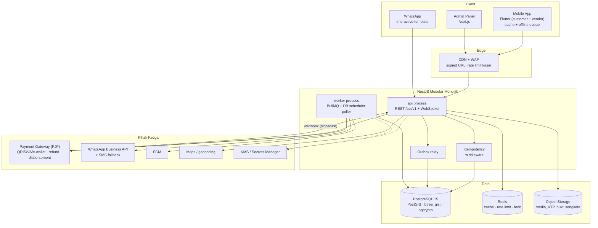
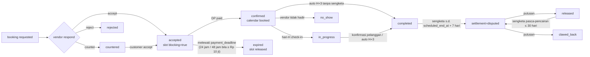
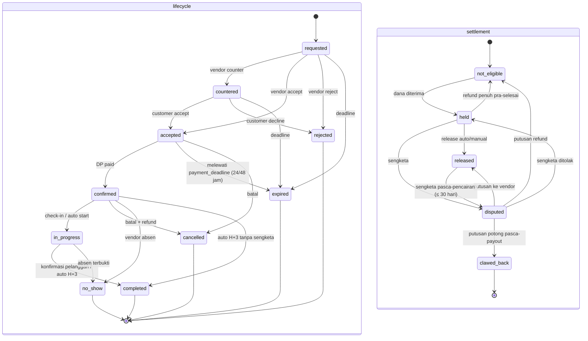
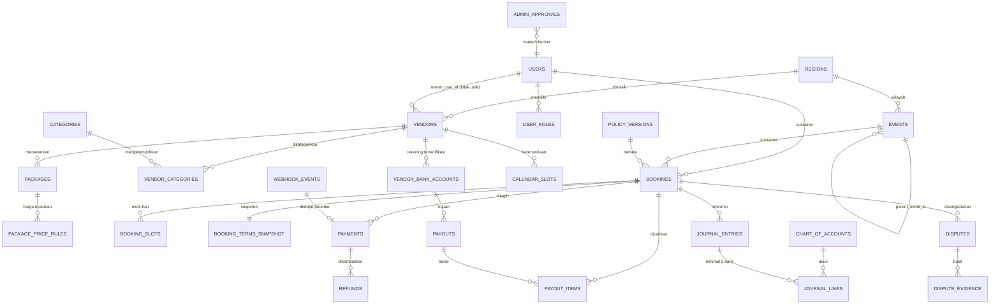

# TECH DESIGN — Marketplace Booking Hiburan Pantura

> **Versi Dokumen:** 1.0
> **Status:** Frozen for implementation
> **Tanggal:** 2026-10-21
> **Dokumen Induk:** `PRD-Booking-Hiburan-Pantura.md` v1.0
> **Sifat:** Mengikat (normatif). Perubahan hanya melalui amendment bernomor dan persetujuan Tech Lead + Product Owner.
> **Ruang Lingkup:** arsitektur, model data, kontrak API, konsistensi, keamanan, observabilitas, migrasi, pengujian. Persona, GTM, dan unit economics **tidak** diulang di sini; rujuk PRD.

**Kata kunci normatif** (mengikuti RFC 2119, diterjemahkan): **WAJIB** = tidak boleh dilanggar tanpa amendment; **DILARANG** = pelanggaran = blocker rilis; **BOLEH** = pilihan implementasi; **TIDAK BOLEH** = sama dengan DILARANG.

**Batasan stack (tidak dapat dinegosiasikan tanpa persetujuan):** Flutter (Android + iOS), backend Node.js + NestJS (TypeScript), PostgreSQL 15 + PostGIS + btree_gist + pgcrypto, Redis, BullMQ, admin panel React/Next.js, object storage S3-compatible, FCM, payment gateway berizin (PJP), WhatsApp Business API.

---

## 1. Keputusan Teknis & Perbaikan Cacat v1.0

### 1.1 Daftar Keputusan Teknis (D-01 … D-18)

Kolom "Konsekuensi implementasi" adalah bagian yang mengikat; kolom "Rujukan" menunjuk bagian dokumen ini.

D-01 … D-16 tetap **frozen**. D-17 dan D-18 adalah delta dari PRD v1.1 final (komisi bertingkat dan batas bayar DP) dan mengikat sejak F1; keduanya menggantikan angka pada D-01 … D-16 yang bertentangan (khususnya komisi datar 10% pada D-02) tanpa mengubah keputusan lainnya.

| ID | Keputusan teknis | Konsekuensi implementasi | Rujukan |
|----|------------------|--------------------------|---------|
| **D-01** | Dana pelanggan **tidak pernah** masuk rekening platform pada rilis awal. | Dana mengalir Pelanggan → PJP (gateway) → Vendor. Platform hanya mencatat **kewajiban** `escrow_liability_vendor` dan **piutang** `gateway_clearing`. Tidak ada tabel `platform_cash` untuk dana pelanggan, tidak ada rekening penampung. Rilis tanpa kemampuan ini = **BLOCKED**, bukan "ditunda dengan workaround". | §3, §6.2, §6.3 |
| **D-02** | Volume acuan: 100 booking/bulan, AOV Rp 4.000.000. | Angka ini **hanya** dipakai untuk dimensi kapasitas, sizing, dan load test. DILARANG dipakai untuk proyeksi pendapatan di dokumen ini. Perhitungan kapasitas: §10.1. Tarif komisi mengikuti D-17 (bertingkat), bukan 10% datar. | §10.1, §12.7, D-17 |
| **D-03** | Biaya gateway pada refund ditanggung pihak yang membatalkan; jika vendor/platform yang membatalkan, platform menyerap. | `refunds.fee_bearer` ∈ {`customer`,`vendor`,`platform`}. Fee yang ditanggung pembatal dikreditkan ke `gateway_fee_expense` (recovery). Fee yang diserap platform didebit ke `gateway_fee_absorbed`. | §6.4, §6.5 |
| **D-04** | Urutan fase: F1 katalog+kalender+booking+DP dengan release manual admin (maker-checker); F2 escrow otomatis, payout, refund, chat, ulasan, sengketa; F3 operasional vendor; F4 pertumbuhan. | Skema inti F2 **WAJIB** ada sejak migrasi awal. Yang boleh ditunda hanya perilaku/job/endpoint, bukan tabel atau kolom. Tabel per fase: §5.19. | §5.19, §11.1 |
| **D-05** | Status booking dipecah menjadi 3 sumbu: `lifecycle_status`, `payment_status`, `settlement_status`. | Tidak ada kolom `bookings.status`. Setiap transisi menulis satu baris `booking_status_history` dengan `axis`. | §4 |
| **D-06** | Ledger double-entry sejati; saldo dihitung, bukan disimpan. | `journal_entries` + `journal_lines`; DILARANG ada kolom `balance_after`, `balance_available`, `balance_pending` di tabel mana pun. Saldo hanya dari view agregasi. | §5.12, §6.1 |
| **D-07** | Semua entitas baru wajib ada dengan kolom eksplisit. | Daftar tabel baru: `regions`, `user_roles`, `user_2fa`, `sessions`, `otp_requests`, `device_tokens`, `vendor_categories`, `vendor_bank_accounts`, `vendor_bank_account_events`, `package_price_rules`, `policy_versions`, `events`, `booking_slots`, `booking_terms_snapshot`, `refunds`, `payout_items`, `dispute_evidence`, `chart_of_accounts`, `journal_entries`, `journal_lines`, `webhook_events`, `outbox_messages`, `idempotency_keys`, `admin_approvals`, `scheduled_jobs`, `wa_action_tokens`, `media_assets`, `reconciliation_runs`, `reconciliation_diffs`. | §5 |
| **D-08** | Peran: `customer`, `vendor_owner`, `vendor_member`, `admin_support`, `admin_finance`, `admin_super`; relasi many-to-many. | `user_roles(user_id, role)`; `users` tidak punya kolom `role`. Otorisasi = himpunan peran + kepemilikan resource. | §5.3, §9.2 |
| **D-09** | Uang = `BIGINT` rupiah utuh + `currency CHAR(3) DEFAULT 'IDR'`. | DILARANG `DECIMAL`/`NUMERIC` untuk nominal. Semua kolom uang berakhiran `_idr`. Persentase disimpan sebagai basis point (`*_bp`, 10000 = 100%). | §5.1, §5.20 |
| **D-10** | Kalender membedakan "belum diisi" vs "eksplisit tersedia"; tersedia `calendar_updated_at`. | Tidak adanya baris `calendar_slots` = belum diisi. Baris `status='available'` = eksplisit tersedia. Aturan label & peringkat pencarian: §5.11. | §5.8, §5.11 |
| **D-11** | `Idempotency-Key` wajib pada POST booking, respond, payment, payout, dispute. | Tabel `idempotency_keys` + middleware global. Replay mengembalikan respons tersimpan; key sama dengan payload berbeda → `422 IDEMPOTENCY_KEY_REUSED`. | §7.5 |
| **D-12** | `policy_versions` + snapshot di booking; tidak retroaktif. | `bookings.policy_version_id` + `booking_terms_snapshot(terms jsonb, terms_hash)`. Perubahan kebijakan hanya berlaku untuk booking baru. | §5.13 |
| **D-13** | `package_price_rules` untuk harga musiman. | Tipe `multiplier` (basis point) atau `fixed`; seleksi deterministik via `priority` lalu `id`. | §5.6 |
| **D-14** | Admin 2FA wajib + maker-checker refund/payout > Rp 1.000.000 **[ASUMSI]** + audit log immutable sejak F1. | `user_2fa` (TOTP), `admin_approvals` dengan `CHECK (requested_by <> decided_by)`, `audit_logs` append-only + hash chain. | §9.3, §9.4, §9.10 |
| **D-15** | Aksi vendor via WhatsApp interactive template. | `wa_action_tokens` (token acak, TTL, single-use) + endpoint `POST /webhooks/whatsapp` untuk callback tombol. | §7.2, §8.7 |
| **D-16** | Belum ada pemungutan pajak di F1; akun `tax_payable` + hook invoice disiapkan. | `tax_payable` ada di CoA sejak migrasi awal; invoice menerima `tax_breakdown` opsional; aktivasi = konfigurasi + policy version baru, tanpa migrasi besar. **[ASUMSI]** validasi pajak sebelum F2. | §6.2, §7.4 |
| **D-17** | **Komisi bertingkat** menggantikan komisi datar 10%: lantai Rp 25.000/booking; 10% untuk bagian dasar sampai Rp 10.000.000; 5% untuk bagian di atas Rp 10.000.000; batas absolut Rp 7.500.000/booking. | Dasar komisi = `bookings.price_package_idr` (nilai jasa paket, sebelum add-on/transport/service fee). `commission_bp` tetap tier-1 (1000); kolom eksplisit per booking: `commission_threshold_idr` (10.000.000), `commission_bp_tier2` (500), `commission_min_idr` (25.000), `commission_cap_idr` (7.500.000), `commission_tier1_idr`, `commission_tier2_idr`. Rumus: `tier1 = floor(min(base, threshold) × bp1 / 10000)`; `tier2 = floor(max(base − threshold, 0) × bp2 / 10000)`; `commission_idr = least(cap, greatest(min, tier1 + tier2))`. Contoh: Rp 40.000.000 → Rp 2.500.000 (6,25%). | §5.8, §6.3, §7.4 |
| **D-18** | Batas bayar DP: **24 jam** default; **48 jam** bila `total_customer_idr >= 10.000.000`. Slot `held` selama batas itu, lalu `expired`. | `payment_deadline` dihitung saat accept (L-03/L-07) dari `platform_settings.payment_deadline_hours` (24) dan `payment_deadline_hours_high_value` (48); `calendar_slots.hold_expires_at` disamakan dengan nilai itu. Job `expire_payment_hold` menegakkan batas ini. | §4.3, §8.2, §11.3 |

### 1.2 Tabel Cacat v1.0 → Perbaikan

| # | Cacat pada PRD v1.0 | Perbaikan di dokumen ini | Bagian |
|---|----------------------|--------------------------|--------|
| 1 | Ledger diklaim *double-entry*, tetapi skemanya single-entry dengan `ledger_entries.amount` bertanda dan `balance_after`. | Diganti `journal_entries` + `journal_lines` (debit/kredit terpisah, minimal 2 baris, total debit = total kredit, immutable, koreksi via reversal). `balance_after` dihapus; saldo dihitung dari view. | §5.12, §6 |
| 2 | `bookings.status` satu enum 13 nilai; refund sebagian, no-show, dan sengketa pasca-pencairan tidak dapat dimodelkan. | Tiga sumbu ortogonal: `lifecycle_status` (10 nilai), `payment_status` (5), `settlement_status` (5) + matriks legalitas + tabel transisi. | §4 |
| 3 | `payouts.account_number_encrypted` per transaksi, tanpa entitas rekening terverifikasi → celah *account takeover* (ubah rekening lalu tarik dana). | Entitas `vendor_bank_accounts` (status `pending\|verified\|rejected`, `cooling_until`, audit perubahan, satu rekening aktif terverifikasi per vendor) + `vendor_bank_account_events`. Payout hanya boleh menunjuk rekening `verified` dan sudah melewati cooling. | §5.5, §9.5 |
| 4 | Tidak ada `Idempotency-Key` pada POST booking; antrean offline dapat membuat booking ganda. | `idempotency_keys` + header wajib pada 5 endpoint + algoritma replay/konflik + kaitan `client_generated_id` di mobile. | §7.5, §8.6 |
| 5 | Tidak ada outbox/webhook dedupe → dual-write inconsistency dan efek ganda. | `outbox_messages` (transaksional) + `webhook_events` (`UNIQUE(provider, external_id)`) + worker retry/backoff/DLQ + penanganan event tidak berurutan. | §5.14, §5.16, §8.3 |
| 6 | `calendar_slots` tidak bisa menyatakan "tersedia" vs "belum diisi"; tidak ada `calendar_updated_at`. | `status` mencakup `available\|blocked\|held\|booked`; ketiadaan baris = belum diisi; `vendors.calendar_updated_at` + `calendar_slots.updated_at`; aturan label & ranking pencarian eksplisit. | §5.8, §5.11 |
| 7 | Acara multi-hari (§4.3) tidak punya model data. | `events` (`start_date`, `end_date`, `parent_event_id` nullable) + `booking_slots` (satu baris per tanggal+sesi) + constraint anti-tumpang-tindih. | §5.7, §5.8 |
| 8 | Satu user = satu peran; satu vendor = satu kategori. | `user_roles` many-to-many; `vendor_categories` many-to-many dengan `is_primary`. `vendors.owner_user_id` **tidak** unik. | §5.3, §5.4 |
| 9 | Wilayah tidak punya master table padahal AC meminta konfigurasi admin. | `regions` (kode, nama, `parent_code`, level, `is_active`, centroid) + CRUD admin + FK dari vendor/event/booking. | §5.3, §7.3 |
| 10 | Tidak ada maker-checker/2FA admin untuk perpindahan uang. | `user_2fa` + step-up token, `admin_approvals` (four-eyes, threshold Rp 1.000.000 **[ASUMSI]**), `audit_logs` immutable dengan hash chain, alert `ledger_imbalance`. | §9.3, §9.4, §9.10, §10.4 |

### 1.3 Prinsip yang Tidak Boleh Dilanggar (ringkasan satu halaman)

1. Tidak ada mutasi saldo. Semua perpindahan nilai uang = satu `journal_entry` seimbang.
2. Tidak ada `UPDATE`/`DELETE` pada `journal_entries`, `journal_lines`, `audit_logs`. Koreksi = reversal.
3. Tidak ada akses tabel lintas modul. Modul berkomunikasi lewat service publik atau port (interface) yang dideklarasikan.
4. Tidak ada efek samping eksternal di dalam transaksi database. Semua lewat outbox.
5. Tidak ada POST pada endpoint uang wajib (§7.5) yang menerima request tanpa `Idempotency-Key`; endpoint uang opsional tetap memproses key bila dikirim.
6. Tidak ada uang pelanggan di rekening platform (D-01).
7. Tidak ada nilai uang bertipe pecahan (D-09).
8. Tidak ada perubahan kebijakan yang berlaku surut (D-12).

---

## 2. Prinsip Arsitektur & Constraint

### 2.1 Gaya Arsitektur

**Modular monolith NestJS**, satu proses API + satu proses worker, satu database PostgreSQL. Alasan: tim 2–4 developer, konsistensi transaksional booking–kalender–ledger lebih penting daripada skalabilitas horizontal prematur; volume acuan (D-02) tidak menuntut pemisahan layanan.

```
apps/
  api/            # HTTP + WebSocket, tanpa job berat
  worker/         # BullMQ consumer + DB scheduler poller
  admin/          # Next.js (memanggil API yang sama, tidak akses DB)
libs/
  modules/auth, catalog, calendar, booking, payment, ledger, payout,
  dispute, notification, admin, region, media
  platform/db, platform/outbox, platform/idempotency, platform/clock
```

Aturan proses: **API tidak menjalankan job periodik**, **worker tidak membuka endpoint publik**. Keduanya memakai library modul yang sama sehingga logika tidak terduplikasi.

### 2.2 Batas Modul & Larangan Akses Lintas Modul

| Modul | Memiliki tabel (write) | BOLEH membaca via | DILARANG |
|---|---|---|---|
| `auth` | `users`, `user_roles`, `user_2fa`, `sessions`, `otp_requests`, `device_tokens` | — | menyentuh `bookings`, `journal_*` |
| `region` | `regions` | — | menulis katalog |
| `catalog` | `vendors`, `vendor_categories`, `vendor_media`, `vendor_members`, `packages`, `package_addons`, `package_price_rules` | `region` (validasi kode) | menulis `bookings`, `calendar_slots` |
| `calendar` | `calendar_slots`, `booking_slots` (lewat port dari `booking`) | `catalog` (vendor aktif) | menulis `bookings` |
| `booking` | `bookings`, `booking_status_history`, `booking_addons`, `booking_terms_snapshot`, `events`, `policy_versions` (baca), `wa_action_tokens` | `calendar` (port `SlotReservation`), `catalog` (port `PricingQuery`), `ledger` (port `LedgerPosting`) | menulis `journal_*` langsung |
| `payment` | `payments`, `refunds`, `webhook_events` | `booking` (port `BookingState`), `ledger` (port `LedgerPosting`) | menulis `payouts` |
| `ledger` | `chart_of_accounts`, `journal_entries`, `journal_lines` | — | memanggil gateway; memanggil modul lain |
| `payout` | `payouts`, `payout_items`, `vendor_bank_accounts`, `vendor_bank_account_events` | `ledger` (saldo vendor), `booking` (kelayakan) | menulis `bookings` |
| `dispute` | `disputes`, `dispute_evidence` | `booking`, `ledger`, `payment` | menulis `journal_*` langsung |
| `notification` | `notifications`, `outbox_messages` (consume) | semua lewat event payload | membaca tabel domain untuk merender ulang |
| `admin` | `admin_approvals`, `audit_logs`, `platform_settings`, `reconciliation_runs`, `reconciliation_diffs` | semua lewat port baca | menulis tabel domain |

**Mekanisme penegakan (bukan sekadar konvensi):**

1. Setiap modul mengekspor `*.public.ts` berisi service/port. File internal (`*.repository.ts`) diberi lint rule `no-restricted-imports` sehingga hanya boleh diimpor dari dalam folder modul yang sama.
2. Akses lintas modul **WAJIB** lewat interface port yang dideklarasikan di `libs/platform/ports`. Contoh:
   ```ts
   export interface SlotReservationPort {
     reserve(input: ReserveSlotsInput): Promise<ReserveSlotsResult>; // throws SlotTakenError
     release(bookingId: string, reason: ReleaseReason): Promise<void>;
     confirm(bookingId: string): Promise<void>; // held -> booked
   }
   export interface LedgerPostingPort {
     post(entry: PostJournalCommand): Promise<{ journalEntryId: string }>; // idempoten via source_event_key
   }
   ```
3. Review PR yang menambah `import` lintas modul tanpa port = **blocker**.
4. Query lintas modul untuk kebutuhan baca (dashboard admin) hanya lewat *read model* (`libs/read-model/*.sql`) yang bersifat read-only, dimiliki modul pemilik data, dan tidak boleh menulis.

### 2.3 Aturan Uang

1. Semua nominal disimpan `BIGINT` dalam rupiah utuh (tanpa sen). Kolom wajib `currency CHAR(3) NOT NULL DEFAULT 'IDR'`; saat ini hanya `IDR` yang diizinkan (`CHECK (currency = 'IDR')` sampai multi-currency dibuka).
2. Tidak ada arti uang pada tipe `TEXT`, `FLOAT`, `JSONB` bebas. Nominal di `jsonb` hanya untuk payload eksternal dan **wajib** divalidasi + dikonversi sebelum masuk kolom.
3. Setiap perpindahan uang **WAJIB** menghasilkan `journal_entry` dengan minimal 2 baris dan `SUM(debit)=SUM(credit)`.
4. Saldo adalah hasil agregasi. Tidak ada kolom saldo yang dapat di-`UPDATE`.
5. Pembulatan: semua perhitungan memakai integer. Persentase memakai basis point dan pembagian dibulatkan ke bawah (`floor`), kecuali refund yang dibulatkan ke atas menguntungkan pelanggan. Selisih pembulatan ≤ Rp 1 ditampung di baris terakhir entry (akun yang sama dengan penerima terbesar) dan dicatat di `journal_entries.rounding_idr`.
6. Nilai negatif pada nominal transaksi (`amount_idr`) DILARANG; arah nilai dinyatakan oleh sisi debit/kredit.

### 2.4 Aturan Idempotensi

1. Semua POST yang membuat entitas atau memindahkan uang **WAJIB** menerima header `Idempotency-Key` (UUID v4, 16–64 karakter). Endpoint yang diwajibkan: `POST /bookings`, `POST /bookings/{id}/respond`, `POST /payments`, `POST /payouts`, `POST /disputes`.
2. Cakupan key: `(actor_id, scope, key)`. `scope` = `METHOD + path pattern` (contoh `POST /bookings`).
3. Retensi key: 24 jam untuk pembayaran/booking, 7 hari untuk payout (karena payout punya jeda manual).
4. Handler **WAJIB** idempoten di level domain juga (guard status + constraint DB), bukan hanya di level HTTP. Alasannya: worker dapat mengulang pesan yang sama setelah crash.
5. `journal_entries.source_event_key` **UNIQUE**: satu event bisnis hanya boleh menghasilkan satu entry.

### 2.5 Aturan Waktu

| Konsep | Penyimpanan | Contoh |
|---|---|---|
| Instan (kejadian, deadline, audit) | `TIMESTAMPTZ`, UTC | `created_at`, `respond_deadline`, `hold_expires_at` |
| Tanggal acara & sesi | `DATE` + `VARCHAR(8)` sesi, **interpretasi zona** `Asia/Jakarta` | `booking_slots.date = '2026-12-05'`, `session='night'` |
| Jam acara | `TIME` lokal WIB (tanpa offset), selalu dipasangkan dengan `date` | `start_time='19:00'` |
| Nama zona | `vendors.timezone`, `events.timezone` default `'Asia/Jakarta'` | kolom `TEXT NOT NULL DEFAULT 'Asia/Jakarta'` |

Aturan:
1. Database berjalan `timezone = 'UTC'`. Semua `TIMESTAMPTZ` disimpan UTC dan dikirim ke klien dalam ISO-8601 dengan offset (`2026-10-21T10:15:00+07:00`).
2. Batas hari (deadline "H-1", "24 jam") dihitung di aplikasi memakai `Temporal` dengan zona `Asia/Jakarta`, lalu disimpan sebagai instan UTC.
3. `DATE` **tidak pernah** dikonversi zona saat dibaca. `2026-12-05` adalah tanggal kalender WIB, bukan hasil `toISOString()`.
4. DST tidak berlaku di WIB; tetap gunakan library zona agar konsisten bila ekspansi wilayah terjadi.
5. Sumber waktu tunggal: `Clock` service (di-inject) — DILARANG `Date.now()` langsung di domain agar dapat diuji.

---

## 3. Diagram Komponen & Alur Dana End-to-End

### 3.1 Diagram Komponen



**Catatan penting diagram:** tidak ada panah dana pelanggan menuju `App` atau `PG` sebagai pemilik dana. `PG` di sini adalah **custodian pihak ketiga berizin**; platform hanya memegang *piutang* `gateway_clearing` dan *kewajiban* `escrow_liability_vendor` (D-01).

### 3.2 Alur Dana End-to-End (D-01 ditandai)

```mermaid
sequenceDiagram
    autonumber
    participant C as Pelanggan
    participant API as NestJS API
    participant DB as PostgreSQL
    participant PJP as Payment Gateway (custodian)
    participant WK as Worker
    participant V as Vendor (bank)

    Note over C,PJP: FASE 1 — DP. Dana TIDAK PERNAH masuk rekening platform (D-01)

    C->>API: POST /payments {kind:dp} + Idempotency-Key
    API->>DB: lock booking, cek payment_status=unpaid
    API->>DB: insert payments(pending), reserve calendar_slots=held (TTL 30 mnt)
    API->>PJP: create charge (split/disbursement enabled, vendor sebagai beneficiary)
    PJP-->>API: gateway_ref + QR/VA
    API-->>C: 201 {payment_id, qr_string, expires_at}

    C->>PJP: bayar QRIS
    PJP-->>API: webhook payment.succeeded (signature)
    API->>DB: insert webhook_events ON CONFLICT DO NOTHING
    API-->>PJP: 200 OK (ack cepat, proses async)
    WK->>DB: SELECT ... FOR UPDATE SKIP LOCKED (webhook_events pending)
    WK->>DB: BEGIN
    WK->>DB: payments -> paid ; bookings.payment_status=dp_paid ; lifecycle=confirmed
    WK->>DB: journal_entry: Dr gateway_clearing / Cr escrow_liability_vendor
    WK->>DB: calendar_slots -> booked ; outbox_messages INSERT
    WK->>DB: COMMIT

    Note over PJP: Dana berada di rekening custodian PJP atas nama transaksi.<br/>Platform tidak dapat menariknya, hanya menginstruksikan release.

    Note over C,PJP: FASE 2 — Pelunasan
    C->>PJP: bayar pelunasan (charge ke-2)
    PJP-->>API: webhook payment.succeeded
    WK->>DB: payment_status=fully_paid ; Dr gateway_clearing / Cr escrow_liability_vendor

    Note over C,PJP: FASE 3 — Konfirmasi dana di custody PJP
    PJP->>PJP: settlement report harian; dana TETAP di custody/escrow PJP, belum ditransfer ke vendor
    WK->>DB: rekonsiliasi harian: bandingkan settlement report vs journal
    WK->>DB: journal_entry recovery fee (jika ada selisih fee)

    Note over C,PJP: FASE 4 — Release: kewajiban vendor diakui
    WK->>DB: journal_entry release: Dr escrow_liability_vendor<br/>Cr platform_revenue_commission + platform_revenue_service_fee + vendor_payable
    Note right of DB: vendor_payable = hak vendor yang BELUM ditransfer.<br/>Bukan saldo yang disimpan platform.

    Note over C,PJP: FASE 5 — Payout: permintaan vendor + maker-checker
    V->>API: POST /payouts + Idempotency-Key
    API->>DB: admin_approvals(pending) -> approve oleh admin berbeda
    API->>DB: cek vendor_bank_accounts.status=verified & cooling_until < now()
    WK->>DB: vendor_payable -> vendor_payout_clearing

    Note over C,PJP: FASE 6 — Disbursement dari custody PJP
    API->>PJP: instruksi disbursement (sumber dana = custody PJP)
    PJP-->>API: webhook payout.succeeded
    WK->>DB: journal_entry: Dr vendor_payout_clearing / Cr gateway_clearing
    PJP->>V: transfer ke rekening vendor
```

### 3.3 Titik Kritis D-01 dan Fallback

| Titik | Yang terjadi | Mengapa aman terhadap D-01 |
|---|---|---|
| **T1** Pelanggan membayar | Dana masuk rekening custodian PJP (escrow/split account), bukan rekening platform. | Platform tidak memiliki akses penarikan; hanya memiliki hak instruksi release/disbursement sesuai kontrak PJP. |
| **T2** Settlement PJP | PJP menerbitkan *settlement report* harian; dana tetap berada di custody/escrow PJP sampai instruksi disbursement. | Bukti penyelesaian = file/laporan, bukan mutasi rekening platform. Platform tidak pernah menerima transfer dana pelanggan. |
| **T3** Release | Platform mengakui `vendor_payable`; belum ada instruksi disbursement pada tahap ini. | Tidak ada perpindahan dana ke rekening platform maupun vendor pada saat release; disbursement menunggu permintaan payout dan maker-checker. |
| **T4** Payout | PJP mentransfer dari custody ke rekening vendor terverifikasi. | Rekening tujuan adalah `vendor_bank_accounts` berstatus `verified`, bukan input bebas per transaksi. |
| **T5** Refund | PJP mengembalikan dana ke instrumen asal pelanggan. | Platform hanya mencatat `refund_payable`, tidak menalangi kecuali clawback (dana platform sendiri, akun `platform_operating_cash`). |

**Fallback yang DILARANG:** rekening penampung milik platform, dompet platform, "titipan" ke rekening pribadi founder, atau pencatatan DP manual tanpa `payments`. Jika PJP terpilih tidak mendukung split/disbursement ke vendor, status rilis = **BLOCKED** dan keputusan harus diubah lewat amendment D-01, bukan workaround teknis.

**Kondisi BLOCKED yang harus dilaporkan sebelum coding F2:**

1. PJP tidak menyediakan *sub-account* / *split settlement* / *disbursement* ke rekening pihak ketiga.
2. PJP tidak menyediakan webhook dengan signature yang dapat diverifikasi dan retry.
3. PJP tidak menyediakan API refund parsial.

### 3.4 Alur Non-Dana (ringkas)



---

## 4. Model Status 3 Sumbu

### 4.1 Mengapa Tiga Sumbu

Satu enum 13 nilai (v1.0) memaksa pencampuran tiga dimensi yang independen:

- **Lifecycle** = di mana proses kesepakatan/acara berada.
- **Payment** = seberapa banyak uang pelanggan sudah diterima.
- **Settlement** = di mana hak vendor atas uang berada.

Kombinasi nyata yang tidak dapat diwakili satu enum: acara `completed` tetapi `partially_refunded` dan `clawed_back`; booking `cancelled` tetapi `partially_refunded` dengan `settlement=held` (dana belum diputuskan); booking `no_show` dengan `fully_paid` dan `released` yang kemudian menjadi `clawed_back`.

**Aturan:** transisi pada satu sumbu **TIDAK BOLEH** mengubah sumbu lain secara implisit. Perubahan lintas sumbu **WAJIB** dinyatakan sebagai dua baris `booking_status_history` (satu per sumbu) di dalam transaksi database yang sama.

### 4.2 Definisi State

**Sumbu 1 — `bookings.lifecycle_status`**

| State | Arti | Terminal | Slot dikunci | Tampil di pencarian |
|---|---|---|---|---|
| `requested` | Permintaan dikirim, menunggu respons vendor | tidak | tidak (`is_blocking=false`) | tidak |
| `countered` | Vendor menawar balik; menunggu keputusan pelanggan | tidak | tidak | tidak |
| `accepted` | Harga & jadwal disepakati; menunggu DP | tidak | **ya** (`is_blocking=true`, `held`) | tidak |
| `confirmed` | DP diterima; jadwal pasti | tidak | ya (`booked`) | tidak (slot terisi) |
| `in_progress` | Hari-H, vendor check-in / waktu mulai tercapai | tidak | ya (`booked`) | tidak |
| `completed` | Acara selesai: dikonfirmasi pelanggan, atau otomatis H+3 setelah `scheduled_end_at` bila tidak ada sengketa | tidak (dasar sengketa) | ya (`booked`) | tidak |
| `cancelled` | Dibatalkan salah satu pihak/admin sebelum selesai | ya | dilepas | ya (kembali tersedia) |
| `rejected` | Vendor menolak atau pelanggan menolak counter | ya | dilepas | ya |
| `expired` | Deadline respons/DP terlewat | ya | dilepas | ya |
| `no_show` | Vendor tidak hadir pada hari-H | ya | tetap `booked` (bukti) | tidak |

**Sumbu 2 — `bookings.payment_status`**

| State | Arti | Dana diterima | Refund |
|---|---|---|---|
| `unpaid` | Belum ada pembayaran sukses | Rp 0 | tidak mungkin |
| `dp_paid` | DP sukses, pelunasan belum | `dp_amount_idr` | boleh sebagian/penuh |
| `fully_paid` | Total tagihan pelanggan lunas | `total_customer_idr` | boleh sebagian/penuh |
| `partially_refunded` | Ada refund sukses, sisa > 0 | net > 0 | boleh lanjut |
| `refunded` | Seluruh dana pelanggan dikembalikan | net = 0 | terminal |

**Sumbu 3 — `bookings.settlement_status`**

| State | Arti | Uang ada di | Boleh payout |
|---|---|---|---|
| `not_eligible` | Belum ada dana, atau dana sudah dikembalikan penuh sebelum release | — | tidak |
| `held` | Kewajiban vendor tercatat, belum dirilis | custody PJP | tidak |
| `disputed` | Ada sengketa aktif; hak vendor dibekukan | custody PJP atau sudah payout (pasca-release) | tidak |
| `released` | Hak vendor final; masuk `vendor_payable` | custody PJP sampai payout | ya |
| `clawed_back` | Putusan sengketa memotong hak vendor setelah payout | piutang ke vendor / `dispute_reserve` | tidak (offset) |

### 4.3 Tabel Transisi — Lifecycle

Kolom **Guard** adalah kondisi yang WAJIB benar; jika salah → `409 STATE_CONFLICT` / `409 SLOT_TAKEN` / `403 FORBIDDEN`. Kolom **Efek samping** menyebut ledger/notifikasi/kalender yang WAJIB terjadi dalam transaksi yang sama atau lewat outbox.

| # | Dari | Event | Aktor (role) | Guard | Ke | Efek samping |
|---|---|---|---|---|---|---|
| L-01 | — | `booking.create` | `customer` | paket aktif; vendor `approved` & `is_active`; slot di masa depan; `total_customer_idr` = hasil hitung server atas `package_price_rules`; policy aktif ada | `requested` | `events` (auto bila belum ada), `booking_slots` (`is_blocking=false`), `booking_terms_snapshot`, history, outbox `booking.requested` (WA + push ke vendor) |
| L-02 | `requested` | `booking.counter` | `vendor_owner`, `vendor_member` (izin `respond`) | pemilik vendor; `now() <= respond_deadline`; harga counter ≤ 150% harga awal; tidak ada counter lain yang masih terbuka | `countered` | `bookings.price_package_idr` baru + recompute; `counter_deadline = now()+24h`; history; outbox `booking.countered` |
| L-03 | `requested` | `booking.accept` | `vendor_owner`, `vendor_member` (izin `respond`) | `now() <= respond_deadline`; **slot berhasil diblokir** (exclusion constraint) | `accepted` | `booking_slots.is_blocking=true`; `calendar_slots` → `held` + `hold_expires_at`; `payment_deadline = now() + (CASE WHEN total_customer_idr >= 10000000 THEN payment_deadline_hours_high_value ELSE payment_deadline_hours END) * interval '1 hour'` — nilai 48/24 jam dibaca dari `platform_settings` (D-18); `hold_expires_at = payment_deadline`; outbox `booking.accepted` |
| L-04 | `requested` | `booking.reject` | `vendor_owner`, `vendor_member` | alasan wajib (enum + teks) | `rejected` | slot tetap tidak diblokir; history; outbox `booking.rejected` + rekomendasi vendor |
| L-05 | `requested` | `booking.expire` | `system` (scheduler) | `now() > respond_deadline` | `expired` | lepas hold (jika ada); history; outbox `booking.expired`; `metric booking_expired_total` |
| L-06 | `requested` | `booking.cancel_by_customer` | `customer` | `now() <= respond_deadline` | `cancelled` | tidak ada ledger (belum ada dana); history; outbox |
| L-07 | `countered` | `booking.counter_accept` | `customer` | `now() <= counter_deadline`; slot berhasil diblokir | `accepted` | sama dengan L-03 (blokir slot, `payment_deadline` = 24 jam atau 48 jam bila `total_customer_idr >= 10.000.000`, D-18) |
| L-08 | `countered` | `booking.counter_decline` | `customer` | — | `rejected` | history; outbox; rekomendasi |
| L-09 | `countered` | `booking.expire` | `system` | `now() > counter_deadline` | `expired` | lepas hold; history; outbox |
| L-10 | `countered` | `booking.counter_withdraw` | `vendor_owner` | belum dijawab pelanggan | `cancelled` | history; outbox; `cancel_reason='counter_withdrawn'` |
| L-11 | `accepted` | `payment.dp_succeeded` | `system` | `payments.status='paid'` untuk `kind='dp'`; `amount_idr = dp_amount_idr`; booking masih `accepted` | `confirmed` | `payment_status=dp_paid`; `settlement_status=held`; `calendar_slots`→`booked`; `scheduled_start_at`/`scheduled_end_at` terisi dari `booking_slots` (prasyarat jendela sengketa, §4.9 butir 7); `dispute_window_ends_at = scheduled_end_at + interval '7 days'`; ledger §6.4-1; outbox `booking.confirmed` |
| L-12 | `accepted` | `booking.cancel_by_customer` | `customer` | `payment_status='unpaid'` | `cancelled` | lepas hold; history; outbox |
| L-13 | `accepted` | `booking.cancel_by_vendor` | `vendor_owner` | `payment_status='unpaid'` | `cancelled` | lepas hold; history; penalti reputasi; outbox |
| L-14 | `accepted` | `booking.expire` | `system` | `now() > payment_deadline` (24 jam, atau 48 jam bila `total_customer_idr >= 10.000.000` — D-18) | `expired` | lepas hold; history; outbox |
| L-15 | `confirmed` | `booking.checkin` | `vendor_owner`, `vendor_member` | `now()` dalam [`scheduled_start_at` − 3 jam, `scheduled_start_at` + 2 jam]; jarak GPS ≤ `checkin_radius_m` (default 500 m); `payment_status` ∈ {`dp_paid`,`fully_paid`} | `in_progress` | `checkin_at`, `checkin_location`; `booking_slots.is_blocking` tetap; outbox `booking.started` |
| L-16 | `confirmed` | `booking.start_auto` | `system` | `now() >= scheduled_start_at` dan tidak ada check-in | `in_progress` | `checkin_at=NULL`, flag `started_without_checkin=true`; outbox peringatan ke vendor & pelanggan |
| L-17 | `confirmed` | `booking.cancel_by_customer` | `customer` | `now() < scheduled_start_at − 24 jam`; jika lebih dekat → WAJIB jalur sengketa | `cancelled` | refund per policy (`fee_bearer='customer'`); ledger §6.4-4/5; lepas `booked` → `available`; outbox |
| L-18 | `confirmed` | `booking.cancel_by_vendor` | `vendor_owner` | kapan pun sebelum `scheduled_start_at` | `cancelled` | refund 100% (`fee_bearer='vendor'`, `gateway_fee_absorbed`); penalti vendor; lepas slot; outbox + rekomendasi pengganti |
| L-19 | `confirmed` | `booking.cancel_by_admin` | `admin_support` (approval `admin_super`) | alasan wajib; force majeure | `cancelled` | refund penuh; `fee_bearer='platform'`; lepas slot; audit |
| L-20 | `confirmed` | `booking.no_show` | `customer`, `admin_support` | `now() > scheduled_start_at + 2 jam`; tidak ada check-in valid; tidak ada dispute terbuka | `no_show` | `payment_status` tetap; `settlement_status` → `disputed` (otomatis klaim); refund penuh + clawback bila sudah release; outbox |
| L-21 | `in_progress` | `booking.complete` | `customer` | `now() >= scheduled_end_at`; `dispute` tidak terbuka | `completed` | `completed_at`; `dispute_window_ends_at = scheduled_end_at + interval '7 days'` (anchor akhir acara, bukan `now()`); outbox `booking.completed` + permintaan ulasan |
| L-22 | `confirmed`, `in_progress` | `booking.complete_auto` | `system` (job `auto_complete_booking`) | `scheduled_end_at IS NOT NULL`; `now() >= scheduled_end_at + interval '3 days'`; tidak ada dispute terbuka; `payment_status` ∈ {`dp_paid`,`fully_paid`,`partially_refunded`, `refunded`} | `completed` | `completed_at = now()`; `completed_by='system'`; `dispute_window_ends_at = scheduled_end_at + interval '7 days'`; `started_without_checkin=true` bila `started_at` masih `NULL`; outbox `booking.completed`; selesai lewat job ber-`dedupe_key` `auto_complete:<booking_id>` |
| L-23 | `in_progress` | `booking.no_show` | `customer`, `admin_support` | check-in ada tetapi tidak ada aktivitas terbukti (foto/GPS) dan pelanggan mengajukan bukti | `no_show` | `settlement_status`→`disputed`; refund penuh; outbox |
| L-24 | `completed` | `booking.reopen_dispute` | — | **bukan transisi lifecycle** — gunakan sumbu settlement | `completed` | lihat S-07 |
| L-25 | `any non-terminal` | `booking.cancel_by_system` | `system` | `payment_status='refunded'` penuh dan acara belum mulai | `cancelled` | lepas slot; history; outbox |

Catatan L-01/L-03: `requested` **tidak** memblokir slot. Alasannya, satu tanggal dapat menerima beberapa permintaan dan vendor memilih satu. Perlindungan balapan dipindahkan ke titik `accepted` (exclusion constraint) dan titik pembayaran (hold TTL). Konsekuensi: calon pelanggan kedua dapat menerima `409 SLOT_TAKEN` saat vendor mencoba menerima — ini perilaku yang benar, bukan bug.

Catatan L-21/L-22 (auto-complete H+3): pelanggan boleh menutup lebih cepat, tetapi sistem **WAJIB** menutup sendiri pada `scheduled_end_at + 3 hari` (FR-118) agar `settlement_status` tidak tertahan selamanya pada booking yang pelanggannya pasif. Bila pada saat itu ada dispute terbuka, job **tidak** melakukan apa pun; `completed` baru terjadi setelah dispute ditutup. Auto-complete juga berlaku untuk booking yang masih `confirmed` (vendor tidak pernah check-in): `started_at` tetap `NULL` dan `started_without_checkin=true`.

### 4.4 Tabel Transisi — Payment

| # | Dari | Event | Aktor | Guard | Ke | Efek samping |
|---|---|---|---|---|---|---|
| P-01 | `unpaid` | `payment.dp_succeeded` | `system` (webhook) | `payments.kind='dp'`, `status='paid'`, `amount_idr = bookings.dp_amount_idr`, `lifecycle='accepted'` | `dp_paid` | ledger §6.4-1; `lifecycle`→`confirmed`; `settlement_status`→`held`; history |
| P-02 | `unpaid` | `payment.full_succeeded` | `system` | `payments.kind='settlement'` dan akumulasi = `total_customer_idr`; `lifecycle` ∈ {`accepted`,`confirmed`} | `fully_paid` | ledger §6.4-2; `lifecycle`→`confirmed`; `settlement=held`; history |
| P-03 | `dp_paid` | `payment.settlement_succeeded` | `system` | akumulasi pembayaran sukses = `total_customer_idr` | `fully_paid` | ledger §6.4-2; history |
| P-04 | `dp_paid` | `refund.succeeded` | `system` | `refunds.amount_idr = akumulasi diterima` | `refunded` | ledger §6.4-4; `settlement`→`not_eligible` bila lifecycle belum `completed`; history |
| P-05 | `fully_paid` | `refund.succeeded` | `system` | `refunds.amount_idr = total_customer_idr` | `refunded` | ledger §6.4-4; history |
| P-06 | `dp_paid` | `refund.succeeded_partial` | `system` | `0 < refunds.amount_idr < akumulasi diterima` | `partially_refunded` | ledger §6.4-5; history; invoice kredit |
| P-07 | `fully_paid` | `refund.succeeded_partial` | `system` | `0 < amount < total_customer_idr` | `partially_refunded` | ledger §6.4-5; history |
| P-08 | `partially_refunded` | `refund.succeeded_partial` | `system` | akumulasi refund < total diterima | `partially_refunded` (self) | ledger §6.4-5; history; satu-satunya transisi self-loop yang sah |
| P-09 | `partially_refunded` | `refund.succeeded_final` | `system` | akumulasi refund = total diterima | `refunded` | ledger §6.4-4 (sisa); history |
| P-10 | `any` | `payment.failed` / `payment.expired` | `system` | — | tidak berubah | `payments.status` berubah; history `payment.attempt_failed`; TIDAK mengubah sumbu payment |

Aturan tambahan:
1. `unpaid` TIDAK BOLEH menjadi `refunded` (refund tanpa dana = tidak sah).
2. `refunded` adalah terminal; refund baru setelahnya harus melalui `disputes` dan menambah `refunds` dengan `fee_bearer='platform'` — tetapi nilai yang dikembalikan tidak boleh melebihi total diterima (dijaga trigger `refund_total_guard`).
3. Perubahan `payment_status` selalu dipicu oleh baris `payments`/`refunds` berstatus final, bukan oleh input admin langsung.

### 4.5 Tabel Transisi — Settlement

| # | Dari | Event | Aktor | Guard | Ke | Efek samping |
|---|---|---|---|---|---|---|
| S-01 | `not_eligible` | `payment.dp_succeeded` / `payment.settlement_succeeded` | `system` | `payment_status` ∈ {`dp_paid`,`fully_paid`} | `held` | ledger §6.4-1/2; `settlement_held_at` |
| S-02 | `held` | `settlement.release_auto` | `system` (worker) | `lifecycle='completed'`; `payment_status='fully_paid'`; `now() > dispute_window_ends_at` (`= scheduled_end_at + interval '7 days'`); tidak ada dispute terbuka | `released` | ledger §6.4-3 (`escrow_liability_vendor` → revenue + `vendor_payable`); `released_at`; outbox `settlement.released` |
| S-03 | `held` | `settlement.release_manual` | `admin_finance` (approval `admin_super` bila > Rp 1.000.000 **[ASUMSI]**) | `lifecycle='completed'`; tidak ada dispute; `admin_approvals.status='approved'`; alasan wajib (F1) | `released` | ledger §6.4-3; audit; outbox |
| S-04 | `held` | `dispute.open` | `customer`, `vendor_owner`, `admin_support` | `lifecycle` ∈ {`confirmed`,`in_progress`,`completed`, `no_show`}; belum `released`; `now() <= COALESCE(dispute_window_ends_at, scheduled_end_at + interval '7 days')` — anchor **akhir acara** (`scheduled_end_at + 7 hari`), bukan `completed_at` | `disputed` | `disputes` dibuat; ledger tidak berubah; outbox `dispute.opened`; pembekuan payout |
| S-05 | `held` | `refund.succeeded_full_pre_completion` | `system` | `payment_status='refunded'` dan `lifecycle` ∈ {`cancelled`,`rejected`,`expired`,`no_show`} | `not_eligible` | ledger §6.4-4; tutup kewajiban vendor; history |
| S-06 | `disputed` | `dispute.resolved_to_vendor` | `admin_finance` + `admin_super` | `resolution` ∈ {`release_to_vendor`,`split`} dan `vendor_share_idr > 0`; payout belum pernah sukses | `released` | ledger §6.4-3 untuk porsi vendor + §6.4-4 untuk porsi pelanggan; audit; outbox |
| S-07 | `disputed` | `dispute.resolved_refund` | `admin_finance` + `admin_super` | `resolution` ∈ {`refund_full`,`refund_partial`} dan tidak ada payout sebelumnya | `not_eligible` | ledger §6.4-4/5; `payment_status` menyesuaikan; outbox |
| S-08 | `released` | `dispute.open_post_release` | `customer`, `admin_support` | `now() <= released_at + interval '30 days'` (FR-122); alasan ∈ {`no_show`,`not_as_described`,`fraud`}; ada bukti minimal 1 item | `disputed` | `disputes` dibuat; `settlement_status`→`disputed`; TIDAK ada ledger sampai putusan; alert finance |
| S-09 | `disputed` | `dispute.resolved_clawback` | `admin_finance` + `admin_super` | payout untuk booking ini sudah `succeeded`; `customer_share_idr > 0`; `admin_approvals` approved | `clawed_back` | ledger §6.4-6a + 6b; `vendor_payable` menjadi negatif (piutang vendor); outbox `clawback.issued`; blokir payout vendor sampai offset |
| S-10 | `disputed` | `dispute.rejected` | `admin_finance` + `admin_super` | `resolution='no_action'`; tidak ada payout sukses | `held` | kembali menunggu jendela release; outbox; ledger tidak berubah |
| S-11 | `disputed` | `dispute.rejected_post_release` | `admin_finance` + `admin_super` | `resolution='no_action'`; payout sudah sukses | `released` | status kembali; outbox; audit |
| S-12 | `clawed_back` | `clawback.recovered_full` | `system` | saldo `vendor_payable` vendor ≥ 0 setelah offset | `clawed_back` (tetap) | hanya penanda `clawback_recovered_at`; TIDAK memulihkan hak vendor dan TIDAK mengubah status settlement |

**Jalur wajib `released → disputed → clawed_back`** adalah S-08 → S-09. Ini jalur yang tidak mungkin ada di v1.0. Prasyaratnya: `released_at` dalam **30 hari** terakhir (FR-122), dispute dengan bukti, dan persetujuan four-eyes. Tanpa dua admin berbeda, transisi DILARANG.

### 4.6 Matriks Legalitas Kombinasi

Tanda ✅ = kombinasi sah; `—` = tidak sah dan **WAJIB** ditolak oleh `assert_booking_combination()` (trigger di §5.16).

| lifecycle \ payment | `unpaid` | `dp_paid` | `fully_paid` | `partially_refunded` | `refunded` |
|---|---|---|---|---|---|
| `requested` | ✅ (settlement `not_eligible`) | — | — | — | — |
| `countered` | ✅ (`not_eligible`) | — | — | — | — |
| `accepted` | ✅ (`not_eligible`) | — | — | — | — |
| `confirmed` | — | ✅ | ✅ | ✅ | — |
| `in_progress` | — | ✅ | ✅ | ✅ | — |
| `completed` | — | ✅ | ✅ | ✅ | ✅ |
| `cancelled` | ✅ | ✅ | ✅ | ✅ | ✅ |
| `rejected` | ✅ | — | — | — | — |
| `expired` | ✅ | ✅ | — | — | — |
| `no_show` | — | ✅ | ✅ | ✅ | ✅ |

Batasan tambahan per kombinasi:

| Kombinasi | `settlement_status` yang sah |
|---|---|
| `completed` + `fully_paid` | `held`, `disputed`, `released`, `clawed_back` |
| `completed` + `dp_paid` (pelunasan tidak dibayar) | `held`, `disputed` — release DILARANG sampai pelunasan atau keputusan admin |
| `cancelled` + `refunded` | `not_eligible` |
| `cancelled` + `partially_refunded` (DP hilang sebagian) | `not_eligible` setelah porsi vendor diselesaikan lewat entry S-05 |
| `no_show` + `fully_paid` | `disputed`, `clawed_back`, `not_eligible` (setelah refund penuh; `payment_status` menjadi `refunded`) |
| `expired` + `dp_paid` | `held` (dana perlu diputuskan) atau `not_eligible` (setelah refund; `payment_status` menjadi `refunded`/`partially_refunded`) |

### 4.7 RBAC Transisi

| Transisi | `customer` | `vendor_owner` | `vendor_member` | `admin_support` | `admin_finance` | `admin_super` |
|---|:--:|:--:|:--:|:--:|:--:|:--:|
| `create` / `cancel` (sebelum accepted) | ✅ | — | — | — | — | — |
| `respond` (accept/reject/counter) | — | ✅ | ✅ (izin `respond`) | override + audit | — | ✅ |
| `counter_accept` / `counter_decline` | ✅ | — | — | — | — | — |
| `cancel` setelah `confirmed` | ✅ (≥ H-1) | ✅ | — | ✅ (approval super) | — | ✅ |
| `checkin` | — | ✅ | ✅ | — | — | — |
| `complete` | ✅ | — | — | ✅ (atas nama pelanggan, alasan wajib) | — | — |
| `no_show` | ✅ (dengan bukti) | — | — | ✅ | — | — |
| `settlement.release_manual` | — | — | — | — | ✅ (maker) | ✅ (checker) |
| `refund.create` | ✅ (request) | ✅ (request) | — | ✅ (request) | ✅ (approve ≤ threshold) | ✅ (approve semua) |
| `dispute.open` | ✅ | ✅ | — | ✅ | — | — |
| `dispute.resolve` | — | — | — | — (hanya usul) | ✅ (maker) | ✅ (checker) |
| `clawback` | — | — | — | — | ✅ (maker) | ✅ (checker) |
| `payout.approve` | — | — | — | — | ✅ (maker) | ✅ (checker) |
| `bank_account.verify` | — | — | — | — | ✅ (maker) | ✅ (checker) |

**Aturan four-eyes:** `requested_by <> decided_by` ditegakkan di database (`CHECK` pada `admin_approvals` dan `payouts`/`refunds`), bukan hanya di UI. `admin_support` **DILARANG** menyetujui aksi yang ia ajukan, dan **DILARANG** menjadi approver tunggal untuk perpindahan uang.

### 4.8 State Machine (ringkas, tiga lapis)



### 4.9 Aturan Sengketa Setelah Released (Clawback)

1. **Dua jendela berbeda.** (a) Jendela sengketa pra-pencairan: sampai `dispute_window_ends_at = scheduled_end_at + interval '7 days'` — anchor **akhir acara**, bukan `completed_at` (`platform_settings.dispute_window_days`, default 7). (b) Jendela klaim pasca-pencairan (clawback, FR-122): **30 hari** setelah `released_at` (`platform_settings.post_release_claim_days`, default 30). Di luar jendela yang berlaku, permintaan sengketa ditolak otomatis dengan `409 DISPUTE_WINDOW_CLOSED`.
2. Alasan yang diizinkan pasca-release hanya `no_show`, `not_as_described`, `fraud`. Sengketa kualitas subjektif tanpa bukti dokumen/foto/video ditolak di triase.
3. Selama `disputed`, vendor **DILARANG** melakukan payout yang mengambil booking terkait: `payout` job memfilter `settlement_status='released'`.
4. Clawback mengurangi `vendor_payable` hingga negatif. Negatif **diizinkan** hanya untuk akun `2120 vendor_payable` dan hanya akibat entry `clawback` (dijaga `CHECK` di level aplikasi + laporan harian `negative_vendor_payable`).
5. Offset otomatis: setiap release baru untuk vendor yang sama mengurangi saldo negatif lebih dulu (`payout` menghitung `available = payable_idr - clawback_outstanding_idr`).
6. Write-off setelah 180 hari tanpa offset → `vendor_bad_debt_expense`, wajib persetujuan `admin_super` + catatan di `admin_approvals`.
7. **Prasyarat kolom anchor:** setiap booking yang mencapai `confirmed` **WAJIB** memiliki `scheduled_start_at` dan `scheduled_end_at` (diisi dari `booking_slots` pada L-11). Kedua jendela pada butir 1 tidak dapat dihitung bila `scheduled_end_at` `NULL`; booking seperti itu ditahan untuk koreksi admin dan **DILARANG** di-release otomatis.

---

## 5. Skema Database (DDL PostgreSQL 15)

### 5.1 Konvensi Skema

1. Semua nama tabel/kolom `snake_case` bahasa Inggris. Nama tabel jamak.
2. Primary key: `UUID DEFAULT gen_random_uuid()` (kecuali tabel referensi dan ledger line).
3. Uang: `BIGINT` + akhiran `_idr`; `currency CHAR(3) NOT NULL DEFAULT 'IDR'` dengan `CHECK (currency = 'IDR')`.
4. Persentase: `*_bp INT` (basis point; 10000 = 100%). Rasio jarak: `distance_m INT` (meter). Rating: `rating_sum INT`, `rating_count INT` (rata-rata dihitung, bukan disimpan pecahan).
5. Waktu: `TIMESTAMPTZ` untuk instan; `DATE` + `TIME` untuk jadwal lokal WIB.
6. Semua FK eksplisit dengan aksi `ON DELETE RESTRICT` kecuali dinyatakan lain. Data transaksi tidak pernah dihapus fisik.
7. Semua tabel domain memiliki `created_at TIMESTAMPTZ NOT NULL DEFAULT now()` dan `updated_at` (diperbarui trigger `set_updated_at`).
8. Status domain memakai `ENUM` PostgreSQL. Pengecualian: `calendar_slots.session` dan `booking_slots.session` memakai `VARCHAR(8) + CHECK` karena kolom tersebut dipakai di *exclusion constraint* GiST (operator class `text` dari `btree_gist`), dan `ALTER TYPE ... ADD VALUE` tidak dapat dijalankan di dalam blok transaksi migrasi.

### 5.2 Ekstensi & Tipe

```sql
-- ============================================================
-- M-0001: ekstensi, tipe, utilitas
-- ============================================================
CREATE EXTENSION IF NOT EXISTS postgis;
CREATE EXTENSION IF NOT EXISTS btree_gist;
CREATE EXTENSION IF NOT EXISTS pgcrypto;

CREATE TYPE user_role                  AS ENUM ('customer','vendor_owner','vendor_member','admin_support','admin_finance','admin_super');
CREATE TYPE vendor_verification_status AS ENUM ('pending','approved','rejected','suspended');
CREATE TYPE bank_account_status        AS ENUM ('pending','verified','rejected');
CREATE TYPE booking_lifecycle_status   AS ENUM ('requested','countered','accepted','confirmed','in_progress','completed','cancelled','rejected','expired','no_show');
CREATE TYPE booking_payment_status     AS ENUM ('unpaid','dp_paid','fully_paid','partially_refunded','refunded');
CREATE TYPE booking_settlement_status  AS ENUM ('not_eligible','held','disputed','released','clawed_back');
CREATE TYPE status_axis                AS ENUM ('lifecycle','payment','settlement');
CREATE TYPE calendar_slot_status       AS ENUM ('available','blocked','held','booked');
CREATE TYPE calendar_slot_source       AS ENUM ('vendor','offline_job','admin','booking','system');
CREATE TYPE payment_kind               AS ENUM ('dp','settlement');
CREATE TYPE payment_status             AS ENUM ('pending','paid','failed','expired');
CREATE TYPE refund_status              AS ENUM ('requested','approved','processing','succeeded','failed','rejected');
CREATE TYPE fee_bearer                 AS ENUM ('customer','vendor','platform');
CREATE TYPE payout_status              AS ENUM ('requested','approved','processing','succeeded','failed','rejected','cancelled');
CREATE TYPE dispute_status             AS ENUM ('open','investigating','awaiting_evidence','resolved','rejected');
CREATE TYPE dispute_resolution         AS ENUM ('refund_full','refund_partial','release_to_vendor','split','no_action');
CREATE TYPE price_rule_type            AS ENUM ('multiplier','fixed');
CREATE TYPE outbox_status              AS ENUM ('pending','processing','sent','failed','dead');
CREATE TYPE webhook_status             AS ENUM ('received','processing','processed','ignored','failed','dead');
CREATE TYPE approval_action            AS ENUM ('refund','payout','manual_release','dispute_resolution','clawback','vendor_verification','bank_account_verification','region_change','vendor_suspension');
CREATE TYPE approval_status            AS ENUM ('pending','approved','rejected','expired','cancelled');
CREATE TYPE account_type               AS ENUM ('asset','liability','equity','revenue','expense');
CREATE TYPE normal_balance             AS ENUM ('debit','credit');
CREATE TYPE media_status               AS ENUM ('pending_upload','uploaded','attached','rejected');
CREATE TYPE notification_channel       AS ENUM ('push','whatsapp','sms','email','in_app');
CREATE TYPE event_status               AS ENUM ('draft','open','partially_booked','fully_booked','completed','cancelled');
CREATE TYPE job_status                 AS ENUM ('pending','running','succeeded','failed','dead');
CREATE TYPE otp_purpose                AS ENUM ('login','phone_change','payout_confirm','admin_login');
CREATE TYPE recon_run_status           AS ENUM ('running','balanced','discrepancy','failed');
CREATE TYPE recon_classification       AS ENUM ('matched','missing_in_ledger','missing_at_gateway','amount_mismatch','fee_mismatch','duplicate','resolved','ignored');
CREATE TYPE wa_action                  AS ENUM ('accept','reject','counter','confirm_complete','open_app');

CREATE OR REPLACE FUNCTION set_updated_at() RETURNS trigger
LANGUAGE plpgsql AS $$
BEGIN
  NEW.updated_at := now();
  RETURN NEW;
END;
$$;
```

### 5.3 Wilayah, Pengguna, Peran

```sql
-- ============================================================
-- M-0002: regions, users, identity, peran, sesi, OTP
-- ============================================================
CREATE TABLE regions (
  code          VARCHAR(10) PRIMARY KEY,                 -- kode BPS, mis. '3212'
  name          VARCHAR(120) NOT NULL,
  level         VARCHAR(12) NOT NULL CHECK (level IN ('province','regency','city','district','village')),
  parent_code   VARCHAR(10) REFERENCES regions(code) ON DELETE RESTRICT,
  timezone      TEXT NOT NULL DEFAULT 'Asia/Jakarta',
  centroid      geography(Point,4326),
  is_active     BOOLEAN NOT NULL DEFAULT true,
  sort_order    INT NOT NULL DEFAULT 0,
  created_at    TIMESTAMPTZ NOT NULL DEFAULT now(),
  updated_at    TIMESTAMPTZ NOT NULL DEFAULT now(),
  CHECK (parent_code IS NULL OR parent_code <> code)
);
CREATE INDEX regions_parent_idx ON regions (parent_code, sort_order);
CREATE INDEX regions_active_idx ON regions (level, is_active);

CREATE TABLE users (
  id                UUID PRIMARY KEY DEFAULT gen_random_uuid(),
  phone             VARCHAR(20) NOT NULL UNIQUE,          -- E.164, mis. +6281234567890
  phone_verified_at TIMESTAMPTZ,
  name              VARCHAR(100),
  email             VARCHAR(150),
  avatar_object_key TEXT,
  language          VARCHAR(5) NOT NULL DEFAULT 'id' CHECK (language IN ('id','jv','su')),
  status            VARCHAR(12) NOT NULL DEFAULT 'active' CHECK (status IN ('active','suspended','deleted')),
  last_login_at     TIMESTAMPTZ,
  created_at        TIMESTAMPTZ NOT NULL DEFAULT now(),
  updated_at        TIMESTAMPTZ NOT NULL DEFAULT now()
);
CREATE UNIQUE INDEX users_email_lower_uniq ON users (lower(email)) WHERE email IS NOT NULL;

CREATE TABLE user_roles (
  user_id      UUID NOT NULL REFERENCES users(id) ON DELETE RESTRICT,
  role         user_role NOT NULL,
  vendor_id    UUID,                                     -- diisi hanya untuk role vendor_*
  vendor_scope UUID NOT NULL DEFAULT '00000000-0000-0000-0000-000000000000',
  granted_by   UUID REFERENCES users(id),
  granted_at   TIMESTAMPTZ NOT NULL DEFAULT now(),
  revoked_at   TIMESTAMPTZ,
  PRIMARY KEY (user_id, role, vendor_scope),
  CHECK (
    (role IN ('customer','admin_support','admin_finance','admin_super')
       AND vendor_id IS NULL
       AND vendor_scope = '00000000-0000-0000-0000-000000000000')
    OR
    (role IN ('vendor_owner','vendor_member')
       AND vendor_id IS NOT NULL
       AND vendor_scope = vendor_id)
  )
);
CREATE INDEX user_roles_role_idx ON user_roles (role) WHERE revoked_at IS NULL;
```

> Catatan desain: `vendor_scope` adalah kolom turunan dari `vendor_id` yang semata-mata dipakai agar `PRIMARY KEY` dapat mencakup vendor (PostgreSQL tidak mengizinkan ekspresi atau `NULL` di primary key). Untuk peran non-vendor nilainya UUID nol. Satu pengguna dapat memiliki beberapa peran sekaligus (D-08), termasuk `customer` + `vendor_owner`.

```sql

CREATE TABLE user_2fa (
  user_id              UUID PRIMARY KEY REFERENCES users(id) ON DELETE RESTRICT,
  totp_secret_encrypted BYTEA NOT NULL,
  encryption_key_id    VARCHAR(40) NOT NULL,
  backup_codes_hash    JSONB NOT NULL DEFAULT '[]'::jsonb,
  enrolled_at          TIMESTAMPTZ NOT NULL DEFAULT now(),
  last_used_at         TIMESTAMPTZ,
  is_active            BOOLEAN NOT NULL DEFAULT true
);

CREATE TABLE sessions (
  id                UUID PRIMARY KEY DEFAULT gen_random_uuid(),
  user_id           UUID NOT NULL REFERENCES users(id) ON DELETE RESTRICT,
  family_id         UUID NOT NULL,
  parent_id         UUID REFERENCES sessions(id),
  refresh_token_hash CHAR(64) NOT NULL UNIQUE,
  device_id         VARCHAR(100),
  platform          VARCHAR(20) CHECK (platform IN ('android','ios','web')),
  ip_hash           CHAR(64),
  user_agent        TEXT,
  issued_at         TIMESTAMPTZ NOT NULL DEFAULT now(),
  expires_at        TIMESTAMPTZ NOT NULL,
  rotated_at        TIMESTAMPTZ,
  revoked_at        TIMESTAMPTZ,
  revoke_reason     VARCHAR(40) CHECK (revoke_reason IN ('logout','rotation_reuse','admin','password_change','suspicious')),
  CHECK (expires_at > issued_at)
);
CREATE INDEX sessions_user_active_idx ON sessions (user_id, expires_at) WHERE revoked_at IS NULL;
CREATE INDEX sessions_family_idx ON sessions (family_id);

CREATE TABLE otp_requests (
  id             UUID PRIMARY KEY DEFAULT gen_random_uuid(),
  phone          VARCHAR(20) NOT NULL,
  purpose        otp_purpose NOT NULL,
  code_hash      CHAR(64) NOT NULL,
  attempts       SMALLINT NOT NULL DEFAULT 0,
  max_attempts   SMALLINT NOT NULL DEFAULT 5,
  channel        VARCHAR(10) NOT NULL CHECK (channel IN ('whatsapp','sms')),
  provider_ref   VARCHAR(120),
  request_ip_hash CHAR(64),
  expires_at     TIMESTAMPTZ NOT NULL,
  consumed_at    TIMESTAMPTZ,
  created_at     TIMESTAMPTZ NOT NULL DEFAULT now(),
  CHECK (expires_at > created_at)
);
CREATE INDEX otp_phone_window_idx ON otp_requests (phone, created_at DESC);
CREATE INDEX otp_ip_window_idx ON otp_requests (request_ip_hash, created_at DESC) WHERE request_ip_hash IS NOT NULL;
CREATE INDEX otp_cleanup_idx ON otp_requests (expires_at);

CREATE TABLE device_tokens (
  id           UUID PRIMARY KEY DEFAULT gen_random_uuid(),
  user_id      UUID NOT NULL REFERENCES users(id) ON DELETE RESTRICT,
  fcm_token    TEXT NOT NULL UNIQUE,
  platform     VARCHAR(20) NOT NULL CHECK (platform IN ('android','ios')),
  app_version  VARCHAR(20),
  last_seen_at TIMESTAMPTZ NOT NULL DEFAULT now(),
  revoked_at   TIMESTAMPTZ,
  created_at   TIMESTAMPTZ NOT NULL DEFAULT now()
);
CREATE INDEX device_tokens_user_idx ON device_tokens (user_id) WHERE revoked_at IS NULL;
```

### 5.4 Kategori, Vendor, Multi-Kategori

```sql
-- ============================================================
-- M-0003: katalog
-- ============================================================
CREATE TABLE categories (
  id         SMALLSERIAL PRIMARY KEY,
  parent_id  SMALLINT REFERENCES categories(id) ON DELETE RESTRICT,
  slug       VARCHAR(50) NOT NULL UNIQUE,
  name       VARCHAR(100) NOT NULL,
  icon_url   TEXT,
  sort_order INT NOT NULL DEFAULT 0,
  is_active  BOOLEAN NOT NULL DEFAULT true
);

CREATE TABLE vendors (
  id                     UUID PRIMARY KEY DEFAULT gen_random_uuid(),
  owner_user_id          UUID NOT NULL REFERENCES users(id) ON DELETE RESTRICT,   -- TIDAK unik (D-07 #8)
  region_code            VARCHAR(10) NOT NULL REFERENCES regions(code),
  slug                   VARCHAR(160) NOT NULL UNIQUE,
  display_name           VARCHAR(150) NOT NULL,
  legal_name             VARCHAR(150),
  description            TEXT,
  base_address           TEXT,
  base_location          geography(Point,4326),
  timezone               TEXT NOT NULL DEFAULT 'Asia/Jakarta',
  service_radius_km      INT CHECK (service_radius_km BETWEEN 0 AND 500),
  free_radius_km         INT NOT NULL DEFAULT 0 CHECK (free_radius_km >= 0),
  transport_fee_per_km_idr BIGINT NOT NULL DEFAULT 0 CHECK (transport_fee_per_km_idr >= 0),
  min_dp_bp              INT NOT NULL DEFAULT 3000 CHECK (min_dp_bp BETWEEN 0 AND 10000),
  verification_status    vendor_verification_status NOT NULL DEFAULT 'pending',
  verification_note      TEXT,
  verified_at            TIMESTAMPTZ,
  verified_by            UUID REFERENCES users(id),
  ktp_object_key         TEXT,                 -- bucket privat + SSE-KMS, bukan blob di DB
  npwp_encrypted         BYTEA,                -- pgp_sym_encrypt(npwp, DEK)
  encryption_key_id      VARCHAR(40),
  rating_sum             INT NOT NULL DEFAULT 0 CHECK (rating_sum >= 0),
  rating_count           INT NOT NULL DEFAULT 0 CHECK (rating_count >= 0),
  response_rate_bp       INT CHECK (response_rate_bp BETWEEN 0 AND 10000),
  calendar_updated_at    TIMESTAMPTZ,          -- D-10
  is_active              BOOLEAN NOT NULL DEFAULT true,
  created_at             TIMESTAMPTZ NOT NULL DEFAULT now(),
  updated_at             TIMESTAMPTZ NOT NULL DEFAULT now(),
  CHECK (rating_count > 0 OR rating_sum = 0),
  CHECK (verification_status <> 'approved' OR verified_at IS NOT NULL)
);
CREATE INDEX vendors_location_gist      ON vendors USING gist (base_location);
CREATE INDEX vendors_region_idx         ON vendors (region_code, verification_status, is_active);
CREATE INDEX vendors_rating_idx         ON vendors (verification_status, rating_sum DESC, rating_count DESC) WHERE is_active;
CREATE INDEX vendors_owner_idx          ON vendors (owner_user_id);
CREATE INDEX vendors_calendar_stale_idx ON vendors (calendar_updated_at) WHERE is_active;

CREATE TABLE vendor_categories (
  vendor_id   UUID NOT NULL REFERENCES vendors(id) ON DELETE CASCADE,
  category_id SMALLINT NOT NULL REFERENCES categories(id) ON DELETE RESTRICT,
  is_primary  BOOLEAN NOT NULL DEFAULT false,
  created_at  TIMESTAMPTZ NOT NULL DEFAULT now(),
  PRIMARY KEY (vendor_id, category_id)
);
CREATE INDEX vendor_categories_category_idx ON vendor_categories (category_id, vendor_id);
CREATE UNIQUE INDEX vendor_categories_one_primary ON vendor_categories (vendor_id) WHERE is_primary;

CREATE TABLE vendor_service_areas (
  vendor_id   UUID NOT NULL REFERENCES vendors(id) ON DELETE CASCADE,
  region_code VARCHAR(10) NOT NULL REFERENCES regions(code) ON DELETE RESTRICT,
  PRIMARY KEY (vendor_id, region_code)
);

CREATE TABLE vendor_media (
  id              UUID PRIMARY KEY DEFAULT gen_random_uuid(),
  vendor_id       UUID NOT NULL REFERENCES vendors(id) ON DELETE CASCADE,
  kind            VARCHAR(10) NOT NULL CHECK (kind IN ('photo','video','audio')),
  object_key      TEXT NOT NULL,
  thumbnail_key   TEXT,
  caption         VARCHAR(200),
  moderation_status VARCHAR(12) NOT NULL DEFAULT 'pending' CHECK (moderation_status IN ('pending','approved','rejected')),
  moderation_note TEXT,
  sort_order      INT NOT NULL DEFAULT 0,
  created_at      TIMESTAMPTZ NOT NULL DEFAULT now(),
  updated_at      TIMESTAMPTZ NOT NULL DEFAULT now(),
  UNIQUE (vendor_id, object_key)
);
CREATE INDEX vendor_media_vendor_idx ON vendor_media (vendor_id, moderation_status, sort_order);

CREATE TABLE vendor_members (
  id         UUID PRIMARY KEY DEFAULT gen_random_uuid(),
  vendor_id  UUID NOT NULL REFERENCES vendors(id) ON DELETE CASCADE,
  user_id    UUID REFERENCES users(id) ON DELETE SET NULL,
  name       VARCHAR(100) NOT NULL,
  role_title VARCHAR(50),
  can_respond BOOLEAN NOT NULL DEFAULT false,
  is_active  BOOLEAN NOT NULL DEFAULT true,
  created_at TIMESTAMPTZ NOT NULL DEFAULT now(),
  updated_at TIMESTAMPTZ NOT NULL DEFAULT now()
);
CREATE INDEX vendor_members_vendor_idx ON vendor_members (vendor_id, is_active);
CREATE UNIQUE INDEX vendor_members_user_uniq ON vendor_members (vendor_id, user_id) WHERE user_id IS NOT NULL;

ALTER TABLE user_roles
  ADD CONSTRAINT user_roles_vendor_fk FOREIGN KEY (vendor_id) REFERENCES vendors(id) ON DELETE RESTRICT;
```

### 5.5 Rekening Bank Vendor (Perbaikan #3)

```sql
-- ============================================================
-- M-0004: rekening bank vendor terverifikasi
-- ============================================================
CREATE TABLE vendor_bank_accounts (
  id                        UUID PRIMARY KEY DEFAULT gen_random_uuid(),
  vendor_id                 UUID NOT NULL REFERENCES vendors(id) ON DELETE RESTRICT,
  bank_code                 VARCHAR(10) NOT NULL,        -- kode bank, mis. '014','009'
  bank_name                 VARCHAR(60) NOT NULL,
  account_number_encrypted  BYTEA NOT NULL,              -- pgp_sym_encrypt(no_rek, DEK)
  account_number_masked     VARCHAR(30) NOT NULL,        -- '**** **** 1234'
  account_number_hash       CHAR(64) NOT NULL,           -- sha256(no_rek || pepper) untuk deteksi duplikat
  account_holder_name       VARCHAR(100) NOT NULL,
  encryption_key_id         VARCHAR(40) NOT NULL,
  status                    bank_account_status NOT NULL DEFAULT 'pending',
  cooling_until             TIMESTAMPTZ NOT NULL,        -- default now() + 24 jam [ASUMSI]
  verified_at               TIMESTAMPTZ,
  verified_by               UUID REFERENCES users(id),
  rejection_reason          TEXT,
  created_by                UUID NOT NULL REFERENCES users(id),
  superseded_at             TIMESTAMPTZ,
  created_at                TIMESTAMPTZ NOT NULL DEFAULT now(),
  updated_at                TIMESTAMPTZ NOT NULL DEFAULT now(),
  UNIQUE (vendor_id, account_number_hash),
  CHECK (status <> 'verified' OR verified_at IS NOT NULL),
  CHECK (status <> 'rejected' OR rejection_reason IS NOT NULL)
);
CREATE UNIQUE INDEX vendor_bank_accounts_one_verified
  ON vendor_bank_accounts (vendor_id)
  WHERE status = 'verified' AND superseded_at IS NULL;
CREATE INDEX vendor_bank_accounts_vendor_idx ON vendor_bank_accounts (vendor_id, status);

CREATE TABLE vendor_bank_account_events (
  id          UUID PRIMARY KEY DEFAULT gen_random_uuid(),
  account_id  UUID NOT NULL REFERENCES vendor_bank_accounts(id) ON DELETE RESTRICT,
  vendor_id   UUID NOT NULL REFERENCES vendors(id) ON DELETE RESTRICT,
  event       VARCHAR(20) NOT NULL CHECK (event IN ('created','submitted','verified','rejected','superseded','payout_used')),
  actor_id    UUID REFERENCES users(id),
  actor_role  user_role,
  ip_hash     CHAR(64),
  metadata    JSONB NOT NULL DEFAULT '{}'::jsonb,
  created_at  TIMESTAMPTZ NOT NULL DEFAULT now()
);
CREATE INDEX vendor_bank_account_events_account_idx ON vendor_bank_account_events (account_id, created_at DESC);
```

**Kontrol account takeover yang ditegakkan skema:**

1. Rekening baru selalu `status='pending'` + `cooling_until = now() + 24 jam` **[ASUMSI]**; payout hanya boleh ke rekening `verified` dengan `cooling_until < now()`.
2. Perubahan rekening tidak meng-`UPDATE` baris verified; buat baris baru lalu `superseded_at` pada baris lama. Karena itu `payouts.bank_account_id` selalu menunjuk rekening yang benar-benar dipakai saat itu (jejak audit permanen).
3. `verified_by` wajib `admin_finance`/`admin_super` dan **berbeda** dari `created_by` (ditegakkan di service + `admin_approvals`).
4. Notifikasi WA + push ke `owner_user_id` setiap `created`/`verified`/`superseded`; perubahan rekening menonaktifkan payout 24 jam.
5. `account_number_hash` dipakai untuk mendeteksi rekening yang sama pada vendor berbeda (mule account); temuan masuk antrean review `admin_finance`, bukan diblokir otomatis karena satu pemilik sah dapat memiliki beberapa vendor.

### 5.6 Paket, Add-on, Harga Musiman

```sql
-- ============================================================
-- M-0005: paket & aturan harga
-- ============================================================
CREATE TABLE packages (
  id                UUID PRIMARY KEY DEFAULT gen_random_uuid(),
  vendor_id         UUID NOT NULL REFERENCES vendors(id) ON DELETE RESTRICT,
  name              VARCHAR(150) NOT NULL,
  description       TEXT,
  duration_minutes  INT NOT NULL CHECK (duration_minutes BETWEEN 30 AND 1440),
  personnel_count   INT CHECK (personnel_count BETWEEN 1 AND 200),
  inclusions        JSONB NOT NULL DEFAULT '[]'::jsonb,
  base_price_idr    BIGINT NOT NULL CHECK (base_price_idr > 0),
  currency          CHAR(3) NOT NULL DEFAULT 'IDR',
  is_active         BOOLEAN NOT NULL DEFAULT true,
  version           INT NOT NULL DEFAULT 1,
  created_at        TIMESTAMPTZ NOT NULL DEFAULT now(),
  updated_at        TIMESTAMPTZ NOT NULL DEFAULT now(),
  UNIQUE (vendor_id, name),
  CHECK (currency = 'IDR')
);
CREATE INDEX packages_vendor_active_idx ON packages (vendor_id, is_active, base_price_idr);

CREATE TABLE package_addons (
  id         UUID PRIMARY KEY DEFAULT gen_random_uuid(),
  package_id UUID NOT NULL REFERENCES packages(id) ON DELETE CASCADE,
  name       VARCHAR(100) NOT NULL,
  price_idr  BIGINT NOT NULL CHECK (price_idr >= 0),
  currency   CHAR(3) NOT NULL DEFAULT 'IDR',
  unit       VARCHAR(30) NOT NULL DEFAULT 'unit' CHECK (unit IN ('unit','hour','person')),
  max_qty    SMALLINT NOT NULL DEFAULT 10 CHECK (max_qty > 0),
  is_active  BOOLEAN NOT NULL DEFAULT true,
  created_at TIMESTAMPTZ NOT NULL DEFAULT now(),
  updated_at TIMESTAMPTZ NOT NULL DEFAULT now(),
  CHECK (currency = 'IDR')
);

CREATE TABLE package_price_rules (
  id              UUID PRIMARY KEY DEFAULT gen_random_uuid(),
  package_id      UUID NOT NULL REFERENCES packages(id) ON DELETE CASCADE,
  label           VARCHAR(80) NOT NULL,
  rule_type       price_rule_type NOT NULL,
  date_from       DATE,
  date_to         DATE,
  dow_mask        SMALLINT NOT NULL DEFAULT 127 CHECK (dow_mask BETWEEN 1 AND 127),  -- bit 0=Senin .. 6=Minggu
  multiplier_bp   INT CHECK (multiplier_bp BETWEEN 5000 AND 30000),
  fixed_price_idr BIGINT CHECK (fixed_price_idr > 0),
  priority        SMALLINT NOT NULL DEFAULT 100,
  is_active       BOOLEAN NOT NULL DEFAULT true,
  created_at      TIMESTAMPTZ NOT NULL DEFAULT now(),
  updated_at      TIMESTAMPTZ NOT NULL DEFAULT now(),
  CHECK (date_to IS NULL OR date_from IS NULL OR date_to >= date_from),
  CHECK (
    (rule_type = 'multiplier' AND multiplier_bp IS NOT NULL AND fixed_price_idr IS NULL)
    OR
    (rule_type = 'fixed' AND fixed_price_idr IS NOT NULL AND multiplier_bp IS NULL)
  )
);
CREATE INDEX package_price_rules_lookup_idx
  ON package_price_rules (package_id, priority, id) WHERE is_active;
```

**Seleksi harga (deterministik, dihitung server):**

1. Ambil semua rule aktif untuk `package_id` yang cocok dengan `event_date` (`date_from <= d <= date_to` bila diisi; `dow_mask` bit hari cocok).
2. Urutkan `priority ASC, id ASC`; rule pertama menang. `multiplier` mengalikan `base_price_idr` dengan `floor(base * bp / 10000)`; `fixed` mengganti harga dasar.
3. Hasil disimpan sebagai `bookings.pricing_snapshot` + `booking_terms_snapshot`; perubahan rule setelah booking **tidak** mengubah booking (D-12 semangat yang sama).

### 5.7 Acara Multi-Hari & Multi-Vendor

```sql
-- ============================================================
-- M-0006: events
-- ============================================================
CREATE TABLE events (
  id                UUID PRIMARY KEY DEFAULT gen_random_uuid(),
  code              VARCHAR(24) NOT NULL UNIQUE,
  customer_id       UUID NOT NULL REFERENCES users(id) ON DELETE RESTRICT,
  parent_event_id   UUID REFERENCES events(id) ON DELETE RESTRICT,   -- multi-vendor: induk opsional
  title             VARCHAR(150) NOT NULL,
  event_type        VARCHAR(50),
  region_code       VARCHAR(10) NOT NULL REFERENCES regions(code),
  venue_name        VARCHAR(150),
  venue_address     TEXT NOT NULL,
  venue_location    geography(Point,4326),
  start_date        DATE NOT NULL,
  end_date          DATE NOT NULL,
  timezone          TEXT NOT NULL DEFAULT 'Asia/Jakarta',
  guest_estimate    INT CHECK (guest_estimate BETWEEN 0 AND 100000),
  notes             TEXT,
  status            event_status NOT NULL DEFAULT 'draft',
  created_at        TIMESTAMPTZ NOT NULL DEFAULT now(),
  updated_at        TIMESTAMPTZ NOT NULL DEFAULT now(),
  CHECK (end_date >= start_date),
  CHECK (end_date - start_date <= 30),
  CHECK (parent_event_id IS NULL OR parent_event_id <> id)
);
CREATE INDEX events_customer_idx ON events (customer_id, start_date DESC);
CREATE INDEX events_parent_idx   ON events (parent_event_id) WHERE parent_event_id IS NOT NULL;
CREATE INDEX events_region_idx   ON events (region_code, start_date);
```

**Aturan model acara:**

1. `events` adalah kontainer. Satu acara hajatan 2 hari = satu baris `events` dengan `start_date`/`end_date` berbeda; **bukan** dua booking terpisah tanpa keterkaitan.
2. Satu booking selalu menunjuk satu `event`. `POST /bookings` membuat `events` otomatis bila klien tidak mengirim `event_id`.
3. Multi-vendor: `POST /events` membuat induk (`parent_event_id IS NULL`); setiap vendor mendapat `events` anak dengan `parent_event_id = induk`. Booking menunjuk anak. Induk **tidak** memiliki booking.
4. Multi-hari per booking diwakili `booking_slots` (satu baris per tanggal+sesi), sehingga kontrak dan pembayaran tetap satu.
5. `CHECK (end_date - start_date <= 30)` membatasi acara maksimum 31 hari; kebutuhan lebih panjang harus dipecah menjadi beberapa `events` dengan induk yang sama.

### 5.8 Booking & Slot

```sql
-- ============================================================
-- M-0007: booking (3 sumbu) & slot
-- ============================================================
CREATE TABLE policy_versions (
  id             UUID PRIMARY KEY DEFAULT gen_random_uuid(),
  code           VARCHAR(40) NOT NULL,        -- 'cancellation','dp','service_terms','refund','dispute'
  version        INT NOT NULL CHECK (version > 0),
  body           JSONB NOT NULL,
  body_hash      CHAR(64) NOT NULL,
  effective_from TIMESTAMPTZ NOT NULL,
  effective_to   TIMESTAMPTZ,
  is_active      BOOLEAN NOT NULL DEFAULT true,
  created_by     UUID REFERENCES users(id),
  created_at     TIMESTAMPTZ NOT NULL DEFAULT now(),
  UNIQUE (code, version),
  CHECK (effective_to IS NULL OR effective_to > effective_from)
);
CREATE UNIQUE INDEX policy_versions_one_active ON policy_versions (code) WHERE is_active AND effective_to IS NULL;

CREATE TABLE bookings (
  id                    UUID PRIMARY KEY DEFAULT gen_random_uuid(),
  code                  VARCHAR(24) NOT NULL UNIQUE,
  customer_id           UUID NOT NULL REFERENCES users(id) ON DELETE RESTRICT,
  vendor_id             UUID NOT NULL REFERENCES vendors(id) ON DELETE RESTRICT,
  event_id              UUID NOT NULL REFERENCES events(id) ON DELETE RESTRICT,
  package_id            UUID NOT NULL REFERENCES packages(id) ON DELETE RESTRICT,
  lifecycle_status      booking_lifecycle_status NOT NULL DEFAULT 'requested',
  payment_status        booking_payment_status NOT NULL DEFAULT 'unpaid',
  settlement_status     booking_settlement_status NOT NULL DEFAULT 'not_eligible',
  currency              CHAR(3) NOT NULL DEFAULT 'IDR',
  price_package_idr     BIGINT NOT NULL CHECK (price_package_idr > 0),
  price_addons_idr      BIGINT NOT NULL DEFAULT 0 CHECK (price_addons_idr >= 0),
  price_transport_idr   BIGINT NOT NULL DEFAULT 0 CHECK (price_transport_idr >= 0),
  service_fee_idr       BIGINT NOT NULL DEFAULT 0 CHECK (service_fee_idr >= 0),
  discount_idr          BIGINT NOT NULL DEFAULT 0 CHECK (discount_idr >= 0),
  commission_bp             INT NOT NULL DEFAULT 1000 CHECK (commission_bp BETWEEN 0 AND 5000),
  commission_threshold_idr  BIGINT NOT NULL DEFAULT 10000000 CHECK (commission_threshold_idr >= 0),
  commission_bp_tier2       INT NOT NULL DEFAULT 500 CHECK (commission_bp_tier2 BETWEEN 0 AND 5000),
  commission_min_idr        BIGINT NOT NULL DEFAULT 25000 CHECK (commission_min_idr >= 0),
  commission_cap_idr        BIGINT NOT NULL DEFAULT 7500000 CHECK (commission_cap_idr >= 0),
  commission_tier1_idr      BIGINT NOT NULL DEFAULT 0 CHECK (commission_tier1_idr >= 0),
  commission_tier2_idr      BIGINT NOT NULL DEFAULT 0 CHECK (commission_tier2_idr >= 0),
  commission_idr            BIGINT NOT NULL DEFAULT 0 CHECK (commission_idr >= 0),
  total_customer_idr    BIGINT NOT NULL CHECK (total_customer_idr > 0),
  dp_amount_idr         BIGINT NOT NULL DEFAULT 0 CHECK (dp_amount_idr >= 0),
  vendor_entitlement_idr BIGINT NOT NULL DEFAULT 0 CHECK (vendor_entitlement_idr >= 0),
  pricing_snapshot      JSONB NOT NULL DEFAULT '{}'::jsonb,
  policy_version_id     UUID NOT NULL REFERENCES policy_versions(id),
  respond_deadline      TIMESTAMPTZ NOT NULL,
  counter_deadline      TIMESTAMPTZ,
  payment_deadline      TIMESTAMPTZ,
  scheduled_start_at    TIMESTAMPTZ,
  scheduled_end_at      TIMESTAMPTZ,
  checkin_at            TIMESTAMPTZ,
  checkin_location      geography(Point,4326),
  confirmed_at          TIMESTAMPTZ,
  started_at            TIMESTAMPTZ,
  completed_at          TIMESTAMPTZ,
  completed_by          VARCHAR(10) CHECK (completed_by IN ('customer','system','admin')),
  cancelled_at          TIMESTAMPTZ,
  cancelled_by          VARCHAR(10) CHECK (cancelled_by IN ('customer','vendor','admin','system')),
  cancel_reason         VARCHAR(80),
  no_show_at            TIMESTAMPTZ,
  released_at           TIMESTAMPTZ,
  clawback_recovered_at TIMESTAMPTZ,
  dispute_window_ends_at TIMESTAMPTZ,
  started_without_checkin BOOLEAN NOT NULL DEFAULT false,
  row_version           INT NOT NULL DEFAULT 1,
  created_at            TIMESTAMPTZ NOT NULL DEFAULT now(),
  updated_at            TIMESTAMPTZ NOT NULL DEFAULT now(),
  CHECK (currency = 'IDR'),
  CHECK (total_customer_idr = price_package_idr + price_addons_idr + price_transport_idr + service_fee_idr - discount_idr),
  CHECK (dp_amount_idr <= total_customer_idr),
  CHECK (scheduled_end_at IS NULL OR scheduled_start_at IS NULL OR scheduled_end_at > scheduled_start_at),
  CHECK (commission_idr <= total_customer_idr),
  CHECK (commission_min_idr <= commission_cap_idr),
  CHECK (commission_idr = 0 OR commission_idr >= commission_min_idr),
  CHECK (commission_idr = 0 OR commission_idr =
         LEAST(commission_cap_idr, GREATEST(commission_min_idr, commission_tier1_idr + commission_tier2_idr))),
  CHECK (settlement_status NOT IN ('released','clawed_back') OR released_at IS NOT NULL),
  CHECK (lifecycle_status <> 'cancelled' OR cancelled_at IS NOT NULL)
);
CREATE INDEX bookings_vendor_idx     ON bookings (vendor_id, created_at DESC);
CREATE INDEX bookings_customer_idx   ON bookings (customer_id, created_at DESC);
CREATE INDEX bookings_expiry_idx     ON bookings (lifecycle_status, respond_deadline) WHERE lifecycle_status IN ('requested','countered');
CREATE INDEX bookings_dp_expiry_idx  ON bookings (lifecycle_status, payment_deadline) WHERE lifecycle_status = 'accepted';
CREATE INDEX bookings_settlement_idx ON bookings (settlement_status, released_at) WHERE settlement_status IN ('held','released','disputed');
CREATE INDEX bookings_auto_complete_idx ON bookings (scheduled_end_at) WHERE lifecycle_status IN ('confirmed','in_progress');
CREATE INDEX bookings_event_idx      ON bookings (event_id);

CREATE TABLE booking_slots (
  id          UUID PRIMARY KEY DEFAULT gen_random_uuid(),
  booking_id  UUID NOT NULL REFERENCES bookings(id) ON DELETE RESTRICT,
  vendor_id   UUID NOT NULL REFERENCES vendors(id) ON DELETE RESTRICT,
  date        DATE NOT NULL,
  session     VARCHAR(8) NOT NULL CHECK (session IN ('day','night','full')),
  session_span int4range NOT NULL,             -- diisi trigger: day=[1,2), night=[2,3), full=[1,3)
  start_time  TIME,
  end_time    TIME,
  is_blocking BOOLEAN NOT NULL DEFAULT false,  -- true = slot benar-benar dipesan (accepted ke atas)
  created_at  TIMESTAMPTZ NOT NULL DEFAULT now(),
  updated_at  TIMESTAMPTZ NOT NULL DEFAULT now(),
  UNIQUE (booking_id, date, session),
  CHECK (end_time IS NULL OR start_time IS NULL OR end_time > start_time),
  CONSTRAINT booking_slots_no_double_booking
    EXCLUDE USING gist (vendor_id WITH =, date WITH =, session WITH =)
    WHERE (is_blocking),
  CONSTRAINT booking_slots_no_overlap_span
    EXCLUDE USING gist (vendor_id WITH =, date WITH =, session_span WITH &&)
    WHERE (is_blocking)
);
CREATE INDEX booking_slots_vendor_date_idx ON booking_slots (vendor_id, date, session);
CREATE INDEX booking_slots_booking_idx     ON booking_slots (booking_id);

CREATE TABLE booking_addons (
  id         UUID PRIMARY KEY DEFAULT gen_random_uuid(),
  booking_id UUID NOT NULL REFERENCES bookings(id) ON DELETE RESTRICT,
  addon_id   UUID REFERENCES package_addons(id) ON DELETE SET NULL,
  name       VARCHAR(100) NOT NULL,
  qty        SMALLINT NOT NULL DEFAULT 1 CHECK (qty > 0),
  price_idr  BIGINT NOT NULL CHECK (price_idr >= 0),
  currency   CHAR(3) NOT NULL DEFAULT 'IDR',
  CHECK (currency = 'IDR')
);

CREATE TABLE booking_terms_snapshot (
  booking_id        UUID PRIMARY KEY REFERENCES bookings(id) ON DELETE RESTRICT,
  policy_version_id UUID NOT NULL REFERENCES policy_versions(id),
  terms             JSONB NOT NULL,
  terms_hash        CHAR(64) NOT NULL,
  created_at        TIMESTAMPTZ NOT NULL DEFAULT now(),
  CHECK (length(terms_hash) = 64)
);

CREATE TABLE booking_status_history (
  id           BIGSERIAL PRIMARY KEY,
  booking_id   UUID NOT NULL REFERENCES bookings(id) ON DELETE RESTRICT,
  axis         status_axis NOT NULL,
  from_state   VARCHAR(30),
  to_state     VARCHAR(30) NOT NULL,
  event        VARCHAR(50) NOT NULL,
  actor_id     UUID REFERENCES users(id),
  actor_role   user_role,
  request_id   VARCHAR(40),
  note         TEXT,
  created_at   TIMESTAMPTZ NOT NULL DEFAULT now()
);
CREATE INDEX booking_status_history_booking_idx ON booking_status_history (booking_id, id);

CREATE TABLE calendar_slots (
  id              UUID PRIMARY KEY DEFAULT gen_random_uuid(),
  vendor_id       UUID NOT NULL REFERENCES vendors(id) ON DELETE CASCADE,
  date            DATE NOT NULL,
  session         VARCHAR(8) NOT NULL CHECK (session IN ('day','night','full')),
  status          calendar_slot_status NOT NULL DEFAULT 'available',
  source          calendar_slot_source NOT NULL DEFAULT 'vendor',
  booking_id      UUID REFERENCES bookings(id) ON DELETE SET NULL,
  start_time      TIME,
  end_time        TIME,
  hold_expires_at TIMESTAMPTZ,
  note            VARCHAR(200),
  updated_by      UUID REFERENCES users(id),
  created_at      TIMESTAMPTZ NOT NULL DEFAULT now(),
  updated_at      TIMESTAMPTZ NOT NULL DEFAULT now(),
  UNIQUE (vendor_id, date, session),
  CHECK (status <> 'held' OR hold_expires_at IS NOT NULL),
  CHECK (status NOT IN ('held','booked') OR booking_id IS NOT NULL),
  CHECK (status <> 'available' OR booking_id IS NULL),
  CONSTRAINT calendar_slots_no_double_hold
    EXCLUDE USING gist (vendor_id WITH =, date WITH =, session WITH =)
    WHERE (status IN ('held','booked'))
);
CREATE INDEX calendar_slots_vendor_range_idx ON calendar_slots (vendor_id, date);
CREATE INDEX calendar_slots_date_status_idx  ON calendar_slots (date, status);
CREATE INDEX calendar_slots_hold_expiry_idx  ON calendar_slots (hold_expires_at) WHERE status = 'held';
```

**Mengapa `EXCLUDE` ada di dua tempat:**

- `calendar_slots` = proyeksi ketersediaan (satu baris per vendor/tanggal/sesi, `UNIQUE`). Constraint exclusion di sini adalah *defense-in-depth*: menjamin tidak mungkin ada dua baris `held`/`booked` untuk slot yang sama meskipun `UNIQUE` dihapus di masa depan (mis. saat slot per jam diperkenalkan).
- `booking_slots` = catatan reservasi otoritatif. Di sinilah balapan nyata diselesaikan. `session_span` menutup celah `full` vs `day`/`night` yang tidak tertangkap oleh perbandingan kesamaan `session`.

**Kenapa `session` bukan ENUM di dua tabel ini:** operator class GiST untuk `enum` tidak tersedia secara portable di `btree_gist`; `varchar` + `CHECK` memberi jaminan yang sama dan dapat di-`ALTER` tanpa `ALTER TYPE`.

### 5.9 Pembayaran, Refund, Payout

```sql
-- ============================================================
-- M-0008: payments & refunds
-- ============================================================
CREATE TABLE payments (
  id               UUID PRIMARY KEY DEFAULT gen_random_uuid(),
  booking_id       UUID NOT NULL REFERENCES bookings(id) ON DELETE RESTRICT,
  kind             payment_kind NOT NULL,
  method           VARCHAR(30) NOT NULL CHECK (method IN ('qris','va_bca','va_bni','va_bri','va_mandiri','gopay','ovo','dana','shopeepay')),
  amount_idr       BIGINT NOT NULL CHECK (amount_idr > 0),
  currency         CHAR(3) NOT NULL DEFAULT 'IDR',
  status           payment_status NOT NULL DEFAULT 'pending',
  provider         VARCHAR(30) NOT NULL,
  provider_ref     VARCHAR(120),
  provider_txn_id  VARCHAR(120),
  fee_idr          BIGINT NOT NULL DEFAULT 0 CHECK (fee_idr >= 0),
  expires_at       TIMESTAMPTZ,
  paid_at          TIMESTAMPTZ,
  failure_code     VARCHAR(60),
  raw_payload      JSONB,
  created_at       TIMESTAMPTZ NOT NULL DEFAULT now(),
  updated_at       TIMESTAMPTZ NOT NULL DEFAULT now(),
  CHECK (currency = 'IDR'),
  UNIQUE (provider, provider_ref)
);
CREATE UNIQUE INDEX payments_one_active_dp
  ON payments (booking_id) WHERE kind = 'dp' AND status IN ('pending','paid');
CREATE INDEX payments_booking_idx ON payments (booking_id, status);
CREATE INDEX payments_pending_expiry_idx ON payments (expires_at) WHERE status = 'pending';

CREATE TABLE refunds (
  id                 UUID PRIMARY KEY DEFAULT gen_random_uuid(),
  booking_id         UUID NOT NULL REFERENCES bookings(id) ON DELETE RESTRICT,
  payment_id         UUID NOT NULL REFERENCES payments(id) ON DELETE RESTRICT,
  amount_idr         BIGINT NOT NULL CHECK (amount_idr > 0),
  currency           CHAR(3) NOT NULL DEFAULT 'IDR',
  fee_idr            BIGINT NOT NULL DEFAULT 0 CHECK (fee_idr >= 0),
  fee_bearer         fee_bearer NOT NULL,
  status             refund_status NOT NULL DEFAULT 'requested',
  reason_code        VARCHAR(40) NOT NULL,
  reason_note        TEXT,
  policy_version_id  UUID REFERENCES policy_versions(id),
  computed_percent_bp INT CHECK (computed_percent_bp BETWEEN 0 AND 10000),
  provider_ref       VARCHAR(120),
  provider_refund_id VARCHAR(120),
  requested_by       UUID REFERENCES users(id),
  approved_by        UUID REFERENCES users(id),
  approved_at        TIMESTAMPTZ,
  processed_at       TIMESTAMPTZ,
  failure_code       VARCHAR(60),
  created_at         TIMESTAMPTZ NOT NULL DEFAULT now(),
  updated_at         TIMESTAMPTZ NOT NULL DEFAULT now(),
  CHECK (currency = 'IDR'),
  CHECK (approved_by IS NULL OR approved_by <> requested_by)
);
CREATE UNIQUE INDEX refunds_one_inflight
  ON refunds (booking_id) WHERE status IN ('requested','approved','processing');
CREATE INDEX refunds_booking_idx ON refunds (booking_id, created_at DESC);

-- ============================================================
-- M-0009: payouts
-- ============================================================
CREATE TABLE payouts (
  id                      UUID PRIMARY KEY DEFAULT gen_random_uuid(),
  vendor_id               UUID NOT NULL REFERENCES vendors(id) ON DELETE RESTRICT,
  bank_account_id         UUID NOT NULL REFERENCES vendor_bank_accounts(id) ON DELETE RESTRICT,
  amount_idr              BIGINT NOT NULL CHECK (amount_idr >= 10000),   -- minimum payout [ASUMSI]
  currency                CHAR(3) NOT NULL DEFAULT 'IDR',
  status                  payout_status NOT NULL DEFAULT 'requested',
  provider                VARCHAR(30) NOT NULL,
  provider_ref            VARCHAR(120),
  provider_disbursement_id VARCHAR(120),
  failure_code            VARCHAR(60),
  failure_reason          TEXT,
  requested_by            UUID NOT NULL REFERENCES users(id),
  approved_by             UUID REFERENCES users(id),
  requested_at            TIMESTAMPTZ NOT NULL DEFAULT now(),
  approved_at             TIMESTAMPTZ,
  processed_at            TIMESTAMPTZ,
  settled_at              TIMESTAMPTZ,
  idempotency_key         VARCHAR(80) NOT NULL,
  created_at              TIMESTAMPTZ NOT NULL DEFAULT now(),
  updated_at              TIMESTAMPTZ NOT NULL DEFAULT now(),
  CHECK (currency = 'IDR'),
  CHECK (approved_by IS NULL OR approved_by <> requested_by)
);
CREATE UNIQUE INDEX payouts_idempotency_uniq ON payouts (idempotency_key);
CREATE INDEX payouts_vendor_idx ON payouts (vendor_id, status, requested_at DESC);
CREATE INDEX payouts_inflight_idx ON payouts (status) WHERE status IN ('requested','approved','processing');

CREATE TABLE payout_items (
  payout_id  UUID NOT NULL REFERENCES payouts(id) ON DELETE RESTRICT,
  booking_id UUID NOT NULL REFERENCES bookings(id) ON DELETE RESTRICT,
  amount_idr BIGINT NOT NULL CHECK (amount_idr > 0),
  PRIMARY KEY (payout_id, booking_id),
  UNIQUE (booking_id, payout_id)
);
CREATE INDEX payout_items_booking_idx ON payout_items (booking_id);
```

### 5.10 Sengketa & Bukti

```sql
-- ============================================================
-- M-0010: disputes
-- ============================================================
CREATE TABLE disputes (
  id                  UUID PRIMARY KEY DEFAULT gen_random_uuid(),
  booking_id          UUID NOT NULL REFERENCES bookings(id) ON DELETE RESTRICT,
  raised_by           UUID NOT NULL REFERENCES users(id),
  reason_code         VARCHAR(40) NOT NULL CHECK (reason_code IN
                        ('no_show','not_as_described','late_arrival','fraud','quality','cancellation_abuse','other')),
  description         TEXT NOT NULL,
  status              dispute_status NOT NULL DEFAULT 'open',
  resolution          dispute_resolution,
  resolution_amount_idr BIGINT NOT NULL DEFAULT 0 CHECK (resolution_amount_idr >= 0),
  customer_share_idr  BIGINT NOT NULL DEFAULT 0 CHECK (customer_share_idr >= 0),
  vendor_share_idr    BIGINT NOT NULL DEFAULT 0 CHECK (vendor_share_idr >= 0),
  opened_at           TIMESTAMPTZ NOT NULL DEFAULT now(),
  sla_due_at          TIMESTAMPTZ NOT NULL,
  resolved_at         TIMESTAMPTZ,
  resolved_by         UUID REFERENCES users(id),
  approved_by         UUID REFERENCES users(id),
  resolution_note     TEXT,
  created_at          TIMESTAMPTZ NOT NULL DEFAULT now(),
  updated_at          TIMESTAMPTZ NOT NULL DEFAULT now(),
  CHECK (approved_by IS NULL OR approved_by <> resolved_by),
  CHECK (status <> 'resolved' OR (resolution IS NOT NULL AND resolved_at IS NOT NULL AND resolved_by IS NOT NULL)),
  CHECK (status <> 'resolved' OR customer_share_idr + vendor_share_idr = resolution_amount_idr)
);
CREATE UNIQUE INDEX disputes_one_open_per_booking
  ON disputes (booking_id) WHERE status IN ('open','investigating','awaiting_evidence');
CREATE INDEX disputes_queue_idx ON disputes (status, sla_due_at);

CREATE TABLE dispute_evidence (
  id          UUID PRIMARY KEY DEFAULT gen_random_uuid(),
  dispute_id  UUID NOT NULL REFERENCES disputes(id) ON DELETE CASCADE,
  uploader_id UUID NOT NULL REFERENCES users(id),
  kind        VARCHAR(12) NOT NULL CHECK (kind IN ('photo','video','document','gps','chat_log')),
  object_key  TEXT NOT NULL,
  note        VARCHAR(500),
  created_at  TIMESTAMPTZ NOT NULL DEFAULT now()
);
CREATE INDEX dispute_evidence_dispute_idx ON dispute_evidence (dispute_id, created_at);
```

### 5.11 Kalender: "Belum Diisi" vs "Eksplisit Tersedia" (D-10)

**Definisi operasional:**

| Kondisi baris `calendar_slots` | `availability_state` | Label UI | Perilaku pencarian |
|---|---|---|---|
| Tidak ada baris untuk `(vendor, date, session)` | `unconfirmed` | "Ketersediaan belum dikonfirmasi" | Tetap tampil **hanya** bila `include_unconfirmed=true` (default `true`), diberi skor 0,85× dan CTA "Minta konfirmasi" |
| Baris ada, `status='available'` | `available` | "Tersedia" | Tampil penuh (skor 1,0), dapat langsung `accept` |
| Baris ada, `status='blocked'` | `blocked` | "Tidak tersedia" | Tidak tampil |
| Baris ada, `status='held'` dan `hold_expires_at > now()` | `held` | "Sedang diproses pemesanan lain" | Tidak tampil (atau tampil dengan label "menunggu pembayaran lain") |
| Baris `held` dengan `hold_expires_at <= now()` | `unconfirmed` | "Menunggu pembaruan" | Diperlakukan sebagai `unconfirmed`; job release akan mengubah ke `available` |
| Baris ada, `status='booked'` | `booked` | "Sudah dipesan" | Tidak tampil |
| `vendors.calendar_updated_at < now() − 30 hari` | `stale` | "Kalender perlu diperbarui" | Skor 0,7×; tampil paling bawah; tidak boleh `accept` tanpa konfirmasi vendor |

**Konsekuensi teknis:**

1. `calendar_updated_at` diperbarui setiap kali vendor menulis kalender (`PUT`/`POST bulk`) atau saat booking mengubah slot secara signifikan.
2. Pencarian **tidak** melakukan `LEFT JOIN` yang menghasilkan baris palsu; ketiadaan baris = `unconfirmed` dan dihitung di aplikasi (bukan `COALESCE(status,'available')` — itu yang membuat v1.0 tidak dapat membedakan).
3. Endpoint pencarian mengembalikan `availability_state` per vendor untuk tanggal yang diminta, bukan boolean.
4. Vendor dengan `calendar_updated_at` NULL (baru onboarding) diperlakukan `stale`, dan `POST /vendors` mewajibkan pengisian kalender 30 hari pertama sebelum profil tayang penuh (`verification_status='approved'` tetapi tidak tampil penuh di pencarian sampai ada minimal 1 baris `available`).
5. Metrik yang dipantau: `search_unconfirmed_ratio` (target < 25%), `calendar_stale_vendor_ratio` (target < 40% setelah 3 bulan).

### 5.12 Ledger Double-Entry

```sql
-- ============================================================
-- M-0011: chart of accounts, journal, view saldo
-- ============================================================
CREATE TABLE chart_of_accounts (
  code           VARCHAR(40) PRIMARY KEY,
  name           VARCHAR(100) NOT NULL,
  account_type   account_type NOT NULL,
  normal_balance normal_balance NOT NULL,
  is_vendor_scoped BOOLEAN NOT NULL DEFAULT false,   -- true: saldo dilacak per vendor_id
  is_active      BOOLEAN NOT NULL DEFAULT true,
  description    TEXT,
  created_at     TIMESTAMPTZ NOT NULL DEFAULT now()
);

CREATE TABLE journal_entries (
  id               UUID PRIMARY KEY DEFAULT gen_random_uuid(),
  entry_no         BIGSERIAL NOT NULL UNIQUE,
  event_type       VARCHAR(40) NOT NULL CHECK (event_type IN
                     ('dp_received','settlement_received','fee_charged','fee_recovered',
                      'release','refund_recognized','refund_disbursed','payout_requested',
                      'payout_settled','clawback_recognized','clawback_paid',
                      'margin_sweep','bad_debt_writeoff','adjustment','reversal')),
  source_event_key VARCHAR(160) NOT NULL UNIQUE,      -- idempoten: 1 event bisnis = 1 entry
  reference_type   VARCHAR(30) NOT NULL CHECK (reference_type IN
                     ('payment','refund','booking','payout','dispute','adjustment')),
  reference_id     UUID,
  booking_id       UUID REFERENCES bookings(id) ON DELETE RESTRICT,
  vendor_id        UUID REFERENCES vendors(id) ON DELETE RESTRICT,
  currency         CHAR(3) NOT NULL DEFAULT 'IDR',
  rounding_idr     BIGINT NOT NULL DEFAULT 0,
  reverses_entry_id UUID REFERENCES journal_entries(id) ON DELETE RESTRICT,
  memo             TEXT,
  occurred_at      TIMESTAMPTZ NOT NULL,
  created_by       UUID REFERENCES users(id),
  created_at       TIMESTAMPTZ NOT NULL DEFAULT now(),
  CHECK (currency = 'IDR'),
  CHECK (event_type <> 'reversal' OR reverses_entry_id IS NOT NULL)
);
CREATE INDEX journal_entries_booking_idx ON journal_entries (booking_id, id);
CREATE INDEX journal_entries_vendor_idx  ON journal_entries (vendor_id, occurred_at);
CREATE INDEX journal_entries_occurred_idx ON journal_entries (occurred_at);

CREATE TABLE journal_lines (
  id               UUID PRIMARY KEY DEFAULT gen_random_uuid(),
  journal_entry_id UUID NOT NULL REFERENCES journal_entries(id) ON DELETE RESTRICT,
  line_no          SMALLINT NOT NULL CHECK (line_no > 0),
  account_code     VARCHAR(40) NOT NULL REFERENCES chart_of_accounts(code) ON DELETE RESTRICT,
  vendor_id        UUID REFERENCES vendors(id) ON DELETE RESTRICT,
  debit_idr        BIGINT NOT NULL DEFAULT 0 CHECK (debit_idr >= 0),
  credit_idr       BIGINT NOT NULL DEFAULT 0 CHECK (credit_idr >= 0),
  currency         CHAR(3) NOT NULL DEFAULT 'IDR',
  memo             TEXT,
  UNIQUE (journal_entry_id, line_no),
  CHECK (currency = 'IDR'),
  CHECK ((debit_idr > 0 AND credit_idr = 0) OR (credit_idr > 0 AND debit_idr = 0))
);
CREATE INDEX journal_lines_entry_idx   ON journal_lines (journal_entry_id);
CREATE INDEX journal_lines_account_idx ON journal_lines (account_code, journal_entry_id);
CREATE INDEX journal_lines_vendor_idx  ON journal_lines (vendor_id, account_code) WHERE vendor_id IS NOT NULL;

CREATE VIEW account_balances AS
SELECT
  c.code,
  c.name,
  c.account_type,
  c.normal_balance,
  COALESCE(SUM(l.debit_idr), 0)::BIGINT  AS debit_total_idr,
  COALESCE(SUM(l.credit_idr), 0)::BIGINT AS credit_total_idr,
  CASE c.normal_balance
    WHEN 'debit'  THEN COALESCE(SUM(l.debit_idr - l.credit_idr), 0)::BIGINT
    ELSE               COALESCE(SUM(l.credit_idr - l.debit_idr), 0)::BIGINT
  END AS balance_idr
FROM chart_of_accounts c
LEFT JOIN journal_lines l ON l.account_code = c.code
GROUP BY c.code, c.name, c.account_type, c.normal_balance;

CREATE VIEW vendor_balances AS
SELECT
  v.id AS vendor_id,
  COALESCE(SUM(CASE WHEN l.account_code = '2100' THEN l.credit_idr - l.debit_idr ELSE 0 END), 0)::BIGINT AS escrow_held_idr,
  COALESCE(SUM(CASE WHEN l.account_code = '2120' THEN l.credit_idr - l.debit_idr ELSE 0 END), 0)::BIGINT AS payable_idr,
  COALESCE(SUM(CASE WHEN l.account_code = '1110' THEN l.debit_idr - l.credit_idr ELSE 0 END), 0)::BIGINT AS in_payout_idr,
  COALESCE(SUM(CASE WHEN l.account_code = '5200' THEN l.debit_idr - l.credit_idr ELSE 0 END), 0)::BIGINT AS bad_debt_idr
FROM vendors v
LEFT JOIN journal_lines l ON l.vendor_id = v.id
GROUP BY v.id;

-- Materialized view untuk laporan harian (refresh setelah rekonsiliasi, bukan real-time)
CREATE MATERIALIZED VIEW mv_daily_ledger_totals AS
SELECT
  e.occurred_at::date AS ledger_date,
  l.account_code,
  SUM(l.debit_idr)::BIGINT  AS debit_idr,
  SUM(l.credit_idr)::BIGINT AS credit_idr
FROM journal_entries e
JOIN journal_lines l ON l.journal_entry_id = e.id
GROUP BY e.occurred_at::date, l.account_code
WITH DATA;
CREATE UNIQUE INDEX mv_daily_ledger_totals_pk ON mv_daily_ledger_totals (ledger_date, account_code);
```

### 5.13 Kebijakan & Snapshot

```sql
-- ============================================================
-- M-0012: snapshot kebijakan pada booking
-- ============================================================
CREATE OR REPLACE FUNCTION snapshot_booking_terms() RETURNS trigger
LANGUAGE plpgsql AS $$
DECLARE
  v_policy policy_versions;
BEGIN
  SELECT * INTO v_policy FROM policy_versions WHERE id = NEW.policy_version_id;
  INSERT INTO booking_terms_snapshot (booking_id, policy_version_id, terms, terms_hash)
  VALUES (
    NEW.id,
    v_policy.id,
    jsonb_build_object(
      'policy_code',        v_policy.code,
      'policy_version',     v_policy.version,
      'policy_body',        v_policy.body,
      'price_package_idr',  NEW.price_package_idr,
      'price_addons_idr',   NEW.price_addons_idr,
      'price_transport_idr',NEW.price_transport_idr,
      'service_fee_idr',    NEW.service_fee_idr,
      'commission_bp',      NEW.commission_bp,
      'commission_threshold_idr', NEW.commission_threshold_idr,
      'commission_bp_tier2',NEW.commission_bp_tier2,
      'commission_min_idr', NEW.commission_min_idr,
      'commission_cap_idr', NEW.commission_cap_idr,
      'commission_tier1_idr', NEW.commission_tier1_idr,
      'commission_tier2_idr', NEW.commission_tier2_idr,
      'commission_idr',     NEW.commission_idr,
      'dp_amount_idr',      NEW.dp_amount_idr,
      'total_customer_idr', NEW.total_customer_idr,
      'currency',           NEW.currency
    ),
    encode(digest(
      jsonb_build_object(
        'policy_code', v_policy.code,
        'policy_version', v_policy.version,
        'policy_body', v_policy.body,
        'total_customer_idr', NEW.total_customer_idr,
        'dp_amount_idr', NEW.dp_amount_idr
      )::text, 'sha256'), 'hex')
  );
  RETURN NEW;
END;
$$;
```
> Trigger ini dipasang **setelah** `bookings` dibuat dan sebelum seed; lihat §5.16.

### 5.14 Infrastruktur Pesan: Outbox, Webhook, Idempotensi, Approval, Scheduler

```sql
-- ============================================================
-- M-0013: outbox, webhook, idempotency, approval, scheduler
-- ============================================================
CREATE TABLE webhook_events (
  id                UUID PRIMARY KEY DEFAULT gen_random_uuid(),
  provider          VARCHAR(30) NOT NULL,
  external_id       VARCHAR(160) NOT NULL,
  event_type        VARCHAR(60) NOT NULL,
  provider_sequence BIGINT,
  payload           JSONB NOT NULL,
  headers           JSONB NOT NULL DEFAULT '{}'::jsonb,
  signature_valid   BOOLEAN NOT NULL,
  status            webhook_status NOT NULL DEFAULT 'received',
  attempts          SMALLINT NOT NULL DEFAULT 0,
  last_error        TEXT,
  received_at       TIMESTAMPTZ NOT NULL DEFAULT now(),
  processed_at      TIMESTAMPTZ,
  UNIQUE (provider, external_id)
);
CREATE INDEX webhook_events_pending_idx ON webhook_events (received_at) WHERE status IN ('received','failed');
CREATE INDEX webhook_events_type_idx    ON webhook_events (provider, event_type, received_at);

CREATE TABLE outbox_messages (
  id                UUID PRIMARY KEY DEFAULT gen_random_uuid(),
  aggregate_type    VARCHAR(40) NOT NULL,
  aggregate_id      UUID NOT NULL,
  aggregate_version INT NOT NULL DEFAULT 1,
  event_type        VARCHAR(60) NOT NULL,
  payload           JSONB NOT NULL,
  dedupe_key        VARCHAR(160) NOT NULL UNIQUE,
  status            outbox_status NOT NULL DEFAULT 'pending',
  attempts          SMALLINT NOT NULL DEFAULT 0,
  available_at      TIMESTAMPTZ NOT NULL DEFAULT now(),
  locked_at         TIMESTAMPTZ,
  locked_by         VARCHAR(60),
  last_error        TEXT,
  created_at        TIMESTAMPTZ NOT NULL DEFAULT now(),
  sent_at           TIMESTAMPTZ
);
CREATE INDEX outbox_pending_idx ON outbox_messages (available_at, id) WHERE status IN ('pending','failed');

CREATE TABLE idempotency_keys (
  id              UUID PRIMARY KEY DEFAULT gen_random_uuid(),
  actor_id        UUID REFERENCES users(id) ON DELETE RESTRICT,
  scope           VARCHAR(80) NOT NULL,       -- 'POST /bookings'
  key             VARCHAR(80) NOT NULL,       -- header Idempotency-Key
  request_hash    CHAR(64) NOT NULL,
  status          VARCHAR(12) NOT NULL DEFAULT 'in_progress'
                    CHECK (status IN ('in_progress','completed','failed')),
  response_status SMALLINT CHECK (response_status BETWEEN 100 AND 599),
  response_body   JSONB,
  locked_until    TIMESTAMPTZ,
  created_at      TIMESTAMPTZ NOT NULL DEFAULT now(),
  expires_at      TIMESTAMPTZ NOT NULL,
  UNIQUE NULLS NOT DISTINCT (actor_id, scope, key),
  CHECK (length(key) BETWEEN 16 AND 80),
  CHECK (status <> 'completed' OR response_status IS NOT NULL)
);
CREATE INDEX idempotency_expiry_idx ON idempotency_keys (expires_at);

CREATE TABLE admin_approvals (
  id             UUID PRIMARY KEY DEFAULT gen_random_uuid(),
  action         approval_action NOT NULL,
  entity_type    VARCHAR(40) NOT NULL,
  entity_id      UUID NOT NULL,
  amount_idr     BIGINT CHECK (amount_idr IS NULL OR amount_idr >= 0),
  currency       CHAR(3) NOT NULL DEFAULT 'IDR',
  payload        JSONB NOT NULL DEFAULT '{}'::jsonb,
  status         approval_status NOT NULL DEFAULT 'pending',
  request_reason TEXT NOT NULL,
  requested_by   UUID NOT NULL REFERENCES users(id),
  requested_at   TIMESTAMPTZ NOT NULL DEFAULT now(),
  decided_by     UUID REFERENCES users(id),
  decided_at     TIMESTAMPTZ,
  decision_note  TEXT,
  expires_at     TIMESTAMPTZ NOT NULL DEFAULT (now() + interval '24 hours'),
  CHECK (currency = 'IDR'),
  CHECK (decided_by IS NULL OR decided_by <> requested_by),
  CHECK (status NOT IN ('approved','rejected') OR (decided_by IS NOT NULL AND decided_at IS NOT NULL))
);
CREATE INDEX admin_approvals_queue_idx ON admin_approvals (status, action, requested_at);
CREATE UNIQUE INDEX admin_approvals_one_pending
  ON admin_approvals (action, entity_type, entity_id) WHERE status = 'pending';

CREATE TABLE scheduled_jobs (
  id          UUID PRIMARY KEY DEFAULT gen_random_uuid(),
  job_type    VARCHAR(60) NOT NULL,
  dedupe_key  VARCHAR(160) NOT NULL UNIQUE,
  run_at      TIMESTAMPTZ NOT NULL,
  payload     JSONB NOT NULL DEFAULT '{}'::jsonb,
  status      job_status NOT NULL DEFAULT 'pending',
  attempts    SMALLINT NOT NULL DEFAULT 0,
  max_attempts SMALLINT NOT NULL DEFAULT 10,
  locked_by   VARCHAR(60),
  locked_until TIMESTAMPTZ,
  last_error  TEXT,
  created_at  TIMESTAMPTZ NOT NULL DEFAULT now(),
  updated_at  TIMESTAMPTZ NOT NULL DEFAULT now()
);
CREATE INDEX scheduled_jobs_due_idx ON scheduled_jobs (run_at, id) WHERE status IN ('pending','failed');

CREATE TABLE wa_action_tokens (
  id             UUID PRIMARY KEY DEFAULT gen_random_uuid(),
  token_hash     CHAR(64) NOT NULL UNIQUE,
  booking_id     UUID NOT NULL REFERENCES bookings(id) ON DELETE RESTRICT,
  action         wa_action NOT NULL,
  actor_user_id  UUID NOT NULL REFERENCES users(id),
  expires_at     TIMESTAMPTZ NOT NULL,
  used_at        TIMESTAMPTZ,
  response_payload JSONB,
  created_at     TIMESTAMPTZ NOT NULL DEFAULT now(),
  CHECK (expires_at > created_at)
);
CREATE INDEX wa_action_tokens_booking_idx ON wa_action_tokens (booking_id, action);

CREATE TABLE media_assets (
  id              UUID PRIMARY KEY DEFAULT gen_random_uuid(),
  owner_user_id   UUID NOT NULL REFERENCES users(id) ON DELETE RESTRICT,
  purpose         VARCHAR(30) NOT NULL CHECK (purpose IN ('vendor_media','ktp','dispute_evidence','review_photo','invoice')),
  bucket          VARCHAR(60) NOT NULL,
  object_key      TEXT NOT NULL UNIQUE,
  mime_type       VARCHAR(80) NOT NULL,
  size_bytes      BIGINT NOT NULL CHECK (size_bytes > 0 AND size_bytes <= 104857600),
  checksum_sha256 CHAR(64),
  status          media_status NOT NULL DEFAULT 'pending_upload',
  attached_to_type VARCHAR(30),
  attached_to_id  UUID,
  created_at      TIMESTAMPTZ NOT NULL DEFAULT now(),
  updated_at      TIMESTAMPTZ NOT NULL DEFAULT now()
);
CREATE INDEX media_assets_owner_idx ON media_assets (owner_user_id, created_at DESC);
```

### 5.15 Rekonsiliasi, Notifikasi, Chat, Ulasan, Audit

```sql
-- ============================================================
-- M-0014: rekonsiliasi & tabel pendukung
-- ============================================================
CREATE TABLE reconciliation_runs (
  id                 UUID PRIMARY KEY DEFAULT gen_random_uuid(),
  provider           VARCHAR(30) NOT NULL,
  report_date        DATE NOT NULL,
  status             recon_run_status NOT NULL DEFAULT 'running',
  report_object_key  TEXT,
  gateway_total_idr  BIGINT,
  ledger_total_idr   BIGINT,
  diff_idr           BIGINT,
  diff_count         INT NOT NULL DEFAULT 0,
  started_at         TIMESTAMPTZ NOT NULL DEFAULT now(),
  finished_at        TIMESTAMPTZ,
  UNIQUE (provider, report_date)
);

CREATE TABLE reconciliation_diffs (
  id                 UUID PRIMARY KEY DEFAULT gen_random_uuid(),
  run_id             UUID NOT NULL REFERENCES reconciliation_runs(id) ON DELETE CASCADE,
  classification     recon_classification NOT NULL,
  external_id        VARCHAR(160),
  booking_id         UUID REFERENCES bookings(id),
  payment_id         UUID REFERENCES payments(id),
  payout_id          UUID REFERENCES payouts(id),
  gateway_amount_idr BIGINT,
  ledger_amount_idr  BIGINT,
  delta_idr          BIGINT,
  auto_resolved      BOOLEAN NOT NULL DEFAULT false,
  resolution_note    TEXT,
  resolved_by        UUID REFERENCES users(id),
  resolved_at        TIMESTAMPTZ,
  created_at         TIMESTAMPTZ NOT NULL DEFAULT now()
);
CREATE INDEX reconciliation_diffs_run_idx ON reconciliation_diffs (run_id, classification);

CREATE TABLE notifications (
  id            UUID PRIMARY KEY DEFAULT gen_random_uuid(),
  user_id       UUID NOT NULL REFERENCES users(id) ON DELETE RESTRICT,
  channel       notification_channel NOT NULL,
  template_code VARCHAR(60) NOT NULL,
  title         VARCHAR(150),
  body          TEXT,
  data          JSONB NOT NULL DEFAULT '{}'::jsonb,
  read_at       TIMESTAMPTZ,
  sent_at       TIMESTAMPTZ,
  failure_reason TEXT,
  created_at    TIMESTAMPTZ NOT NULL DEFAULT now()
);
CREATE INDEX notifications_user_unread_idx ON notifications (user_id, created_at DESC) WHERE read_at IS NULL;
CREATE INDEX notifications_user_idx        ON notifications (user_id, created_at DESC);

CREATE TABLE favorites (
  user_id    UUID NOT NULL REFERENCES users(id) ON DELETE CASCADE,
  vendor_id  UUID NOT NULL REFERENCES vendors(id) ON DELETE CASCADE,
  created_at TIMESTAMPTZ NOT NULL DEFAULT now(),
  PRIMARY KEY (user_id, vendor_id)
);

CREATE TABLE messages (
  id              UUID PRIMARY KEY DEFAULT gen_random_uuid(),
  booking_id      UUID NOT NULL REFERENCES bookings(id) ON DELETE RESTRICT,
  sender_id       UUID NOT NULL REFERENCES users(id),
  kind            VARCHAR(12) NOT NULL DEFAULT 'text' CHECK (kind IN ('text','image','location','system')),
  body            TEXT,
  media_object_key TEXT,
  location        geography(Point,4326),
  masked          BOOLEAN NOT NULL DEFAULT false,   -- true bila mengandung kontak yang disensor
  read_at         TIMESTAMPTZ,
  created_at      TIMESTAMPTZ NOT NULL DEFAULT now()
);
CREATE INDEX messages_booking_idx ON messages (booking_id, created_at);

CREATE TABLE reviews (
  id             UUID PRIMARY KEY DEFAULT gen_random_uuid(),
  booking_id     UUID NOT NULL UNIQUE REFERENCES bookings(id) ON DELETE RESTRICT,
  customer_id    UUID NOT NULL REFERENCES users(id),
  vendor_id      UUID NOT NULL REFERENCES vendors(id),
  rating         SMALLINT NOT NULL CHECK (rating BETWEEN 1 AND 5),
  comment        TEXT,
  photo_keys     JSONB NOT NULL DEFAULT '[]'::jsonb,
  vendor_reply   TEXT,
  vendor_reply_at TIMESTAMPTZ,
  status         VARCHAR(10) NOT NULL DEFAULT 'published' CHECK (status IN ('published','hidden')),
  created_at     TIMESTAMPTZ NOT NULL DEFAULT now(),
  updated_at     TIMESTAMPTZ NOT NULL DEFAULT now()
);
CREATE INDEX reviews_vendor_idx ON reviews (vendor_id, created_at DESC) WHERE status = 'published';

CREATE TABLE platform_settings (
  key         VARCHAR(80) PRIMARY KEY,
  value       JSONB NOT NULL,
  is_public   BOOLEAN NOT NULL DEFAULT false,
  description TEXT,
  updated_by  UUID REFERENCES users(id),
  updated_at  TIMESTAMPTZ NOT NULL DEFAULT now()
);

CREATE TABLE audit_logs (
  seq          BIGSERIAL PRIMARY KEY,
  id           UUID NOT NULL DEFAULT gen_random_uuid() UNIQUE,
  actor_id     UUID REFERENCES users(id),
  actor_role   user_role,
  action       VARCHAR(100) NOT NULL,
  entity_type  VARCHAR(40) NOT NULL,
  entity_id    VARCHAR(64),
  before_state JSONB,
  after_state  JSONB,
  ip_hash      CHAR(64),
  user_agent   TEXT,
  request_id   VARCHAR(40),
  prev_hash    CHAR(64) NOT NULL,
  row_hash     CHAR(64) NOT NULL,
  created_at   TIMESTAMPTZ NOT NULL DEFAULT now()
);
CREATE INDEX audit_logs_entity_idx ON audit_logs (entity_type, entity_id, created_at DESC);
CREATE INDEX audit_logs_actor_idx  ON audit_logs (actor_id, created_at DESC);
CREATE INDEX audit_logs_action_idx ON audit_logs (action, created_at DESC);
```

### 5.16 Constraint & Trigger Integritas

```sql
-- ============================================================
-- M-0015: trigger integritas
-- ============================================================

-- (1) updated_at otomatis
CREATE TRIGGER trg_vendors_touch            BEFORE UPDATE ON vendors            FOR EACH ROW EXECUTE FUNCTION set_updated_at();
CREATE TRIGGER trg_bookings_touch           BEFORE UPDATE ON bookings           FOR EACH ROW EXECUTE FUNCTION set_updated_at();
CREATE TRIGGER trg_calendar_slots_touch     BEFORE UPDATE ON calendar_slots     FOR EACH ROW EXECUTE FUNCTION set_updated_at();
CREATE TRIGGER trg_booking_slots_touch      BEFORE UPDATE ON booking_slots      FOR EACH ROW EXECUTE FUNCTION set_updated_at();
CREATE TRIGGER trg_packages_touch           BEFORE UPDATE ON packages           FOR EACH ROW EXECUTE FUNCTION set_updated_at();
CREATE TRIGGER trg_payments_touch           BEFORE UPDATE ON payments           FOR EACH ROW EXECUTE FUNCTION set_updated_at();
CREATE TRIGGER trg_payouts_touch            BEFORE UPDATE ON payouts            FOR EACH ROW EXECUTE FUNCTION set_updated_at();
CREATE TRIGGER trg_disputes_touch           BEFORE UPDATE ON disputes           FOR EACH ROW EXECUTE FUNCTION set_updated_at();
CREATE TRIGGER trg_media_assets_touch       BEFORE UPDATE ON media_assets       FOR EACH ROW EXECUTE FUNCTION set_updated_at();
CREATE TRIGGER trg_reviews_touch            BEFORE UPDATE ON reviews            FOR EACH ROW EXECUTE FUNCTION set_updated_at();

-- (2) session_span dari session (dipakai exclusion constraint)
CREATE OR REPLACE FUNCTION booking_slots_set_span() RETURNS trigger
LANGUAGE plpgsql AS $$
BEGIN
  NEW.session_span := CASE NEW.session
    WHEN 'day'   THEN int4range(1, 2, '[)')
    WHEN 'night' THEN int4range(2, 3, '[)')
    ELSE              int4range(1, 3, '[)')
  END;
  RETURN NEW;
END;
$$;
CREATE TRIGGER trg_booking_slots_span
  BEFORE INSERT OR UPDATE OF session ON booking_slots
  FOR EACH ROW EXECUTE FUNCTION booking_slots_set_span();

-- (2b) slot yang diblokir vendor tidak boleh di-accept; slot yang dipegang
-- booking lain juga ditolak lebih awal (exclusion tetap menjadi arbiter final).
CREATE OR REPLACE FUNCTION assert_booking_slot_calendar_available() RETURNS trigger
LANGUAGE plpgsql AS $$
DECLARE
  v_status  calendar_slot_status;
  v_booking UUID;
BEGIN
  IF NOT NEW.is_blocking THEN
    RETURN NEW;
  END IF;

  SELECT status, booking_id INTO v_status, v_booking
    FROM calendar_slots
   WHERE vendor_id = NEW.vendor_id
     AND date = NEW.date
     AND session = NEW.session
   FOR UPDATE;

  IF FOUND AND v_status = 'blocked' THEN
    RAISE EXCEPTION 'slot % % % diblokir vendor', NEW.vendor_id, NEW.date, NEW.session
      USING ERRCODE = '23514';
  END IF;

  IF FOUND AND v_status IN ('held','booked')
     AND v_booking IS DISTINCT FROM NEW.booking_id THEN
    RAISE EXCEPTION 'slot % % % sudah dipegang booking lain', NEW.vendor_id, NEW.date, NEW.session
      USING ERRCODE = '23514';
  END IF;

  RETURN NEW;
END;
$$;
CREATE TRIGGER trg_booking_slots_calendar_guard
  BEFORE INSERT OR UPDATE OF is_blocking ON booking_slots
  FOR EACH ROW EXECUTE FUNCTION assert_booking_slot_calendar_available();

-- (3) sinkronisasi calendar_slots dari booking_slots
CREATE OR REPLACE FUNCTION sync_calendar_from_booking_slots() RETURNS trigger
LANGUAGE plpgsql AS $$
DECLARE
  v_status calendar_slot_status;
  v_source calendar_slot_source;
BEGIN
  IF NEW.is_blocking THEN
    SELECT CASE WHEN b.lifecycle_status = 'confirmed' THEN 'booked'::calendar_slot_status
                ELSE 'held'::calendar_slot_status END
      INTO v_status
      FROM bookings b WHERE b.id = NEW.booking_id;
    v_source := 'booking';
    INSERT INTO calendar_slots (vendor_id, date, session, status, source, booking_id,
                                hold_expires_at, updated_by)
    VALUES (NEW.vendor_id, NEW.date, NEW.session, v_status, v_source, NEW.booking_id,
            CASE WHEN v_status = 'held' THEN now() + interval '2 hours' ELSE NULL END, NULL)
    ON CONFLICT (vendor_id, date, session) DO UPDATE
      SET status = EXCLUDED.status,
          source = EXCLUDED.source,
          booking_id = EXCLUDED.booking_id,
          hold_expires_at = EXCLUDED.hold_expires_at,
          updated_at = now()
      WHERE calendar_slots.status IN ('available','held','blocked');
  END IF;
  RETURN NEW;
END;
$$;
CREATE TRIGGER trg_booking_slots_sync_calendar
  AFTER INSERT OR UPDATE OF is_blocking ON booking_slots
  FOR EACH ROW EXECUTE FUNCTION sync_calendar_from_booking_slots();

-- (4) total debit = total kredit per journal entry (deferred)
CREATE OR REPLACE FUNCTION assert_journal_entry_balanced() RETURNS trigger
LANGUAGE plpgsql AS $$
DECLARE
  v_debit  BIGINT;
  v_credit BIGINT;
BEGIN
  SELECT COALESCE(SUM(debit_idr), 0), COALESCE(SUM(credit_idr), 0)
    INTO v_debit, v_credit
    FROM journal_lines
   WHERE journal_entry_id = NEW.journal_entry_id;

  IF v_debit <> v_credit THEN
    RAISE EXCEPTION 'unbalanced journal entry %: debit=% credit=%',
      NEW.journal_entry_id, v_debit, v_credit
      USING ERRCODE = '23514', HINT = 'Setiap entry wajib total debit = total kredit.';
  END IF;
  RETURN NULL;
END;
$$;
CREATE CONSTRAINT TRIGGER trg_journal_entry_balanced
  AFTER INSERT OR UPDATE ON journal_lines
  DEFERRABLE INITIALLY DEFERRED
  FOR EACH ROW EXECUTE FUNCTION assert_journal_entry_balanced();

-- (5) immutable: journal & audit
CREATE OR REPLACE FUNCTION reject_mutation() RETURNS trigger
LANGUAGE plpgsql AS $$
BEGIN
  RAISE EXCEPTION '% bersifat append-only; gunakan reversal entry', TG_TABLE_NAME
    USING ERRCODE = '23000';
END;
$$;
CREATE TRIGGER trg_journal_entries_immutable BEFORE UPDATE OR DELETE ON journal_entries FOR EACH ROW EXECUTE FUNCTION reject_mutation();
CREATE TRIGGER trg_journal_lines_immutable   BEFORE UPDATE OR DELETE ON journal_lines   FOR EACH ROW EXECUTE FUNCTION reject_mutation();
CREATE TRIGGER trg_audit_logs_immutable      BEFORE UPDATE OR DELETE ON audit_logs      FOR EACH ROW EXECUTE FUNCTION reject_mutation();

-- (6) hash chain audit log (serialized agar tidak bercabang)
CREATE OR REPLACE FUNCTION audit_logs_chain() RETURNS trigger
LANGUAGE plpgsql AS $$
DECLARE
  v_prev CHAR(64);
BEGIN
  PERFORM pg_advisory_xact_lock(hashtext('audit_logs_chain'));
  SELECT row_hash INTO v_prev FROM audit_logs ORDER BY seq DESC LIMIT 1;
  NEW.prev_hash := COALESCE(v_prev, repeat('0', 64));
  NEW.row_hash  := encode(digest(
    NEW.prev_hash || NEW.action || NEW.entity_type || COALESCE(NEW.entity_id, '') ||
    COALESCE(NEW.before_state::text, '') || COALESCE(NEW.after_state::text, '') ||
    NEW.created_at::text, 'sha256'), 'hex');
  RETURN NEW;
END;
$$;
CREATE TRIGGER trg_audit_logs_chain BEFORE INSERT ON audit_logs
  FOR EACH ROW EXECUTE FUNCTION audit_logs_chain();

-- (7) kombinasi 3 sumbu hanya yang sah
CREATE OR REPLACE FUNCTION assert_booking_combination() RETURNS trigger
LANGUAGE plpgsql AS $$
DECLARE
  v_ok BOOLEAN;
BEGIN
  SELECT EXISTS (
    SELECT 1 FROM (VALUES
      ('requested','unpaid'),
      ('countered','unpaid'),
      ('accepted','unpaid'),
      ('confirmed','dp_paid'), ('confirmed','fully_paid'), ('confirmed','partially_refunded'),
      ('in_progress','dp_paid'), ('in_progress','fully_paid'), ('in_progress','partially_refunded'),
      ('completed','dp_paid'), ('completed','fully_paid'), ('completed','partially_refunded'), ('completed','refunded'),
      ('cancelled','unpaid'), ('cancelled','dp_paid'), ('cancelled','fully_paid'),
      ('cancelled','partially_refunded'), ('cancelled','refunded'),
      ('rejected','unpaid'),
      ('expired','unpaid'), ('expired','dp_paid'),
      ('no_show','dp_paid'), ('no_show','fully_paid'),
      ('no_show','partially_refunded'), ('no_show','refunded')
    ) AS allowed(l, p)
    WHERE allowed.l = NEW.lifecycle_status::text
      AND allowed.p = NEW.payment_status::text
  ) INTO v_ok;

  IF NOT v_ok THEN
    RAISE EXCEPTION 'illegal booking combination lifecycle=% payment=%',
      NEW.lifecycle_status, NEW.payment_status USING ERRCODE = '23514';
  END IF;

  -- Sumbu settlement tidak boleh berdiri sendiri: validasi silang dengan
  -- lifecycle + payment agar kombinasi tiga sumbu tetap konsisten.
  IF NEW.settlement_status = 'released'
     AND NOT (NEW.lifecycle_status = 'completed'
              AND NEW.payment_status IN ('fully_paid','partially_refunded')) THEN
    RAISE EXCEPTION 'illegal settlement=released for lifecycle=% payment=%',
      NEW.lifecycle_status, NEW.payment_status USING ERRCODE = '23514';
  END IF;

  IF NEW.settlement_status = 'clawed_back'
     AND NOT (NEW.lifecycle_status IN ('completed','no_show')
              AND NEW.payment_status IN ('fully_paid','partially_refunded','refunded')) THEN
    RAISE EXCEPTION 'illegal settlement=clawed_back for lifecycle=% payment=%',
      NEW.lifecycle_status, NEW.payment_status USING ERRCODE = '23514';
  END IF;

  IF NEW.settlement_status = 'not_eligible'
     AND NOT (NEW.payment_status = 'unpaid'
              OR (NEW.lifecycle_status IN ('cancelled','rejected','expired','no_show')
                  AND NEW.payment_status IN ('partially_refunded','refunded'))
              OR (NEW.lifecycle_status = 'completed'
                  AND NEW.payment_status IN ('partially_refunded','refunded'))) THEN
    RAISE EXCEPTION 'illegal settlement=not_eligible for lifecycle=% payment=%',
      NEW.lifecycle_status, NEW.payment_status USING ERRCODE = '23514';
  END IF;

  IF NEW.settlement_status IN ('held','disputed')
     AND NOT (NEW.payment_status IN ('dp_paid','fully_paid','partially_refunded')
              AND NEW.lifecycle_status IN ('confirmed','in_progress','completed','no_show','cancelled','expired')) THEN
    RAISE EXCEPTION 'illegal settlement=% for lifecycle=% payment=%',
      NEW.settlement_status, NEW.lifecycle_status, NEW.payment_status USING ERRCODE = '23514';
  END IF;

  RETURN NEW;
END;
$$;
CREATE TRIGGER trg_bookings_combination
  BEFORE INSERT OR UPDATE OF lifecycle_status, payment_status, settlement_status ON bookings
  FOR EACH ROW EXECUTE FUNCTION assert_booking_combination();

-- (8) refund tidak boleh melebihi dana diterima
CREATE OR REPLACE FUNCTION assert_refund_within_collected() RETURNS trigger
LANGUAGE plpgsql AS $$
DECLARE
  v_collected BIGINT;
  v_refunded  BIGINT;
BEGIN
  IF NEW.status <> 'succeeded' THEN
    RETURN NEW;
  END IF;
  SELECT COALESCE(SUM(amount_idr), 0) INTO v_collected
    FROM payments WHERE booking_id = NEW.booking_id AND status = 'paid';
  SELECT COALESCE(SUM(amount_idr), 0) INTO v_refunded
    FROM refunds WHERE booking_id = NEW.booking_id AND status = 'succeeded' AND id <> NEW.id;
  IF v_refunded + NEW.amount_idr > v_collected THEN
    RAISE EXCEPTION 'refund melebihi dana diterima: collected=% refunded=% baru=%',
      v_collected, v_refunded, NEW.amount_idr USING ERRCODE = '23514';
  END IF;
  RETURN NEW;
END;
$$;
CREATE TRIGGER trg_refunds_within_collected
  BEFORE INSERT OR UPDATE OF status ON refunds
  FOR EACH ROW EXECUTE FUNCTION assert_refund_within_collected();

-- (9) snapshot terms otomatis
CREATE TRIGGER trg_bookings_snapshot_terms
  AFTER INSERT ON bookings
  FOR EACH ROW EXECUTE FUNCTION snapshot_booking_terms();

-- (10) rating agregat vendor
CREATE OR REPLACE FUNCTION refresh_vendor_rating() RETURNS trigger
LANGUAGE plpgsql AS $$
BEGIN
  UPDATE vendors v
     SET rating_sum = COALESCE((SELECT SUM(r.rating) FROM reviews r
                                 WHERE r.vendor_id = v.id AND r.status = 'published'), 0),
         rating_count = COALESCE((SELECT COUNT(*) FROM reviews r
                                   WHERE r.vendor_id = v.id AND r.status = 'published'), 0)
   WHERE v.id = COALESCE(NEW.vendor_id, OLD.vendor_id);
  RETURN NULL;
END;
$$;
CREATE TRIGGER trg_reviews_rating
  AFTER INSERT OR UPDATE OR DELETE ON reviews
  FOR EACH ROW EXECUTE FUNCTION refresh_vendor_rating();
```

### 5.17 Indeks untuk Query Pencarian & Operasional

| Kebutuhan query | Indeks | Alasan/estimasi |
|---|---|---|
| Cari vendor dalam radius | `vendors_location_gist` (GiST `base_location`) | `ST_DWithin` pada 10–50 km; target p95 < 120 ms untuk 5.000 vendor |
| Filter kategori + terverifikasi + rating | `vendor_categories_category_idx`, `vendors_rating_idx` | Kombinasi paling sering; target p95 < 80 ms |
| Ketersediaan per tanggal | `calendar_slots_vendor_range_idx`, `calendar_slots_date_status_idx` | `WHERE date = ANY($1)` + status; target p95 < 60 ms untuk 200 vendor |
| Anti double-booking | exclusion `booking_slots_no_double_booking` + `booking_slots_no_overlap_span` | Deteksi konflik O(log n) saat insert |
| Daftar booking vendor/pelanggan | `bookings_vendor_idx`, `bookings_customer_idx` | Cursor pagination `(created_at, id)` |
| Expiry job | `bookings_expiry_idx`, `bookings_dp_expiry_idx`, `calendar_slots_hold_expiry_idx` | Poller `FOR UPDATE SKIP LOCKED`; target < 1.000 baris/putaran |
| Ledger per akun | `journal_lines_account_idx`, `journal_lines_vendor_idx` | Saldo vendor & rekonsiliasi; target p95 < 50 ms per vendor |
| Outbox & webhook | `outbox_pending_idx`, `webhook_events_pending_idx` | Latensi relay p95 < 2 s |
| Audit | `audit_logs_entity_idx`, `audit_logs_actor_idx` | Investigasi insiden < 1 menit |

Catatan performa: seluruh angka target di atas **asumsi** PG 15, single primary 4 vCPU/16 GB, dataset ≤ 5.000 vendor, ≤ 2.000 booking/bulan, dan seluruh query memakai `LIMIT`. Angka ini wajib divalidasi dengan `EXPLAIN (ANALYZE, BUFFERS)` pada dataset sintetis 12 bulan (§12.6).

### 5.18 Urutan Pemasangan Trigger

1. `set_updated_at` → setelah semua tabel dibuat.
2. `booking_slots_set_span` + `assert_booking_slot_calendar_available` → **sebelum** baris pertama `booking_slots` masuk.
3. `sync_calendar_from_booking_slots` → setelah `calendar_slots` dan `bookings` ada.
4. `assert_journal_entry_balanced`, `reject_mutation`, `audit_logs_chain` → setelah `journal_*` dan `audit_logs`.
5. `assert_booking_combination` → sebelum seed booking (tidak ada di migrasi awal produksi).
6. `snapshot_booking_terms` → setelah `booking_terms_snapshot` dan `policy_versions` terisi.
7. `refresh_vendor_rating` → idempoten terhadap backfill karena menghitung ulang dari `reviews`.

### 5.19 Tabel yang Ditunda per Fase (D-04)

| Tabel | F1 | F2 | F3 | F4 | Catatan |
|---|:--:|:--:|:--:|:--:|---|
| `regions`, `users`, `user_roles`, `sessions`, `otp_requests`, `device_tokens` | ✅ | | | | fondasi |
| `vendors`, `vendor_categories`, `vendor_media`, `packages`, `package_addons` | ✅ | | | | katalog |
| `calendar_slots`, `booking_slots`, `events`, `bookings`, `booking_status_history`, `policy_versions`, `booking_terms_snapshot` | ✅ | | | | inti booking |
| `chart_of_accounts`, `journal_entries`, `journal_lines`, `idempotency_keys`, `outbox_messages`, `scheduled_jobs`, `admin_approvals`, `audit_logs` | ✅ | | | | **wajib sejak F1** (uang & audit) |
| `payments`, `refunds`, `webhook_events` | ✅ (DP) | ✅ | | | F1 hanya DP; refund manual oleh finance lewat `admin_approvals` |
| `payouts`, `payout_items`, `vendor_bank_accounts`, `vendor_bank_account_events` | ✅ (skema) | ✅ (aktif) | | | F1: release & payout **manual** dengan maker-checker; skema sudah lengkap |
| `disputes`, `dispute_evidence` | ✅ (skema) | ✅ (aktif) | | | F1: sengketa ditangani manual via support, tetap tercatat |
| `notifications`, `wa_action_tokens` | ✅ (push) | ✅ (WA) | | | D-15 |
| `package_price_rules` | ✅ | | | | D-13 |
| `messages`, `reviews`, `favorites` | | ✅ | | | chat/ulasan F2 |
| `reconciliation_runs`, `reconciliation_diffs` | ✅ (harian) | ✅ | | | rekonsiliasi sejak ada DP |
| `media_assets` | ✅ | | | | presigned upload |
| Tabel promo/voucher, loyalitas, event publik | | | | ✅ | tidak ada di migrasi awal; dibuat saat F4 dimulai |

**Aturan D-04:** kolom dan constraint untuk F2 **tidak boleh** ditunda. Yang ditunda hanya job, endpoint, dan flag aktivasi (`platform_settings.feature_flags`).

**Tabel v1.0 yang secara sengaja tidak dibuat:** `wallets`, `ledger_entries`, dan kolom `calendar_slots.source` versi lama digantikan oleh `journal_entries`/`journal_lines` dan `calendar_slots` baru (§6, §5.8). `promos` (Fase 4) tidak masuk migrasi awal; tabelnya dibuat saat F4 dimulai. Tidak ada tabel v1.0 lain yang hilang: setiap tabel lama yang masih relevan memiliki padanan di §5 dengan nama yang sama atau nama baru yang dijelaskan pada §11.4.

### 5.20 Aturan Tipe Uang (D-09) — Penegasan

1. Seluruh nominal: `BIGINT`. Tidak ada tipe pecahan untuk uang di skema ini. Pencarian pola tipe pecahan desimal (DECIMAL/NUMERIC) pada dokumen ini harus menghasilkan nol kecuali pada penjelasan eksplisit bahwa itu **bukan** uang.
2. `rating` memakai `SMALLINT` (1–5) dan agregat `rating_sum`/`rating_count`; rata-rata dihitung di aplikasi (`rating_sum * 100 / rating_count` → `rating_avg_x100`) sehingga tidak perlu tipe pecahan.
3. Jarak memakai `distance_m INT` (meter); tarif transport `transport_fee_per_km_idr BIGINT`; perhitungan `floor(distance_m * fee_per_km / 1000)`.
4. Persentase memakai basis point `INT`. Tidak ada `FLOAT`/`DOUBLE PRECISION` di jalur uang.
5. `SUM()` atas `BIGINT` menghasilkan `NUMERIC` secara internal di PostgreSQL; hasilnya di-cast kembali ke `BIGINT` di setiap view/query yang diekspos ke API (lihat `::BIGINT` pada `account_balances`).

### 5.21 Estimasi Ukuran & Pertumbuhan

Asumsi D-02 (100 booking/bulan) + riwayat 5 tahun:

| Tabel | Baris/bulan | Baris 5 tahun | Ukuran perkiraan |
|---|---|---|---|
| `bookings` | 100 | 6.000 | < 10 MB |
| `booking_slots` | 130 | 7.800 | < 10 MB |
| `calendar_slots` | 3.000 (25 vendor × 30 hari × 4 sesi) | 180.000 | < 50 MB |
| `payments` | 220 | 13.200 | < 20 MB |
| `journal_entries` | 600 | 36.000 | < 40 MB |
| `journal_lines` | 2.100 | 126.000 | < 60 MB |
| `outbox_messages` | 1.500 | 90.000 (dipangkas 90 hari) | < 100 MB |
| `webhook_events` | 400 | 24.000 (dipangkas 180 hari) | < 50 MB |
| `audit_logs` | 2.000 | 120.000 | < 150 MB |

Kesimpulan sizing: satu primary 4 vCPU/16 GB + 1 replica read-only cukup untuk F1–F3. Bottleneck bukan volume, melainkan latensi pihak ketiga dan kualitas kalender vendor.

### 5.22 ERD Ringkas



---

## 6. Ledger Double-Entry

### 6.1 Aturan Dasar (D-06)

1. Setiap perpindahan nilai uang = satu `journal_entries` + **minimal dua** `journal_lines`.
2. Untuk setiap entry: `SUM(debit_idr) = SUM(credit_idr)`. Ditegakkan `trg_journal_entry_balanced` (deferred) sehingga entry dapat ditulis dalam beberapa `INSERT` selama satu transaksi.
3. Satu baris hanya boleh berisi debit **atau** kredit, tidak keduanya, dan tidak boleh nol (CHECK).
4. `journal_entries` dan `journal_lines` **immutable**. Koreksi dilakukan dengan entry `event_type='reversal'` yang membalik sisi debit/kredit entry asli, lalu entry baru yang benar. `reverses_entry_id` wajib diisi.
5. Tidak ada saldo tersimpan. Saldo = agregasi `journal_lines` (view `account_balances`, `vendor_balances`).
6. `source_event_key` unik memastikan satu event bisnis tidak pernah diposting dua kali (mis. webhook ganda, retry worker).
7. Posting **WAJIB** berada dalam transaksi yang sama dengan perubahan state domain yang memicunya (`payments.status='paid'`, `bookings.settlement_status='released'`), sehingga tidak ada state tanpa jurnal atau jurnal tanpa state.
8. Akun `gateway_clearing` adalah **piutang kepada PJP**, bukan kas platform (D-01). Akun `platform_operating_cash` hanya berisi dana milik platform (modal/margin yang sudah menjadi hak platform) dan DILARANG dipakai untuk menampung dana pelanggan.

### 6.2 Chart of Accounts Awal

| Kode | Nama | Tipe | Saldo normal | Vendor-scoped | Fungsi |
|---|---|---|---|:--:|---|
| `1000` | `platform_operating_cash` | asset | debit | tidak | Kas platform dari modal/margin sendiri; **bukan** dana pelanggan |
| `1100` | `gateway_clearing` | asset | debit | tidak | Piutang ke PJP atas dana pelanggan yang belum dirilis/dikembalikan |
| `1110` | `vendor_payout_clearing` | asset | debit | ya | Dana dalam perjalanan saat disbursement ke vendor |
| `2100` | `escrow_liability_vendor` | liability | credit | ya | Kewajiban tercatat kepada vendor atas dana yang sudah diterima PJP |
| `2110` | `refund_payable` | liability | credit | tidak | Kewajiban mengembalikan dana ke pelanggan |
| `2120` | `vendor_payable` | liability | credit | ya | Hak vendor yang sudah final, belum ditransfer; boleh negatif hanya karena clawback |
| `2130` | `tax_payable` | liability | credit | tidak | Pajak terutang (D-16; belum aktif di F1) |
| `2140` | `dispute_reserve` | liability | credit | tidak | Dana yang disisihkan untuk refund akibat clawback |
| `4100` | `platform_revenue_commission` | revenue | credit | tidak | Komisi platform |
| `4110` | `platform_revenue_service_fee` | revenue | credit | tidak | Biaya layanan pelanggan |
| `5100` | `gateway_fee_expense` | expense | debit | tidak | Biaya gateway yang dibayar platform; dikredit saat fee dipulihkan dari pihak yang membatalkan |
| `5110` | `gateway_fee_absorbed` | expense | debit | tidak | Biaya gateway yang diserap platform (D-03) |
| `5200` | `vendor_bad_debt_expense` | expense | debit | ya | Write-off piutang vendor setelah 180 hari **[ASUMSI]** |

Seed SQL ada di §11.3.

### 6.3 Konvensi Angka Contoh

| Parameter | Nilai | Keterangan |
|---|---|---|
| `price_package_idr` | 4.000.000 | AOV acuan D-02 |
| `price_addons_idr` | 0 | — |
| `price_transport_idr` | 0 | — |
| `service_fee_idr` | 40.000 | biaya layanan pelanggan = 1% × `price_package_idr` (D-17) |
| `total_customer_idr` | 4.040.000 | total tagihan |
| `dp_amount_idr` | 1.200.000 | 30% dari harga paket |
| `commission_bp` (tier-1) | 1000 | 10% untuk bagian dasar sampai `commission_threshold_idr` |
| `commission_threshold_idr` | 10.000.000 | ambang tier-1/tier-2 (D-17) |
| `commission_bp_tier2` | 500 | 5% untuk bagian di atas ambang |
| `commission_min_idr` | 25.000 | lantai komisi per booking |
| `commission_cap_idr` | 7.500.000 | batas absolut komisi per booking |
| `commission_tier1_idr` | 400.000 | `floor(min(4.000.000, 10.000.000) × 1000 / 10000)` |
| `commission_tier2_idr` | 0 | `floor(max(4.000.000 − 10.000.000, 0) × 500 / 10000)` |
| `commission_idr` | 400.000 | `least(7.500.000, greatest(25.000, 400.000 + 0))` |
| `vendor_entitlement_idr` | 3.600.000 | 4.000.000 − 400.000 |
| Tarif fee gateway | 0,7% **[ASUMSI]** | QRIS; fee pelunasan 2.840.000 × 0,7% = 19.880 |
| Fee DP | 8.400 | 1.200.000 × 0,7% |

**Contoh komisi bertingkat (D-17) — transaksi Rp 40.000.000.** Dasar komisi = `price_package_idr` = 40.000.000:

| Langkah | Perhitungan | Hasil |
|---|---|---|
| Tier-1 | `floor(min(40.000.000, 10.000.000) × 1000 / 10000)` | `commission_tier1_idr` = 1.000.000 |
| Tier-2 | `floor(max(40.000.000 − 10.000.000, 0) × 500 / 10000)` | `commission_tier2_idr` = 1.500.000 |
| Batas | `least(7.500.000, greatest(25.000, 1.000.000 + 1.500.000))` | `commission_idr` = **2.500.000** |
| Efektif | 2.500.000 / 40.000.000 | 6,25% |

Untuk transaksi di bawah ambang (mis. dasar 4.000.000), `commission_tier2_idr` = 0 sehingga `commission_idr` = 400.000 — identik dengan komisi datar 10% versi sebelumnya. Pembulatan selalu ke bawah (`floor`), tidak pernah ke atas, agar platform tidak mengambil lebih dari tarif yang dijanjikan.

**Erratum D-17 (21 Okt 2026):** biaya layanan pelanggan adalah **1% dari `price_package_idr`** (40.000 pada contoh ini), bukan nominal flat 25.000. Karena itu `total_customer_idr` = 4.040.000, pelunasan = 2.840.000, fee gateway pelunasan = 19.880, dan seluruh nominal turunan pada skenario §6.4 (saldo escrow, refund, saldo akhir) mengikuti angka-angka itu. **Komisi platform sendiri tidak berubah** (400.000). Implementasi: `computeServiceFee()` di `libs/platform/pricing`, dipanggil dari `libs/modules/booking`.

### 6.4 Enam Skenario Jurnal

#### Skenario 1 — DP masuk (`dp_received`)

Konteks: `payments` DP `paid`, `bookings.payment_status` → `dp_paid`, `lifecycle` → `confirmed`. Fee gateway dibukukan dalam entry yang sama agar atomik dengan perubahan status.

| # | Akun | Debit (Rp) | Kredit (Rp) |
|---|---|---:|---:|
| 1 | `1100 gateway_clearing` | 1.200.000 | 0 |
| 2 | `5100 gateway_fee_expense` | 8.400 | 0 |
| 3 | `2100 escrow_liability_vendor` (vendor) | 0 | 1.200.000 |
| 4 | `1100 gateway_clearing` | 0 | 8.400 |
| | **TOTAL** | **1.208.400** | **1.208.400** |

`source_event_key = 'payment:<payment_id>:paid'`. Efek: piutang ke PJP naik bersih 1.191.600; kewajiban vendor 1.200.000; beban fee 8.400.

#### Skenario 2 — Pelunasan (`settlement_received`)

Konteks: `payments` pelunasan 2.840.000 `paid`, `payment_status` → `fully_paid`.

| # | Akun | Debit (Rp) | Kredit (Rp) |
|---|---|---:|---:|
| 1 | `1100 gateway_clearing` | 2.840.000 | 0 |
| 2 | `5100 gateway_fee_expense` | 19.880 | 0 |
| 3 | `2100 escrow_liability_vendor` (vendor) | 0 | 2.840.000 |
| 4 | `1100 gateway_clearing` | 0 | 19.880 |
| | **TOTAL** | **2.859.880** | **2.859.880** |

Setelah S1+S2: `escrow_liability_vendor` = 4.040.000; `gateway_clearing` = 4.011.720; `gateway_fee_expense` = 28.280.

#### Skenario 3 — Release ke vendor (`release`)

Konteks: `lifecycle='completed'`, jendela sengketa lewat (atau release manual disetujui), `settlement_status` → `released`.

| # | Akun | Debit (Rp) | Kredit (Rp) |
|---|---|---:|---:|
| 1 | `2100 escrow_liability_vendor` (vendor) | 4.040.000 | 0 |
| 2 | `4100 platform_revenue_commission` | 0 | 400.000 |
| 3 | `4110 platform_revenue_service_fee` | 0 | 40.000 |
| 4 | `2120 vendor_payable` (vendor) | 0 | 3.600.000 |
| | **TOTAL** | **4.040.000** | **4.040.000** |

Komisi 400.000 konsisten dengan D-17: `commission_tier1_idr = floor(min(4.000.000, 10.000.000) × 1000 / 10000) = 400.000`, `commission_tier2_idr = 0` (dasar di bawah ambang), lantai 25.000 dan batas 7.500.000 tidak mengikat.

Sub-entry payout:

**3b — payout diminta (`payout_requested`)**

| # | Akun | Debit (Rp) | Kredit (Rp) |
|---|---|---:|---:|
| 1 | `2120 vendor_payable` (vendor) | 3.600.000 | 0 |
| 2 | `1110 vendor_payout_clearing` (vendor) | 0 | 3.600.000 |
| | **TOTAL** | **3.600.000** | **3.600.000** |

**3c — payout sukses (`payout_settled`)**

| # | Akun | Debit (Rp) | Kredit (Rp) |
|---|---|---:|---:|
| 1 | `1110 vendor_payout_clearing` (vendor) | 3.600.000 | 0 |
| 2 | `1100 gateway_clearing` | 0 | 3.600.000 |
| | **TOTAL** | **3.600.000** | **3.600.000** |

Setelah 3c: `gateway_clearing` = 411.720 (margin platform yang belum disapu = komisi 400.000 + biaya layanan 40.000 − fee gateway 28.280), `vendor_payable` = 0, `vendor_payout_clearing` = 0.

#### Skenario 4 — Refund penuh (`refund_recognized` + `refund_disbursed`)

Konteks: pelanggan membatalkan > 30 hari sebelum acara; belum ada release. Kebijakan: refund 100% dikurangi biaya gateway; `fee_bearer='customer'` (D-03). Dana diterima 4.040.000; fee yang sudah dibayar 28.280; refund bersih 4.011.720.

**4a — pengakuan refund**

| # | Akun | Debit (Rp) | Kredit (Rp) |
|---|---|---:|---:|
| 1 | `2100 escrow_liability_vendor` (vendor) | 4.040.000 | 0 |
| 2 | `2110 refund_payable` | 0 | 4.011.720 |
| 3 | `5100 gateway_fee_expense` (pemulihan fee) | 0 | 28.280 |
| | **TOTAL** | **4.040.000** | **4.040.000** |

**4b — pencairan refund**

| # | Akun | Debit (Rp) | Kredit (Rp) |
|---|---|---:|---:|
| 1 | `2110 refund_payable` | 4.011.720 | 0 |
| 2 | `1100 gateway_clearing` | 0 | 4.011.720 |
| | **TOTAL** | **4.011.720** | **4.011.720** |

`settlement_status` → `not_eligible` (S-05). Jika gateway mengenakan biaya refund, biaya itu mengurangi `refund_payable` dan mengkredit `5100 gateway_fee_expense` dengan pola identik.

#### Skenario 5 — Refund sebagian (`refund_recognized` + `refund_disbursed`)

Konteks: pelanggan membatalkan 14–30 hari; hanya DP 1.200.000 yang dibayar. Kebijakan: refund 50% DP = 600.000, fee gateway ditanggung pelanggan (8.400). Vendor mempertahankan 600.000; komisi dihitung ulang dari dasar yang dipertahankan (600.000) memakai D-17 → `tier1 = floor(600.000 × 1000 / 10000) = 60.000` (≥ lantai 25.000, ≤ batas 7.500.000); vendor payable 540.000.

**5a — pengakuan refund sebagian**

| # | Akun | Debit (Rp) | Kredit (Rp) |
|---|---|---:|---:|
| 1 | `2100 escrow_liability_vendor` (vendor) | 1.200.000 | 0 |
| 2 | `2110 refund_payable` | 0 | 591.600 |
| 3 | `5100 gateway_fee_expense` (pemulihan fee) | 0 | 8.400 |
| 4 | `4100 platform_revenue_commission` | 0 | 60.000 |
| 5 | `2120 vendor_payable` (vendor) | 0 | 540.000 |
| | **TOTAL** | **1.200.000** | **1.200.000** |

**5b — pencairan refund sebagian**

| # | Akun | Debit (Rp) | Kredit (Rp) |
|---|---|---:|---:|
| 1 | `2110 refund_payable` | 591.600 | 0 |
| 2 | `1100 gateway_clearing` | 0 | 591.600 |
| | **TOTAL** | **591.600** | **591.600** |

`payment_status` → `partially_refunded`; `settlement_status` tetap `held` sampai porsi vendor diselesaikan, lalu `not_eligible` bila tidak ada sisa kewajiban.

#### Skenario 6 — Clawback setelah payout (`clawback_recognized` + `clawback_paid`)

Konteks: booking sudah `released` dan payout 3.600.000 sukses; sengketa pasca-pencairan dibuka pada `released_at + 20 hari` (masih di dalam jendela klaim 30 hari, S-08), putusan: pelanggan menerima 40% × 4.000.000 = 1.600.000. Platform tetap mempertahankan komisi 400.000 dan service fee 40.000, sehingga hak bersih vendor = 4.040.000 − 1.600.000 − 440.000 = 2.000.000. Karena vendor sudah menerima 3.600.000, kelebihan yang harus ditarik kembali adalah 1.600.000.

**6a — pengakuan clawback**

| # | Akun | Debit (Rp) | Kredit (Rp) |
|---|---|---:|---:|
| 1 | `2120 vendor_payable` (vendor) | 1.600.000 | 0 |
| 2 | `2140 dispute_reserve` | 0 | 1.600.000 |
| | **TOTAL** | **1.600.000** | **1.600.000** |

**6b — pembayaran refund clawback (dana platform sendiri, bukan dana pelanggan lain)**

| # | Akun | Debit (Rp) | Kredit (Rp) |
|---|---|---:|---:|
| 1 | `2140 dispute_reserve` | 1.600.000 | 0 |
| 2 | `1000 platform_operating_cash` | 0 | 1.600.000 |
| | **TOTAL** | **1.600.000** | **1.600.000** |

**6c — biaya gateway atas refund diserap platform (D-03, vendor penyebab)**

| # | Akun | Debit (Rp) | Kredit (Rp) |
|---|---|---:|---:|
| 1 | `5110 gateway_fee_absorbed` | 2.500 | 0 |
| 2 | `1000 platform_operating_cash` | 0 | 2.500 |
| | **TOTAL** | **2.500** | **2.500** |

`settlement_status` → `clawed_back`. `vendor_payable` = −1.600.000. Offset: setiap release berikutnya mengurangi nilai absolut ini lebih dulu; payout dihitung dari `payable_idr` yang sudah dikurangi `clawback_outstanding`. Write-off 180 hari: `Dr 5200 vendor_bad_debt_expense / Cr 2120 vendor_payable` (wajib approval `admin_super`).

### 6.5 Ringkasan Keseimbangan per Skenario

| Skenario | Total debit | Total kredit | Selisih |
|---|---:|---:|---:|
| 1 DP masuk | 1.208.400 | 1.208.400 | 0 |
| 2 Pelunasan | 2.859.880 | 2.859.880 | 0 |
| 3 Release (+3b, 3c) | 4.040.000 / 3.600.000 / 3.600.000 | 4.040.000 / 3.600.000 / 3.600.000 | 0 |
| 4 Refund penuh (+4b) | 4.040.000 / 4.011.720 | 4.040.000 / 4.011.720 | 0 |
| 5 Refund sebagian (+5b) | 1.200.000 / 591.600 | 1.200.000 / 591.600 | 0 |
| 6 Clawback (+6b, 6c) | 1.600.000 / 1.600.000 / 2.500 | 1.600.000 / 1.600.000 / 2.500 | 0 |

### 6.6 Posting API (kontrak internal)

```ts
interface PostJournalCommand {
  eventType: JournalEventType;
  sourceEventKey: string;          // unik; duplikat = no-op (return existing id)
  referenceType: 'payment' | 'refund' | 'booking' | 'payout' | 'dispute' | 'adjustment';
  referenceId: string;
  bookingId?: string;
  vendorId?: string;
  occurredAt: string;              // ISO-8601 UTC
  memo?: string;
  lines: Array<{
    accountCode: string;
    vendorId?: string;
    debitIdr?: number;             // integer rupiah
    creditIdr?: number;
  }>;
}
```

Aturan implementasi `LedgerPostingService.post()`:

1. `INSERT ... ON CONFLICT (source_event_key) DO NOTHING RETURNING id`. Jika tidak ada baris kembali → entry sudah pernah diposting; kembalikan id lama (idempoten).
2. Validasi di aplikasi sebelum insert: minimal 2 baris, setiap baris tepat satu sisi > 0, integer, total debit = total kredit, akun aktif.
3. Insert entry + lines dalam satu transaksi. Constraint trigger memverifikasi keseimbangan saat commit.
4. Jika `source_event_key` sama tetapi `request_hash` berbeda → `409 LEDGER_EVENT_CONFLICT` dan alert (indikasi bug, bukan retry normal).

### 6.7 Menghitung Saldo

```sql
-- Saldo semua akun (trial balance)
SELECT code, name, account_type, normal_balance, balance_idr
FROM account_balances
ORDER BY code;

-- Saldo per vendor (untuk dashboard & payout)
SELECT vendor_id, escrow_held_idr, payable_idr, in_payout_idr, bad_debt_idr
FROM vendor_balances
WHERE vendor_id = $1;

-- Deteksi entry tidak seimbang (harus selalu 0 baris)
SELECT journal_entry_id, SUM(debit_idr) AS debit, SUM(credit_idr) AS credit
FROM journal_lines
GROUP BY journal_entry_id
HAVING SUM(debit_idr) <> SUM(credit_idr);

-- Deteksi ketidakseimbangan global (harus 0)
SELECT COALESCE(SUM(debit_idr) - SUM(credit_idr), 0) AS imbalance_idr FROM journal_lines;

-- Saldo yang dapat ditarik vendor
SELECT GREATEST(payable_idr, 0) AS withdrawable_idr FROM vendor_balances WHERE vendor_id = $1;
```

Aturan tambahan:
1. `account_balances` dipakai untuk laporan < 10.000 baris; `mv_daily_ledger_totals` untuk laporan bulanan/tahunan.
2. `REFRESH MATERIALIZED VIEW CONCURRENTLY mv_daily_ledger_totals` dijalankan setelah rekonsiliasi harian selesai (butuh unique index, sudah ada).
3. Cache Redis untuk `vendor_balances` TTL 60 detik; **invalidasi** pada setiap posting yang menyentuh `vendor_id` tersebut. Kebenaran tetap di database.

### 6.8 Rekonsiliasi Harian terhadap Settlement Report Gateway

**Jadwal:** 02:00 WIB setiap hari untuk tanggal `T-1`; dapat dijalankan manual oleh `admin_finance`.

**Input:** settlement report PJP (CSV/API) berisi per transaksi: `external_id`, `gross_idr`, `fee_idr`, `net_idr`, `settled_at`, `type` (`payment`/`refund`/`payout`).

**Algoritma:**

1. Buat/lookup `reconciliation_runs (provider, report_date)` dengan `INSERT ... ON CONFLICT DO NOTHING`. Jika status sudah `balanced`, keluar (idempoten).
2. Unduh report, simpan ke object storage (`report_object_key`), hitung checksum. Jika unduhan gagal → status `failed`, retry 3× backoff, alert.
3. Bangun map `external_id → (gross, fee, net)` dari report; bangun map pembanding dari ledger: `payments.provider_ref` + `journal_entries.source_event_key`.
4. Untuk setiap `external_id` di report:
   - Tidak ada di `payments`/`refunds`/`payouts` → `missing_in_ledger`.
   - Ada, tetapi `status` belum final → `missing_in_ledger` (kemungkinan webhook hilang).
   - Ada, nominal beda → `amount_mismatch`; fee beda → `fee_mismatch`.
   - `external_id` muncul > 1× di report → `duplicate`.
5. Untuk setiap transaksi internal berstatus final yang tidak ada di report → `missing_at_gateway`.
6. **Auto-resolve terbatas:**
   - `fee_mismatch` dengan `|delta| ≤ 1.000` → posting `adjustment` ke `5100 gateway_fee_expense` (debit bila fee naik, kredit bila turun), tandai `resolved`.
   - `missing_in_ledger` **hanya** jika `webhook_events` memuat event dengan `external_id` yang sama dan `status` ∈ {`failed`,`received`} → replay pemrosesan (idempoten), lalu jalankan ulang pencocokan.
   - Selain itu **tidak** ada auto-resolve.
7. Untuk `amount_mismatch`, `duplicate`, `missing_at_gateway`: buat `admin_approvals(action='refund')`? Tidak — buat task investigasi (`admin_approvals` tidak dipakai untuk ini) dan alert ke `#finance`. Batas waktu investigasi 2 hari kerja.
8. Hitung `gateway_total_idr = SUM(gross−fee)` dari report; `ledger_total_idr = SUM(debit−credit) akun 1100` untuk periode. `diff_idr = gateway − ledger`.
9. `status = 'balanced'` bila `diff_idr = 0` dan `diff_count = 0`; `'discrepancy'` bila ada selisih; `'failed'` bila langkah 2/3 gagal.
10. Simpan `finished_at`; kirim ringkasan ke `#finance` (jumlah selisih, nilai, tautan run).

**Penanganan selisih kronis:**

| Selisih | Tindakan |
|---|---|
| Fee beda ≤ Rp 1.000 | Auto-adjust, catat di `reconciliation_diffs.auto_resolved=true` |
| Fee beda > Rp 1.000 | Investigasi; kemungkinan perubahan tarif PJP; update `platform_settings.gateway_fee_bp` setelah verifikasi |
| Dana ada di PJP, tidak di ledger | Replay webhook; bila tetap gagal, posting manual dengan `admin_approvals` + `source_event_key` sintetis `recon:<run_id>:<external_id>` |
| Dana di ledger, tidak di PJP | **Jangan** reversal otomatis; eskalasi ke PJP; potensi fraud internal |
| Duplikat | Bandingkan `provider_txn_id`; refund duplikat diproses via `refunds` dengan `fee_bearer='platform'` |

**Query inti pencocokan:**

```sql
-- Transaksi internal final yang tidak muncul di report (report diimpor ke temp table oleh worker)
SELECT p.id, p.provider_ref, p.amount_idr, p.paid_at
FROM payments p
LEFT JOIN tmp_gateway_report r ON r.external_id = p.provider_ref
WHERE p.status = 'paid'
  AND p.paid_at >= $1 AND p.paid_at < $2
  AND r.external_id IS NULL;
```

---

## 7. API Contract

### 7.1 Prinsip Kontrak

1. Base path: `/api/v1`. JSON UTF-8. Semua waktu ISO-8601 dengan offset. Semua uang integer rupiah + `currency`.
2. Autentikasi: `Authorization: Bearer <access_token>` (JWT, TTL 15 menit). Refresh via `POST /auth/refresh` (rotasi + deteksi reuse).
3. Otorisasi: himpunan peran (`user_roles`) **dan** kepemilikan resource (`vendor_id` milik user, `customer_id`, `booking` partisipan). Peran saja tidak cukup.
4. Setiap respons memuat `X-Request-Id`. Klien **WAJIB** mengirim `X-Request-Id` bila punya; jika tidak, server membuat.
5. Perubahan aditif (field/endpoint baru) tidak menaikkan versi. Perubahan breaking → `/api/v2` dengan masa transisi ≥ 6 bulan dan header `Sunset`.
6. Endpoint yang memindahkan uang atau membuat entitas kritis **WAJIB** `Idempotency-Key` (D-11).

### 7.2 Tabel Endpoint

Kolom **Idem** = `WAJIB` (header wajib, replay tersimpan), `ops` (opsional), `—` (tidak relevan). Kolom **Dasar** merujuk FR PRD atau nomor cacat/perbaikan di §1.2.

#### Autentikasi & Akun

**Erratum auth (21 Okt 2026) — keputusan produk, menggantikan asumsi "OTP saja":**
- Login utama sekarang **email + password (scrypt)** untuk SEMUA peran, termasuk vendor dan pelanggan. Password disimpan sebagai `scrypt$N$salt$hash`; tidak ada plaintext, tidak ada library eksternal.
- **Google Sign-In** tersedia sebagai opsi untuk semua peran. Backend memverifikasi `id_token` lewat `oauth2.googleapis.com/tokeninfo` (aud harus sama dengan `GOOGLE_CLIENT_ID`, `email_verified`, `exp`), lalu menautkan `users.google_sub`. Tanpa `GOOGLE_CLIENT_ID`, endpoint mengembalikan `UPSTREAM_ERROR` (502) dengan pesan "Google Sign-In belum dikonfigurasi" — UI menyembunyikan tombolnya.
- **Nomor HP + OTP WhatsApp tetap ada** dan tetap menjadi identitas vendor (kanal WA, onboarding lapangan). OTP bukan lagi satu-satunya cara masuk.
- Registrasi publik hanya membuat peran `customer`; peran vendor/admin tidak pernah diterima dari payload registrasi (schema strict menolak field `role`).
- Batas percobaan password: 5 kegagalan per email per 10 menit; pesan gagal selalu identik (`Email atau kata sandi salah`) agar tidak membocorkan email mana yang terdaftar.
- Konsekuensi skema: `users.phone` menjadi nullable (akun Google tanpa nomor), `users.google_sub` unik parsial, `users.email_verified_at`, `login_attempts`, `sessions`, `otp_requests` (migrasi 003–005).

| Method | Path | Auth / Role | Idem | Deskripsi | Dasar |
|---|---|---|---|---|---|
| POST | `/v1/auth/register` | publik | — | Daftar akun customer (email + password + nomor HP) → token | FR-001 |
| POST | `/v1/auth/login` | publik | — | Email + password → access token; rate limit 5 gagal/10 menit | FR-001 |
| POST | `/v1/auth/google` | publik | — | Verifikasi Google `id_token` → tautkan/buat akun → token | FR-001 |
| POST | `/v1/auth/otp/request` | publik | — | Kirim OTP WhatsApp (identitas vendor); rate limit 3/10 menit | FR-001 |
| POST | `/v1/auth/otp/verify` | publik | — | Verifikasi OTP → access token | FR-001 |
| POST | `/v1/auth/refresh` | refresh token | — | Rotasi refresh; reuse → cabut seluruh family | NFR-006 |
| POST | `/v1/auth/logout` | semua | — | Cabut sesi aktif | NFR-006 |
| POST | `/v1/auth/2fa/enroll` | `admin_*` | — | Mulai enrolment TOTP; kembalikan secret + QR (sekali) | D-14 |
| POST | `/v1/auth/2fa/verify` | `admin_*` | — | Konfirmasi TOTP; aktifkan 2FA | D-14 |
| POST | `/v1/auth/phone/change/request` | semua | — | Minta OTP ke nomor baru | Edge case PRD §4.3 |
| POST | `/v1/auth/phone/change/confirm` | semua | — | Konfirmasi perubahan nomor; cabut semua sesi | Edge case PRD §4.3 |
| GET | `/v1/me` | semua | — | Profil, peran, vendor yang dimiliki | FR-002 |
| GET | `/v1/me/device-tokens` | semua | — | Daftar device aktif | FR-051 |
| POST | `/v1/me/device-tokens` | semua | — | Registrasi/refresh FCM token | FR-051 |
| DELETE | `/v1/me/device-tokens/{id}` | semua | — | Cabut token device | FR-051 |

#### Wilayah & Katalog

| Method | Path | Auth / Role | Idem | Deskripsi | Dasar |
|---|---|---|---|---|---|
| GET | `/api/v1/regions` | publik | — | Daftar wilayah aktif (`parent_code`, `level`) untuk filter | #9 |
| GET | `/api/v1/categories` | publik | — | Kategori aktif + sub-kategori | FR-010 |
| GET | `/api/v1/vendors` | publik (opsional auth) | — | Cari vendor: kategori, wilayah, tanggal, radius, harga, rating, `availability_state` | FR-012, FR-014 |
| GET | `/api/v1/vendors/{id}` | publik | — | Detail vendor, paket, media approved, ringkasan ulasan | FR-013 |
| POST | `/api/v1/vendors` | `customer` → menjadi `vendor_owner` | ops | Daftar vendor baru (satu user boleh > 1 vendor) | FR-003, #8 |
| PUT | `/api/v1/vendors/{id}` | `vendor_owner` (pemilik) | — | Ubah profil; kategori via `vendor_categories` | FR-010 |
| GET | `/api/v1/vendors/{id}/availability` | publik | — | Ketersediaan per rentang tanggal (maks 90 hari) | FR-014 |
| GET | `/api/v1/availability/search` | publik | — | Pencarian ketersediaan massal (banyak vendor × rentang tanggal) | #6 |
| PUT | `/api/v1/vendors/{id}/calendar` | `vendor_owner`, `vendor_member` | — | Set satu slot (available/blocked) | FR-020 |
| POST | `/api/v1/vendors/{id}/calendar/bulk` | `vendor_owner`, `vendor_member` | ops | Set banyak slot sekaligus (maks 366 hari × 3 sesi) + `expected_version` | FR-020, #6 |
| DELETE | `/api/v1/vendors/{id}/calendar/{date}/{session}` | `vendor_owner` | — | Hapus baris → kembali "belum diisi" | D-10 |
| POST | `/api/v1/vendors/{id}/media/presign` | `vendor_owner` | — | Presigned PUT (maks 100 MB, TTL 10 menit), validasi MIME | FR-010 |
| POST | `/api/v1/vendors/{id}/media` | `vendor_owner` | ops | Lampirkan object hasil upload; masuk moderasi | FR-010 |
| DELETE | `/api/v1/vendors/{id}/media/{mediaId}` | `vendor_owner` | — | Hapus media (soft: moderasi `rejected`) | FR-071 |
| POST | `/api/v1/vendors/{id}/packages` | `vendor_owner` | ops | Tambah paket | FR-011 |
| PUT | `/api/v1/packages/{id}` | `vendor_owner` | — | Ubah paket (versi baru; booking lama tidak berubah) | FR-011 |
| GET | `/api/v1/vendors/{id}/bank-accounts` | `vendor_owner` | — | Daftar rekening (nomor ter-mask) | #3 |
| POST | `/api/v1/vendors/{id}/bank-accounts` | `vendor_owner` | ops | Ajukan rekening baru → `pending`, cooling 24 jam | #3 |
| DELETE | `/api/v1/vendors/{id}/bank-accounts/{accountId}` | `vendor_owner` | — | Nonaktifkan (supersede) rekening | #3 |
| GET | `/api/v1/me/favorites` | `customer` | — | Daftar favorit | FR-015 |
| POST | `/api/v1/me/favorites/{vendorId}` | `customer` | — | Tambah favorit | FR-015 |
| DELETE | `/api/v1/me/favorites/{vendorId}` | `customer` | — | Hapus favorit | FR-015 |

#### Booking, Acara, Kalender

| Method | Path | Auth / Role | Idem | Deskripsi | Dasar |
|---|---|---|---|---|---|
| POST | `/api/v1/bookings` | `customer` | **WAJIB** | Buat permintaan booking; membuat `events` bila perlu | FR-030, #4 |
| GET | `/api/v1/bookings` | semua (difilter per peran) | — | Daftar booking; cursor pagination + filter status 3 sumbu | FR-030 |
| GET | `/api/v1/bookings/{id}` | partisipan, `admin_*` | — | Detail lengkap: 3 sumbu, slot, tagihan, riwayat | FR-030 |
| POST | `/api/v1/bookings/{id}/respond` | `vendor_owner`, `vendor_member` (`can_respond`) | **WAJIB** | Terima / tolak / tawar balik | FR-031, #4 |
| POST | `/api/v1/bookings/{id}/cancel` | `customer`, `vendor_owner`, `admin_*` | ops | Batal; server menghitung refund sesuai policy | FR-044 |
| POST | `/api/v1/bookings/{id}/checkin` | `vendor_owner`, `vendor_member` | — | Check-in GPS (radius + waktu) | FR-063 |
| POST | `/api/v1/bookings/{id}/complete` | `customer`, `admin_support` | ops | Konfirmasi selesai | FR-041 |
| POST | `/api/v1/bookings/{id}/no-show` | `customer`, `admin_support` | ops | Tandai vendor tidak hadir (wajib bukti) | Edge case PRD §4.3 |
| GET | `/api/v1/bookings/{id}/invoice` | partisipan | — | Invoice (PDF/HTML), termasuk `tax_breakdown` opsional | FR-046, D-16 |
| GET | `/api/v1/bookings/{id}/contract` | partisipan | — | Kontrak digital dari `booking_terms_snapshot` | FR-035 |
| POST | `/api/v1/events` | `customer` | ops | Buat acara (induk multi-vendor / multi-hari) | FR-036, #7 |
| GET | `/api/v1/events/{id}` | partisipan | — | Detail acara + daftar booking anak | #7 |
| POST | `/api/v1/events/{id}/close` | `customer` | — | Tutup acara (tidak menerima booking baru) | #7 |

#### Pembayaran, Refund, Payout

| Method | Path | Auth / Role | Idem | Deskripsi | Dasar |
|---|---|---|---|---|---|
| POST | `/api/v1/payments` | `customer` (pemilik booking) | **WAJIB** | Buat tagihan DP/pelunasan; memicu hold slot | FR-040, FR-041, #4 |
| GET | `/api/v1/payments/{id}` | partisipan | — | Status pembayaran | FR-040 |
| GET | `/api/v1/payments/{id}/status` | partisipan | — | Polling ringan (fallback webhook) | Edge case PRD §4.3 |
| POST | `/api/v1/refunds` | `customer`, `vendor_owner`, `admin_support` | ops | Ajukan refund (dihitung server dari policy) | FR-044 |
| GET | `/api/v1/refunds/{id}` | pemohon, `admin_finance` | — | Status refund | FR-044 |
| POST | `/api/v1/payouts` | `vendor_owner` | **WAJIB** | Ajukan payout ke rekening verified | FR-045, #4 |
| GET | `/api/v1/payouts` | `vendor_owner`, `admin_finance` | — | Riwayat payout | FR-045 |
| GET | `/api/v1/payouts/{id}` | pemilik, `admin_finance` | — | Status payout | FR-045 |
| GET | `/api/v1/vendors/{id}/balance` | `vendor_owner`, `admin_finance` | — | Saldo dari ledger: `escrow_held`, `payable`, `in_payout` | D-06 |
| POST | `/api/v1/webhooks/payment` | signature PJP | — | Callback pembayaran/refund | NFR-007, #5 |
| POST | `/api/v1/webhooks/payout` | signature PJP | — | Callback disbursement | FR-045, #5 |
| POST | `/api/v1/webhooks/whatsapp` | signature Meta | — | Callback tombol aksi vendor (D-15) | D-15 |

#### Sengketa, Chat, Ulasan, Notifikasi

| Method | Path | Auth / Role | Idem | Deskripsi | Dasar |
|---|---|---|---|---|---|
| POST | `/api/v1/disputes` | `customer`, `vendor_owner` | **WAJIB** | Ajukan sengketa (pra/pasca-release) | FR-056, #4 |
| GET | `/api/v1/disputes/{id}` | partisipan, `admin_*` | — | Detail sengketa + timeline | FR-056 |
| POST | `/api/v1/disputes/{id}/evidence` | partisipan | ops | Tambah bukti (presigned upload → daftar) | FR-056 |
| GET | `/api/v1/chats/{bookingId}/messages` | partisipan | — | Riwayat chat (cursor) | FR-050 |
| POST | `/api/v1/chats/{bookingId}/messages` | partisipan | ops | Kirim pesan (REST fallback; realtime via WS) | FR-050 |
| POST | `/api/v1/reviews` | `customer` (booking `completed`) | ops | Tulis ulasan | FR-053 |
| POST | `/api/v1/reviews/{id}/reply` | `vendor_owner` | — | Balas ulasan | FR-054 |
| GET | `/api/v1/me/notifications` | semua | — | Daftar notifikasi (cursor, unread filter) | FR-051 |
| POST | `/api/v1/me/notifications/{id}/read` | semua | — | Tandai dibaca | FR-051 |
| POST | `/api/v1/me/notifications/read-all` | semua | — | Tandai semua dibaca | FR-051 |

#### Admin

| Method | Path | Auth / Role | Idem | Deskripsi | Dasar |
|---|---|---|---|---|---|
| GET | `/api/v1/admin/vendors/pending` | `admin_support` | — | Antrean verifikasi vendor | FR-004 |
| POST | `/api/v1/admin/vendors/{id}/approve` | `admin_support` + `admin_super` | ops | Setujui vendor (four-eyes) | FR-004, D-14 |
| POST | `/api/v1/admin/vendors/{id}/reject` | `admin_support` | — | Tolak dengan alasan | FR-004 |
| POST | `/api/v1/admin/bank-accounts/{id}/verify` | `admin_finance` + `admin_super` | ops | Verifikasi rekening (four-eyes) | #3, D-14 |
| POST | `/api/v1/admin/bookings/{id}/release` | `admin_finance` + `admin_super` | ops | Release manual F1 (maker-checker) | D-04 |
| POST | `/api/v1/admin/refunds/{id}/approve` | `admin_finance` / `admin_super` | ops | Setujui refund (maker-checker) | FR-072, D-14 |
| POST | `/api/v1/admin/refunds/{id}/reject` | `admin_finance` / `admin_super` | — | Tolak refund + alasan | FR-072 |
| GET | `/api/v1/admin/approvals` | `admin_finance`, `admin_super` | — | Antrean maker-checker | D-14 |
| POST | `/api/v1/admin/approvals/{id}/approve` | `admin_super` (atau `admin_finance` bila bukan maker) | ops | Setujui aksi (payout/refund/release/clawback) | D-14 |
| POST | `/api/v1/admin/approvals/{id}/reject` | `admin_super` | — | Tolak aksi | D-14 |
| POST | `/api/v1/admin/disputes/{id}/resolve` | `admin_finance` + `admin_super` | ops | Putusan sengketa (termasuk clawback) | FR-072 |
| GET | `/api/v1/admin/disputes` | `admin_support`, `admin_finance` | — | Antrean sengketa + SLA | FR-072 |
| GET | `/api/v1/admin/regions` | `admin_support` | — | Daftar wilayah (termasuk nonaktif) | #9 |
| POST | `/api/v1/admin/regions` | `admin_super` | ops | Tambah wilayah | #9, FR-073 |
| PATCH | `/api/v1/admin/regions/{code}` | `admin_super` | — | Ubah nama/aktif/parent | #9 |
| GET | `/api/v1/admin/audit-logs` | `admin_super` | — | Audit log (filter actor/entity/action) | FR-075, D-14 |
| GET | `/api/v1/admin/reconciliation/runs` | `admin_finance` | — | Riwayat rekonsiliasi | §6.8 |
| GET | `/api/v1/admin/reconciliation/diffs` | `admin_finance` | — | Selisih per run | §6.8 |
| GET | `/api/v1/admin/reports/finance` | `admin_finance` | — | GMV, komisi, refund, payout per periode | FR-074 |
| GET | `/api/v1/vendors/me/reports/revenue` | `vendor_owner` | — | Laporan pendapatan vendor (dari ledger) | FR-064 |
| GET | `/api/v1/health` | internal | — | Liveness/readiness | NFR-015 |
| GET | `/api/v1/metrics` | internal (mTLS) | — | Prometheus metrics | NFR-015 |

**Catatan endpoint baru:** semua penambahan di atas berasal dari daftar tugas teknis atau FR PRD yang belum punya endpoint di §5.4 PRD. Tidak ada endpoint yang "dikarang" tanpa rujukan; kolom **Dasar** wajib diisi pada setiap PR yang menambah endpoint.

### 7.3 Standar Respons

**Envelope error** (semua 4xx/5xx):

```json
{
  "error": {
    "code": "SLOT_TAKEN",
    "message": "Slot 2026-12-05 sesi night sudah dipesan vendor lain.",
    "details": [
      { "field": "slots[0]", "reason": "booked", "vendor_id": "9b1e...", "date": "2026-12-05", "session": "night" }
    ],
    "request_id": "req_01J9Z8K3M4"
  }
}
```

Kode error yang dibakukan:

| HTTP | `code` | Kapan |
|---|---|---|
| 400 | `VALIDATION_ERROR` | Skema request tidak valid; `details` berisi field |
| 401 | `UNAUTHENTICATED` | Token tidak ada/kedaluwarsa |
| 401 | `TOKEN_REUSE_DETECTED` | Refresh token dipakai ulang; seluruh family dicabut |
| 403 | `FORBIDDEN` | Peran/kepemilikan tidak memenuhi |
| 403 | `STEP_UP_REQUIRED` | Aksi uang butuh 2FA segar (< 15 menit) |
| 404 | `NOT_FOUND` | Resource tidak ada atau tidak boleh dilihat (sengaja disamakan) |
| 409 | `SLOT_TAKEN` | Exclusion constraint menolak |
| 409 | `STATE_CONFLICT` | Transisi tidak sah menurut §4 |
| 409 | `IDEMPOTENCY_IN_PROGRESS` | Key sama sedang diproses |
| 409 | `PAYOUT_ACCOUNT_NOT_READY` | Rekening belum verified/cooling |
| 422 | `IDEMPOTENCY_KEY_REUSED` | Key sama, payload berbeda |
| 422 | `POLICY_NOT_APPLICABLE` | Refund di luar kebijakan |
| 429 | `RATE_LIMITED` | Kuota habis; ada `Retry-After` |
| 500 | `INTERNAL_ERROR` | Tidak ada detail internal di respons |
| 503 | `GATEWAY_UNAVAILABLE` | PJP down; `Retry-After` diisi |

**Pagination cursor:**

```
GET /api/v1/bookings?limit=20&cursor=eyJjcmVhdGVkX2F0IjoiMjAyNi0xMC0yMVQwMzoxNDowMFoiLCJpZCI6Ij...&lifecycle_status=confirmed
```

```json
{
  "data": [ { "id": "bk_...", "code": "BK-261021-AB12" } ],
  "next_cursor": "eyJjcmVhdGVkX2F0IjoiMjAyNi0xMC0yMFQxMTowMDowMFoiLCJpZCI6ImJrXy4uLiJ9",
  "has_more": true
}
```

Aturan: `limit` default 20, maksimum 100. Cursor = base64url(`{"created_at","id"}`) dan **opaque** bagi klien. Urutan default `created_at DESC, id DESC`. DILARANG offset pagination untuk daftar booking/ledger (biaya scanning tidak terbatas).

**Rate limit & header** (Redis token bucket per kunci):

| Endpoint | Kunci | Kuota |
|---|---|---|
| `POST /auth/otp/request` | nomor HP | 3 / jam |
| `POST /auth/otp/request` | IP | 10 / jam |
| `POST /auth/otp/verify` | nomor HP | 10 / 15 menit |
| `GET /vendors`, `/availability/search` | IP/device | 60 / menit (anon), 120 / menit (auth) |
| `POST /bookings` | user | 10 / jam |
| `POST /payments` | booking | 5 / jam |
| `POST /payouts` | vendor | 3 / hari |
| `POST /webhooks/*` | provider | 1.200 / menit (proteksi, bukan pembatas fungsional) |

Respons menyertakan `RateLimit-Limit`, `RateLimit-Remaining`, `RateLimit-Reset` (epoch detik), dan `Retry-After` pada 429.

### 7.4 Contoh Request/Response

**POST /api/v1/bookings**

```http
POST /api/v1/bookings HTTP/1.1
Authorization: Bearer <access_token>
Content-Type: application/json
Idempotency-Key: 6f1c2a9e-7b2d-4f5a-9c31-2d7e8b4a1f60
X-Request-Id: req_01J9Z8K3M4
```

```json
{
  "vendor_id": "3f7c1d20-5b8e-4a91-9c2d-1e4b7a6f0c11",
  "package_id": "a91b7e44-2c3d-4f10-8b55-7d9e6a1c2f33",
  "event": {
    "title": "Hajatan Nikah Siti",
    "event_type": "wedding",
    "region_code": "3212",
    "venue_name": "Kediaman Bapak Sutarno",
    "venue_address": "Jl. Raya Losarang KM 5, Indramayu",
    "venue_location": { "lat": -6.3271, "lng": 108.3242 },
    "start_date": "2026-12-05",
    "end_date": "2026-12-06",
    "guest_estimate": 300,
    "notes": "Listrik 2200W tersedia, panggung 6x4"
  },
  "slots": [
    { "date": "2026-12-05", "session": "night" },
    { "date": "2026-12-06", "session": "night" }
  ],
  "addons": [ { "addon_id": "8c2f0e11-3a44-4d22-9f01-5b6c7d8e9f00", "qty": 1 } ],
  "notes": "Mohon konfirmasi sebelum 3 hari.",
  "policy_version_id": "5a0d9c11-8e2f-4b3a-9d10-6c7e8f9a0b12",
  "client_generated_id": "8f2c1d90-4b7a-4e12-9c33-1a2b3c4d5e6f"
}
```

```json
HTTP/1.1 201 Created
X-Request-Id: req_01J9Z8K3M4
Idempotency-Replayed: false
```

```json
{
  "data": {
    "id": "b1c2d3e4-f5a6-4b7c-8d9e-0f1a2b3c4d5e",
    "code": "BK-261021-AB12",
    "lifecycle_status": "requested",
    "payment_status": "unpaid",
    "settlement_status": "not_eligible",
    "vendor": { "id": "3f7c1d20-...", "display_name": "Tarling Sinar Muda" },
    "event": { "id": "e7f8a9b0-...", "start_date": "2026-12-05", "end_date": "2026-12-06" },
    "slots": [
      { "date": "2026-12-05", "session": "night", "is_blocking": false },
      { "date": "2026-12-06", "session": "night", "is_blocking": false }
    ],
    "pricing": {
      "currency": "IDR",
      "price_package_idr": 4000000,
      "price_addons_idr": 0,
      "price_transport_idr": 0,
      "service_fee_idr": 40000,
      "discount_idr": 0,
      "total_customer_idr": 4040000,
      "dp_amount_idr": 1200000,
      "commission_bp": 1000,
      "commission_threshold_idr": 10000000,
      "commission_bp_tier2": 500,
      "commission_min_idr": 25000,
      "commission_cap_idr": 7500000,
      "commission_tier1_idr": 400000,
      "commission_tier2_idr": 0,
      "commission_idr": 400000,
      "pricing_snapshot": {
        "rule_id": "aa11bb22-...",
        "rule_type": "multiplier",
        "multiplier_bp": 11000,
        "base_price_idr": 3636364
      }
    },
    "terms": { "policy_version_id": "5a0d9c11-...", "terms_hash": "9f2c...e1" },
    "respond_deadline": "2026-10-22T10:15:00+07:00",
    "row_version": 1,
    "created_at": "2026-10-21T10:15:00+07:00"
  }
}
```

**POST /api/v1/payments**

```http
POST /api/v1/payments HTTP/1.1
Authorization: Bearer <access_token>
Idempotency-Key: 0c9b8a7d-6e5f-4a3b-2c1d-0e9f8a7b6c5d
Content-Type: application/json
```

```json
{
  "booking_id": "b1c2d3e4-f5a6-4b7c-8d9e-0f1a2b3c4d5e",
  "kind": "dp",
  "method": "qris",
  "return_url": "panturaapp://payment/return"
}
```

```json
HTTP/1.1 201 Created
Idempotency-Replayed: false
```

```json
{
  "data": {
    "id": "c3d4e5f6-a7b8-4c9d-8e1f-2a3b4c5d6e7f",
    "booking_id": "b1c2d3e4-...",
    "kind": "dp",
    "status": "pending",
    "amount_idr": 1200000,
    "currency": "IDR",
    "method": "qris",
    "provider": "pjp",
    "provider_ref": "QR-261021-9F2A1B",
    "qr_string": "00020101021226...",
    "expires_at": "2026-10-21T11:45:00+07:00",
    "hold_expires_at": "2026-10-21T11:45:00+07:00"
  }
}
```

Validasi server pada `POST /payments`: `amount_idr` **tidak** diterima dari klien (dihitung server); `kind='dp'` hanya bila `payment_status='unpaid'`; `kind='settlement'` hanya bila `payment_status='dp_paid'`; booking harus `accepted`/`confirmed` milik pelanggan; slot harus berhasil di-hold (jika gagal → 409 sebelum charge dibuat).

**GET /api/v1/availability/search** (pencarian ketersediaan massal — perbaikan #6)

```http
GET /api/v1/availability/search?vendor_ids=3f7c1d20-...,a91b7e44-...&date_from=2026-12-05&date_to=2026-12-07&sessions=day,night&include_unconfirmed=true
```

```json
{
  "data": [
    {
      "vendor_id": "3f7c1d20-5b8e-4a91-9c2d-1e4b7a6f0c11",
      "calendar_updated_at": "2026-10-18T09:20:00+07:00",
      "days": [
        { "date": "2026-12-05", "session": "day",   "availability_state": "available",   "label": "Tersedia" },
        { "date": "2026-12-05", "session": "night", "availability_state": "blocked",     "label": "Tidak tersedia" },
        { "date": "2026-12-06", "session": "day",   "availability_state": "unconfirmed", "label": "Ketersediaan belum dikonfirmasi" },
        { "date": "2026-12-07", "session": "night", "availability_state": "held",        "label": "Sedang diproses pemesanan lain" }
      ]
    }
  ],
  "meta": {
    "include_unconfirmed": true,
    "stale_threshold_days": 30,
    "unconfirmed_ratio": 0.25
  }
}
```

`availability_state` ∈ {`available`,`unconfirmed`,`stale`,`blocked`,`held`,`booked`}. `stale` dipakai bila `now − calendar_updated_at > 30 hari`. Klien **WAJIB** merender label, bukan hanya warna, agar dapat diakses (§WCAG pada PRD NFR-013).

### 7.5 Idempotency-Key: Perilaku Wajib

**Cakupan:** `POST /bookings`, `POST /bookings/{id}/respond`, `POST /payments`, `POST /payouts`, `POST /disputes`. Juga diterapkan (opsional) pada `POST /refunds`, `POST /events`, `POST /admin/approvals/{id}/approve`, `POST /admin/bookings/{id}/release`, `POST /admin/disputes/{id}/resolve`.

**Algoritma middleware (urutan operasi):**

```
1. Jika header tidak ada → 400 VALIDATION_ERROR (untuk endpoint WAJIB).
2. Hitung request_hash = sha256(canonical(body) + '|' + canonical(query) + '|' + actor_id).
3. INSERT INTO idempotency_keys (actor_id, scope, key, request_hash, status, locked_until, expires_at)
   VALUES (..., 'in_progress', now() + interval '30 seconds', now() + ttl)
   ON CONFLICT (actor_id, scope, key) DO NOTHING
   RETURNING id;
4. Jika INSERT berhasil → jalankan handler. Simpan status/response (kode + body) lalu
   UPDATE ... SET status='completed', response_status=..., response_body=...; COMMIT.
5. Jika INSERT gagal (key sudah ada):
   a. SELECT ... FOR UPDATE baris tersebut.
   b. request_hash berbeda → 422 IDEMPOTENCY_KEY_REUSED (jangan eksekusi).
   c. status='completed' → kembalikan response tersimpan dengan header
      Idempotency-Replayed: true. Tidak ada efek samping baru.
   d. status='in_progress' dan locked_until > now() → 409 IDEMPOTENCY_IN_PROGRESS
      + Retry-After: 1.
   e. status='in_progress' dan locked_until <= now() (handler crash) → ambil alih:
      set locked_until = now() + 30s, jalankan handler. Handler WAJIB idempoten
      di level domain (guard status + UNIQUE constraint).
   f. status='failed' dengan response 5xx → boleh dieksekusi ulang; dengan 4xx →
      kembalikan respons gagal tersimpan.
```

**Catatan penting:** reservasi key (langkah 3) di-`COMMIT` sebelum handler dijalankan; tanpa commit terpisah, request paralel tidak melihat baris `in_progress` dan idempotensi gagal.

1. TTL: 24 jam (booking, payment, respond, dispute), 7 hari (payout, release).
2. `Idempotency-Key` **harus** berbeda untuk operasi berbeda; memakai ulang key dengan body berbeda = bug klien → 422 dan metrik `idempotency_conflict_total`.
3. Replay mengembalikan **status code asli** (201/200/409) beserta body, ditambah header `Idempotency-Replayed: true` dan `Idempotency-Original-Request-Id`.
4. Request dengan key sama dan body sama tetapi berasal dari `actor_id` berbeda = key berbeda (bukan konflik).
5. Mobile **WAJIB** memakai `client_generated_id` sebagai `Idempotency-Key` untuk booking, sehingga retry antrean offline tidak pernah membuat booking ganda.
6. Endpoint non-wajib yang menerima key tetap mengikuti algoritma yang sama (tidak ada jalur "abaikan key").

### 7.6 Kontrak Webhook Masuk

| Aspek | Aturan |
|---|---|
| Verifikasi | HMAC-SHA256 atas `timestamp + "." + raw_body` dengan secret per provider; bandingkan constant-time |
| Toleransi waktu | `abs(now − timestamp) ≤ 300 detik`; di luar itu → 401 `WEBHOOK_EXPIRED` |
| Dedupe | `INSERT INTO webhook_events (provider, external_id, ...) ON CONFLICT (provider, external_id) DO NOTHING`; duplikat → 200 tanpa proses ulang |
| ACK | Balas `200` dalam ≤ 2 detik; pemrosesan dilakukan worker (bukan di request handler) |
| Retry PJP | Biarkan PJP retry; kita idempoten |
| Urutan | Tidak dijamin. Setiap handler memakai guard state machine; event lebih lama (`provider_sequence`/`occurred_at` < state saat ini) di-`ignored` |
| Signature invalid | Simpan `signature_valid=false`, balas 401, alert `webhook_signature_invalid_total` |
| Dead letter | `status='dead'` setelah 8 percobaan; tampil di dashboard admin + alert |

---

## 8. Konkurensi & Konsistensi

### 8.1 Alur Hold Slot → Bayar DP → Konfirmasi

**Tujuan:** tidak ada dua booking yang sama-sama `confirmed` untuk `(vendor, date, session)` yang sama, dan tidak ada slot "nyangkut" karena proses mati di tengah jalan.

**Titik keputusan:**

| Tahap | Aksi | Yang menjaga |
|---|---|---|
| 1. `POST /bookings` | insert `bookings(requested)` + `booking_slots(is_blocking=false)` | `UNIQUE(booking_id,date,session)`; tidak memblokir vendor |
| 2. `POST /bookings/{id}/respond` (accept) | set `is_blocking=true` untuk semua slot | `assert_booking_slot_calendar_available`; `EXCLUDE` pada `booking_slots` (dua constraint); `UPDATE calendar_slots` |
| 3. `POST /payments` (dp) | buat charge + hold `calendar_slots.status='held'` + `hold_expires_at` | `UNIQUE(vendor_id,date,session)` + `EXCLUDE` calendar; `payments_one_active_dp` |
| 4. webhook `payment.succeeded` | `payments.paid`, `payment_status='dp_paid'`, `lifecycle='confirmed'`, `calendar_slots='booked'` | guard status + `source_event_key` unik |
| 5. expiry | `calendar_slots held → available`, `bookings accepted → expired` | job idempoten + guard status |

**Urutan lock (WAJIB, untuk mencegah deadlock):**

```
BEGIN;
1. SELECT id, lifecycle_status, payment_status, payment_deadline
     FROM bookings WHERE id = $1 FOR UPDATE;              -- lock baris booking lebih dulu
2. SELECT ... FROM calendar_slots
     WHERE vendor_id = $2 AND (date, session) IN (...)
     ORDER BY date, session
     FOR UPDATE;                                          -- urutan deterministik
3. INSERT INTO booking_slots (...) VALUES (...);          -- exclusion constraint = arbiter final
4. INSERT INTO calendar_slots (...) ON CONFLICT (vendor_id, date, session)
     DO UPDATE SET ... WHERE calendar_slots.status IN ('available','held');
5. UPDATE bookings SET lifecycle_status = ..., payment_deadline = ... WHERE id = $1 AND row_version = $n;
6. INSERT INTO journal_entries/lines (...) (bila ada uang);
7. INSERT INTO outbox_messages (...);
COMMIT;
```

**Aturan:**
1. Lock diambil **hanya** pada baris yang terlibat; DILARANG lock tabel (`LOCK TABLE`) di jalur transaksi pengguna.
2. Redis lock **boleh** dipakai sebagai *fast-fail* (mengurangi beban), tetapi **bukan** sumber kebenaran. Kebenaran = constraint PostgreSQL. Jika Redis mati, sistem tetap benar (hanya lebih banyak transaksi yang mencapai DB).
3. Isolasi `READ COMMITTED` cukup karena semua invariant dijaga constraint; tidak perlu `SERIALIZABLE`.
4. Retry otomatis untuk `40001` (serialization failure) dan `40P01` (deadlock) maksimum 2× dengan jitter; `23P01` (exclusion violation) **tidak** di-retry → 409.
5. `row_version` dipakai untuk optimistic concurrency pada update profil/booking oleh manusia; bukan untuk slot.

**Siapa menang saat balapan:**

| Balapan | Pemenang | Perilaku yang kalah |
|---|---|---|
| Dua vendor respond `accept` untuk slot sama | Transaksi yang **commit lebih dulu** (yang kedua kena `23P01`/`23514`) | `409 SLOT_TAKEN`, booking tetap `requested`, UI menawarkan tanggal lain |
| Dua `POST /payments` untuk booking sama | Yang insert pertama pada `payments_one_active_dp` | `409 STATE_CONFLICT` + tagihan aktif dikembalikan |
| Webhook sukses dan expiry job bersamaan | Webhook, jika commit lebih dulu; expiry job melihat status bukan `accepted` lalu no-op | Jika expiry menang, pembayaran yang masuk setelahnya memicu **auto-refund** (bukan konfirmasi paksa) |
| Vendor bulk calendar vs customer accept | Constraint `calendar_slots` + guard `status IN ('available','held')` | `409 CALENDAR_VERSION_CONFLICT` atau `SLOT_TAKEN` |

**Kebijakan jika pembayaran sukses tetapi slot sudah dilepas karena expiry:** dana **tidak** dipakai untuk memaksa konfirmasi. Sistem membuat `refunds` otomatis (`fee_bearer='platform'`, karena kesalahan sistem) dan memberi notifikasi. Ini mencegah vendor menerima dua job.

### 8.2 Hold TTL

| Hold | TTL default | Sumber konfigurasi | Perilaku saat kedaluwarsa |
|---|---|---|---|
| `accepted` menunggu DP | **24 jam** default; **48 jam** bila `total_customer_idr >= 10.000.000` | `platform_settings.payment_deadline_hours` (24) + `payment_deadline_hours_high_value` (48) — D-18 | `bookings → expired`, slot dilepas, notifikasi |
| Auto-complete setelah acara | `scheduled_end_at + 3 hari` (tetap, FR-118) | konstanta L-22 | `confirmed`/`in_progress` → `completed` bila tidak ada sengketa terbuka |
| Charge pending (QR/VA) | 30 menit | `platform_settings.payment_expiry_minutes` | `payments → expired`, hold dilepas, pelanggan dapat membuat charge baru selama < `payment_deadline` |
| Sengketa menahan payout | sampai putusan, maks 14 hari | `platform_settings.dispute_max_days` | eskalasi ke `admin_super`, alert |
| Cooling rekening bank | 24 jam | `platform_settings.bank_cooling_hours` | rekening boleh dipakai payout |

### 8.3 Scheduler Berbasis Database (tahan crash, idempoten)

**Prinsip:** tidak bergantung pada satu proses. Setiap job adalah baris di `scheduled_jobs` dengan `dedupe_key` unik; poller mengambil dengan `FOR UPDATE SKIP LOCKED`; lease (`locked_until`) mencegah dua worker memproses job yang sama; job yang crash otomatis diambil ulang setelah lease habis.

```sql
-- Poller: ambil maksimal 50 job siap, kunci dengan SKIP LOCKED
WITH picked AS (
  SELECT id FROM scheduled_jobs
   WHERE status IN ('pending','failed')
     AND run_at <= now()
     AND (locked_until IS NULL OR locked_until < now())
   ORDER BY run_at, id
   LIMIT 50
   FOR UPDATE SKIP LOCKED
)
UPDATE scheduled_jobs j
   SET status = 'running',
       locked_by = $1,
       locked_until = now() + interval '2 minutes',
       attempts = attempts + 1
  FROM picked
 WHERE j.id = picked.id
RETURNING j.id, j.job_type, j.payload, j.attempts, j.max_attempts;
```

**Handler WAJIB idempoten**, contoh expiry booking:

```sql
-- Guard status membuat eksekusi kedua tidak berefek
UPDATE bookings
   SET lifecycle_status = 'expired',
       row_version = row_version + 1
 WHERE id = $1
   AND lifecycle_status IN ('requested','countered','accepted')
   AND COALESCE(payment_deadline, respond_deadline) < now()
RETURNING id;
-- rowcount 0 => sudah diproses / tidak memenuhi syarat => sukses tanpa efek
```

Setelah update berhasil (rowcount = 1), dalam transaksi yang sama: lepas `calendar_slots`, tulis `booking_status_history`, `outbox_messages` (`booking.expired`), lalu `UPDATE scheduled_jobs SET status='succeeded'`.

**Handler auto-complete H+3 (L-22, FR-118)** — idempoten, guard state + jendela sengketa:

```sql
-- $2 = make_interval(days => platform_settings.dispute_window_days)  -- default 7 hari
UPDATE bookings b
   SET lifecycle_status = 'completed',
       completed_at = now(),
       completed_by = 'system',
       dispute_window_ends_at = b.scheduled_end_at + $2::interval,
       started_without_checkin = b.started_without_checkin OR b.started_at IS NULL,
       row_version = row_version + 1
 WHERE b.id = $1
   AND b.lifecycle_status IN ('confirmed','in_progress')
   AND b.scheduled_end_at IS NOT NULL
   AND now() >= b.scheduled_end_at + interval '3 days'
   AND b.settlement_status <> 'disputed'
   AND NOT EXISTS (
         SELECT 1 FROM disputes d
          WHERE d.booking_id = b.id
            AND d.status IN ('open','investigating','awaiting_evidence'))
RETURNING b.id;
-- rowcount 0 => sudah completed / ada sengketa / belum jatuh tempo => no-op sukses
```

`dispute_window_ends_at` **selalu** dihitung dari `scheduled_end_at`, bukan `completed_at` dan bukan `now()`, sehingga pelanggan tidak memperoleh jendela lebih panjang hanya karena booking baru di-auto-complete. Bila pada saat job berjalan ada dispute terbuka, job menunda dan menjadwalkan ulang (`run_at = now() + 6 jam`) sampai dispute ditutup.

**Job yang terjadwal:**

| `job_type` | Frekuensi | `dedupe_key` | Aksi |
|---|---|---|---|
| `expire_booking_response` | 60 detik | `expire_response:<booking_id>` | `requested/countered` lewat deadline → `expired` |
| `expire_payment_hold` | 30 detik | `expire_hold:<booking_id>` | `accepted` lewat `payment_deadline` (24 jam; 48 jam bila ≥ Rp 10.000.000 — D-18) → `expired`; `held` lewat `hold_expires_at` → `available`; indeks `bookings_dp_expiry_idx` |
| `auto_complete_booking` | 10 menit | `auto_complete:<booking_id>` | `confirmed`/`in_progress` + `scheduled_end_at + 3 hari` + tidak ada dispute terbuka → `completed` (L-22); indeks `bookings_auto_complete_idx` |
| `release_settlement` | 15 menit | `release:<booking_id>` | `held` + `now() > dispute_window_ends_at` (`= scheduled_end_at + 7 hari`) + `fully_paid` → `released` |
| `process_outbox` | 5 detik | — (poller) | relay outbox |
| `retry_failed_refund` | 15 menit | `refund_retry:<refund_id>:<n>` | refund `failed` yang masih layak |
| `reconcile_daily` | harian 02:00 WIB | `recon:<provider>:<date>` | §6.8 |
| `refresh_ledger_mv` | harian setelah recon | `refresh_mv:<date>` | refresh materialized view |
| `audit_chain_verify` | harian 03:30 WIB | `audit_verify:<date>` | verifikasi hash chain `audit_logs` |
| `payout_retry` | 10 menit | `payout_retry:<payout_id>:<n>` | payout `failed` yang dapat diulang |

**Penanganan kegagalan:** `attempts >= max_attempts` → `status='dead'`, alert, tampil di dashboard admin. Job `dead` **tidak** dihapus (jejak audit); admin dapat memicu `POST /admin/jobs/{id}/retry` (endpoint operasional internal, hanya `admin_super`; tidak masuk kontrak publik).

### 8.4 Outbox Pattern

**Masalah yang diselesaikan:** dual-write (commit DB lalu kirim WA/push/webhook). Jika pengiriman gagal setelah commit, efek hilang; jika dikirim sebelum commit, efek bisa merujuk state yang tidak ada.

**Aturan:**

1. `outbox_messages` ditulis **dalam transaksi yang sama** dengan perubahan state. Tidak ada `INSERT` outbox di transaksi terpisah.
2. `dedupe_key = '<event_type>:<aggregate_id>:<aggregate_version>'` unik → tidak ada duplikat meski handler dijalankan dua kali.
3. Relay worker: ambil `status IN ('pending','failed') AND available_at <= now()` dengan `SKIP LOCKED`, kirim, lalu `status='sent'`. Jika gagal: `attempts+1`, `available_at = now() + backoff`, `last_error`.
4. Backoff: `min(5s × 2^attempts, 15 menit)` + jitter 0–20%. Maksimum 8 percobaan → `status='dead'` (DLQ).
5. Consumer (notifikasi/WA/push/webhook keluar) **WAJIB** idempoten: cek `dedupe_key` di sisi penerima (mis. `notifications` unik per `(user_id, template_code, dedupe_key)` — kolom `data->>'dedupe_key'`).
6. Urutan per agregat: `aggregate_version` naik monoton. Consumer menyimpan `last_applied_version`; pesan dengan versi lebih kecil di-`ack` tanpa diproses, pesan dengan gap di-`nack` dan di-`delay` 30 detik.
7. Outbox **tidak** dipakai untuk respons HTTP. Endpoint tetap sinkron terhadap DB; konsekuensi eksternal (notifikasi) asinkron.

**Tabel DLQ operasional:** `outbox_messages.status='dead'` + dashboard (jumlah, event type, umur). Retry manual menghasilkan baris baru dengan `aggregate_version` sama dan `dedupe_key` baru bersufiks `:retry:<n>`; bukan mengubah baris lama (jejak tetap).

### 8.5 Webhook Dedupe, Event Tidak Berurutan, Retry

1. **Dedupe:** `UNIQUE(provider, external_id)`. `external_id` = ID event dari PJP (bukan ID transaksi). Jika PJP hanya memberi ID transaksi, gunakan `provider_txn_id + ':' + event_type` sebagai `external_id`.
2. **Tidak berurutan:** setiap handler membaca state terkini dengan `FOR UPDATE` dan hanya menerapkan transisi yang lebih baru. Contoh: `refund.succeeded` datang sebelum `payment.succeeded` → `refund` disimpan `processing`, `payment` diproses, lalu refund direkonsiliasi ulang oleh job `retry_failed_refund`.
3. **Retry/backoff internal:** worker memproses `webhook_events` dengan `status='received'`. Gagal → `attempts+1`, `status='failed'`, `available_at` tidak ada di tabel ini sehingga retry dijadwalkan lewat `scheduled_jobs` (`webhook_retry:<id>:<n>`) dengan backoff 10s, 30s, 2m, 10m, 1h, 6h. Setelah 8× → `dead` + alert.
4. **Idempotensi proses:** setiap efek memakai `source_event_key = '<provider>:<external_id>:<effect>'`, sehingga replay tidak menggandakan jurnal atau notifikasi.
5. **Event tidak dikenal:** simpan `status='ignored'`, log, jangan 4xx (agar PJP tidak retry selamanya).

### 8.6 Konflik Antrean Offline di Mobile

**Model:** klien menyimpan mutasi di antrean lokal (Hive/Drift) dengan `client_generated_id` (UUID v4), `created_at`, `attempt`, dan `payload_hash`. Sinkronisasi berurutan per entitas.

| Situasi | Perilaku server | Perilaku klien |
|---|---|---|
| Mutasi terkirim dua kali (retry setelah timeout) | `Idempotency-Key = client_generated_id` → replay respons pertama | Tidak ada duplikat; antrean ditandai selesai |
| Booking dibuat saat offline, lalu vendor menolak/menerima booking lain | Server memproses sesuai state terkini; jika slot sudah diambil → 409 `SLOT_TAKEN` | **Server-wins**: buang state optimistis, tampilkan "tanggal sudah diambil", tawarkan vendor lain |
| Vendor menulis kalender offline, lalu perangkat lain mengubah kalender | `expected_version = calendar_updated_at` dikirim; jika beda → 409 `CALENDAR_VERSION_CONFLICT` + diff | Tampilkan konflik per slot, minta vendor memilih; **jangan** auto-merge |
| Mutasi kedaluwarsa (> 24 jam di antrean) | Server menolak dengan 409 `STALE_CLIENT_MUTATION` | Buang mutasi, muat ulang state |
| Aksi `accept` offline, tetapi vendor lain sudah `booked` | 409 `SLOT_TAKEN` | Tampilkan penjelasan, larang retry otomatis |
| Pembayaran dibuat offline | Tidak diizinkan — pembayaran selalu online (butuh charge PJP) | Antrekan niat, buat charge saat online |

**Aturan wajib:**
1. Tidak ada *last-write-wins* untuk kalender. Kalender = data dengan konflik eksplisit.
2. Server selalu mengembalikan snapshot otoritatif (`row_version`, `calendar_updated_at`, status 3 sumbu) pada setiap 409 agar klien dapat rekonsiliasi tanpa menebak.
3. Antrean klien **DILARANG** memutar ulang mutasi yang sudah mendapat 4xx final; hanya 5xx/timeout yang di-retry.
4. Setiap konflik dicatat sebagai metrik `offline_conflict_total{type}` untuk mengukur kualitas UI dan kondisi jaringan.

### 8.7 Aksi Vendor via WhatsApp (D-15)

1. Template interaktif berisi tombol (`accept`, `reject`, `counter`, `confirm_complete`) dengan `wa_action_tokens.token_hash` (acak 32 byte, hash SHA-256) dan TTL 24 jam.
2. Callback `POST /webhooks/whatsapp` memverifikasi signature Meta, lalu `UPDATE wa_action_tokens SET used_at=now() WHERE token_hash=$1 AND used_at IS NULL AND expires_at > now() RETURNING *`. `used_at` adalah pengunci single-use (atomic).
3. Jika token sudah dipakai → balas pesan "aksi sudah diproses" tanpa efek baru.
4. Aksi WA memakai service yang sama dengan endpoint REST (`BookingResponseService.respond()`), sehingga guard dan audit identik. Tidak ada jalur logika terpisah.
5. Untuk aksi yang memerlukan 2FA/step-up (tidak ada di jalur vendor), WA tidak dipakai.

### 8.8 Matriks Konsistensi Lintas Modul

| Operasi | Atomik dalam satu transaksi | Asinkron via outbox |
|---|---|---|
| Booking accept + blokir slot | `bookings`, `booking_slots`, `calendar_slots` | notifikasi vendor/pelanggan |
| DP paid + ledger + status | `payments`, `bookings`, `journal_*`, `calendar_slots` | push, WA, invoice |
| Refund sukses + ledger | `refunds`, `bookings`, `journal_*` | notifikasi, email |
| Release + ledger | `bookings`, `journal_*` | notifikasi vendor |
| Payout request | `payouts`, `payout_items`, `journal_*` | instruksi disbursement (worker) |
| Sengketa dibuka | `disputes`, `bookings.settlement_status` | notifikasi kedua pihak, alert finance |

**Larangan:** memanggil PJP di dalam transaksi DB. Semua panggilan eksternal dilakukan setelah commit, dipicu outbox, dengan idempotency key internal (`payout:<id>`, `refund:<id>`).

---

## 9. Keamanan & Kepatuhan Teknis

### 9.1 Autentikasi

**OTP (WhatsApp utama, SMS fallback):**

| Parameter | Nilai | Alasan |
|---|---|---|
| Panjang kode | 6 digit | keseimbangan UX/keamanan untuk pengguna literasi rendah |
| TTL | 5 menit | standar; cukup untuk jaringan lambat |
| Maks percobaan per kode | 5 | mencegah brute force |
| Kuota | 3/jam per nomor, 10/jam per IP, 20/hari per device | anti SMS pumping (§9.8) |
| Penyimpanan | `code_hash = HMAC-SHA256(code, server_pepper)`; TIDAK pernah plaintext | kebocoran DB tidak membocorkan OTP |
| Single-use | `consumed_at` di-set atomik (`UPDATE ... WHERE consumed_at IS NULL RETURNING`) | mencegah replay |
| Verifikasi | constant-time compare (`crypto.timingSafeEqual`) | timing attack |
| Nomor | normalisasi E.164 sebelum hash/kuota | mencegah bypass kuota dengan format berbeda |

**JWT & sesi:**

1. Access token: JWT `ES256`, TTL **15 menit**, klaim `sub`, `roles`, `vendor_ids`, `sid`, `jti`, `iat`, `exp`, `scope`. Disimpan hanya di secure storage perangkat.
2. Refresh token: opaque 256-bit, disimpan sebagai `refresh_token_hash` (SHA-256) di `sessions`, TTL 30 hari (mobile) / 12 jam (web admin), **rotasi setiap pemakaian** (`rotated_at`, `parent_id`).
3. **Reuse detection:** refresh token yang sudah dirotasi dipakai lagi → cabut seluruh `family_id`, catat audit `auth.refresh_reuse`, kirim notifikasi keamanan.
4. Revocation: `sessions.revoked_at` + cache Redis (`revoked_jti` TTL = sisa umur token). Logout, ganti nomor, suspend user, dan perubahan peran → cabut sesi terkait.
5. Admin panel: cookie `HttpOnly; Secure; SameSite=Strict` untuk refresh, token akses di memori (bukan `localStorage`). CSP ketat + `frame-ancestors 'none'`.
6. Klaim `roles` **bukan** sumber otorisasi tunggal: server memuat peran terbaru dari DB (cache 60 detik) agar pencabutan peran berlaku cepat.

### 9.2 RBAC 6 Peran

| Kemampuan | `customer` | `vendor_owner` | `vendor_member` | `admin_support` | `admin_finance` | `admin_super` |
|---|:--:|:--:|:--:|:--:|:--:|:--:|
| Cari & lihat katalog | ✅ | ✅ | ✅ | ✅ | ✅ | ✅ |
| Buat booking | ✅ | — | — | — | — | — |
| Bayar DP/pelunasan | ✅ (pemilik) | — | — | — | — | — |
| Terima/tolak/tawar booking | — | ✅ | ✅ (`can_respond`) | override + audit | — | ✅ |
| Kelola kalender | — | ✅ | ✅ | bantu (audit) | — | ✅ |
| Kelola profil/paket/media | — | ✅ | — | moderasi | — | ✅ |
| Ajukan payout | — | ✅ | — | — | — | — |
| Setujui payout | — | — | — | — | ✅ (maker) | ✅ (checker) |
| Lihat saldo vendor | — | ✅ (milik) | — | — | ✅ | ✅ |
| Chat | ✅ | ✅ | ✅ | baca (sengketa) | baca (sengketa) | baca |
| Tulis ulasan | ✅ (booking selesai) | — | — | — | — | — |
| Balas ulasan | — | ✅ | — | moderasi | — | ✅ |
| Verifikasi vendor | — | — | — | ✅ (usul) | — | ✅ (putus) |
| Verifikasi rekening | — | — | — | — | ✅ (maker) | ✅ (checker) |
| Putuskan sengketa | — | — | — | usul | ✅ (maker) | ✅ (checker) |
| Refund | ajukan | ajukan | — | ajukan | ✅ (≤ threshold) | ✅ |
| Release manual | — | — | — | — | ✅ (maker) | ✅ (checker) |
| Kelola wilayah | — | — | — | lihat | — | ✅ |
| Audit log | — | — | — | — | lihat terbatas | ✅ |
| Pengaturan platform | — | — | — | — | sebagian | ✅ |

**Aturan penegakan:** guard NestJS `@Roles()` + `@Ownership()` (memeriksa `vendor_id`/`customer_id` dari resource, bukan dari body). Setiap penolakan 403 dicatat `audit_logs.action='authz.denied'` dengan `request_id` untuk investigasi.

### 9.3 2FA Admin & Step-Up

1. **Wajib** untuk semua `admin_support`, `admin_finance`, `admin_super`: TOTP (RFC 6238, 30 detik, SHA-1, 6 digit) + backup codes (10, sekali pakai, disimpan sebagai hash).
2. Login admin: password? Tidak ada password pada F1 — admin memakai OTP nomor + TOTP (dua faktor). Enrollment TOTP wajib sebelum akses panel; belum enroll → hanya halaman enrollment.
3. **Step-up:** aksi uang (approve refund/payout/release/clawback, ubah rekening, ubah komisi) membutuhkan TOTP segar ≤ 15 menit. Token step-up `scope=step_up` TTL 15 menit, disimpan di memori klien.
4. `403 STEP_UP_REQUIRED` memicu prompt TOTP; tidak ada bypass "ingat 30 hari".
5. Kehilangan perangkat: `admin_super` lain mencabut `user_2fa.is_active` + reset enrolment; tindakan dicatat di audit + notifikasi ke seluruh admin.

### 9.4 Maker-Checker

| Aksi | Maker | Checker | Threshold | Penegakan |
|---|---|---|---|---|
| Refund | `admin_support`/`admin_finance` | `admin_finance`/`admin_super` (berbeda orang) | semua refund > Rp 1.000.000 **[ASUMSI]**; ≤ threshold cukup 1 admin finance + step-up | `admin_approvals` + `refunds.approved_by <> requested_by` |
| Payout | `vendor_owner` (request) + `admin_finance` (verifikasi) | `admin_super` | payout > Rp 1.000.000 **[ASUMSI]** | `payouts.approved_by <> requested_by` |
| Release manual | `admin_finance` | `admin_super` | semua release manual di F1 | `admin_approvals(action='manual_release')` unik per booking |
| Clawback | `admin_finance` | `admin_super` | semua | `admin_approvals(action='clawback')` |
| Verifikasi rekening | `admin_finance` | `admin_super` | semua | `admin_approvals(action='bank_account_verification')` |
| Ubah komisi/flag | `admin_super` | `admin_super` lain | semua | `admin_approvals(action='...')` + audit |

Aturan: `admin_approvals` kedaluwarsa 24 jam (job `expire_approvals`), satu entitas hanya boleh punya satu approval `pending`, dan aksi tanpa approval valid **DILARANG** dieksekusi oleh service (bukan hanya UI).

### 9.5 Enkripsi & Manajemen Kunci

| Data | Metode | Kunci | Rotasi |
|---|---|---|---|
| Nomor rekening bank | `pgp_sym_encrypt` (AES-256) di kolom `bytea` | DEK per domain (`bank_account`), dibungkus KMS | 12 bulan; re-enkripsi batch |
| NPWP | `pgp_sym_encrypt` | DEK `tax` | 12 bulan |
| TOTP secret | `pgp_sym_encrypt` | DEK `auth` | 12 bulan |
| KTP, bukti sengketa, foto | Object storage SSE-KMS (bucket privat) | CMK per bucket | otomatis (KMS) |
| Token refresh/OTP/WA | hash satu arah (SHA-256/HMAC) | server pepper di Secrets Manager | pepper 6 bulan (dengan masa transisi verifikasi ganda) |
| Backup DB | enkripsi saat istirahat (KMS) | CMK backup | otomatis |

**Envelope encryption & rotasi:**

1. Setiap ciphertext menyimpan `encryption_key_id` (kolom) agar dekripsi memakai kunci yang benar.
2. Rotasi: buat DEK baru di KMS → job `reencrypt_columns` membaca batch 500 baris (`FOR UPDATE SKIP LOCKED`), dekripsi dengan kunci lama, enkripsi dengan kunci baru, update `encryption_key_id` → verifikasi jumlah → nonaktifkan kunci lama setelah 30 hari.
3. KMS key policy: hanya role `api` dan `worker` yang boleh `Decrypt`; `admin_super` manusia **tidak** punya akses langsung ke KMS.
4. Secrets: disimpan di Secrets Manager/Doppler, di-inject saat runtime; DILARANG di `.env` yang di-commit, DILARANG di log. CI memakai secret scanning (gitleaks) dan gagal bila menemukan pola kunci.
5. `pgcrypto` dipakai untuk enkripsi kolom; kunci **tidak** dikirim ke database dalam query yang di-log. Query logging memakai `log_min_duration_statement` tanpa parameter sensitif (`log_parameter_max_length=0`).

### 9.6 Signed URL & Media

1. Upload: `POST /vendors/{id}/media/presign` mengembalikan URL PUT berumur **10 menit**, `Content-Type` dan `Content-Length` terkunci, key acak (`uuid`), bukan nama file pengguna.
2. Unduh: URL GET berumur **5 menit**; untuk KTP/bukti sengketa, URL hanya diberikan kepada pemilik dan admin berwenang, dan setiap penerbitan URL dicatat `audit_logs.action='media.signed_url_issued'`.
3. Bucket KTP & bukti sengketa: privat, tanpa CDN publik, `block_public_acls=true`, lifecycle ≥ 5 tahun.
4. Validasi media: MIME sniffing (magic bytes), batas ukuran, pemindaian malware (ClamAV/VM), dan transcode video sebelum dipublikasikan.
5. `media_assets` mencegah "orphan upload": objek tanpa `attached_to_id` setelah 24 jam dihapus oleh job.

### 9.7 PII Data-Flow Map

| Data | Sumber | Tujuan | Dasar | Retensi | Kontrol |
|---|---|---|---|---|---|
| Nomor HP | input pengguna | `users.phone`, OTP provider, WA notifikasi | kontrak layanan | selama akun aktif + 90 hari setelah penghapusan | hash untuk rate limit; masking di UI/log |
| Nama & email | input pengguna | `users`, invoice, email transaksi | kontrak layanan | selama akun aktif | akses terbatas; tidak di log |
| KTP pimpinan vendor | upload vendor | object storage privat, verifikasi admin | verifikasi identitas (UU PDP: kepentingan sah) | 5 tahun setelah vendor nonaktif | bucket privat, signed URL 5 menit, akses diaudit |
| Nomor rekening & nama pemilik | input vendor | `vendor_bank_accounts` (terenkripsi), instruksi PJP | pelaksanaan pembayaran | 5 tahun (kewajiban akuntansi) | pgcrypto + KMS, masking, four-eyes |
| Alamat & koordinat lokasi acara | input pelanggan | `events`, `bookings`, Maps, vendor | pelaksanaan layanan | 5 tahun (data transaksi) | akses vendor hanya untuk booking-nya |
| Riwayat chat | interaksi | `messages` | pelaksanaan layanan | 2 tahun | moderasi, sensor kontak sebelum DP, akses admin hanya saat sengketa |
| Device token FCM | perangkat | `device_tokens` | notifikasi | sampai dicabut | dihapus saat logout |
| Bukti sengketa (foto/video) | pelanggan/vendor | object storage, `dispute_evidence` | penyelesaian sengketa | 3 tahun | bucket privat; akses terbatas |
| Data pembayaran (instrumen) | PJP | tidak disimpan platform | PCI-DSS ada di PJP | — | platform hanya menyimpan `provider_ref` |
| Log akses & audit | sistem | `audit_logs` | kepatuhan/audit | 5 tahun | immutable, hash chain |

**Hak subjek data (UU PDP):** endpoint `GET /me/data-export` (F2) dan `DELETE /me` (anonimisasi). Anonimisasi: `users.phone` diganti hash, `name`/`email` dikosongkan, media dihapus; data transaksi & ledger tetap disimpan dengan `customer_id` merujuk baris anonim (tidak dapat dihubungkan kembali).

### 9.8 Proteksi SMS Pumping & Penyalahgunaan OTP

1. Kuota berlapis: nomor (3/jam, 10/hari), IP (10/jam), device (20/hari), global cost cap (`platform_settings.otp_daily_cost_cap_idr`, default Rp 500.000/hari **[ASUMSI]**).
2. Nomor virtual/prefix berisiko: daftar prefix + reputasi; OTP ke nomor berisiko hanya via WhatsApp, tanpa fallback SMS.
3. Deteksi pola: banyak nomor berbeda dari IP/device yang sama dalam 10 menit → blokir sementara + CAPTCHA (F2) + alert.
4. Tidak membocorkan apakah nomor terdaftar (`/auth/otp/request` selalu 200 dengan pesan generik).
5. Fallback SMS hanya setelah WhatsApp gagal **dan** nomor tidak berisiko; setiap fallback dihitung terhadap cost cap.
6. Monitor: `otp_request_total{channel}`, `otp_cost_idr_total`, `otp_blocked_total{reason}`.

### 9.9 Anti-Scraping & Penyalahgunaan API

1. ID publik memakai UUID (bukan auto-increment) sehingga tidak dapat dienumerasi.
2. `limit` maksimum 100; endpoint pencarian membatasi kedalaman filter (mis. `price_max` wajib bila `price_min` diisi) untuk mencegah query mahal.
3. Rate limit per IP + per device + per akun; deteksi pola berurutan (≥ 50 detail vendor berbeda dalam 5 menit) → `429` + tantangan.
4. WAF: blokir User-Agent kosong/klien non-mobile pada endpoint publik tertentu, geo-velocity check untuk admin.
5. Data yang di-scrape tidak mempunyai nilai penuh: nomor HP vendor tidak pernah diekspos sebelum booking `confirmed`; kontak disensor di chat sebelum DP (FR: anti-bypass).
6. Honeypot field pada form (diabaikan manusia, diisi bot) → blokir.
7. Log akses pencarian disimpan agregat (bukan per-request) untuk mendeteksi scraping tanpa menyimpan PII berlebihan.

### 9.10 Audit Log Immutable

1. `audit_logs` append-only (trigger `reject_mutation`), hash chain (`prev_hash`, `row_hash`) dengan advisory lock agar tidak bercabang.
2. Aksi yang **WAJIB** diaudit sejak F1: login admin, perubahan peran, verifikasi vendor, verifikasi rekening, perubahan kalender oleh admin, semua transisi uang, approval, perubahan `platform_settings`, penerbitan signed URL untuk KTP/bukti, akses admin ke chat sengketa.
3. Verifikasi harian `audit_chain_verify`: hitung ulang hash dari `seq` terkecil, bandingkan; selisih → alert `audit_chain_broken` (severity critical) + eskalasi.
4. Ekspor harian ke bucket WORM (object lock) untuk retensi 5 tahun; DB hanya menyimpan 24 bulan terakhir untuk query.
5. `audit_logs` tidak menyimpan PII mentah: nomor rekening di-mask, isi chat tidak disalin.

### 9.11 Kepatuhan Teknis Lain

| Kebutuhan | Implementasi |
|---|---|
| UU PDP | basis hukum per tujuan (§9.7), persetujuan eksplisit saat onboarding, mekanisme export/hapus, DPO tercatat di `platform_settings` |
| PCI-DSS | tidak menyimpan PAN/CVV; hanya `provider_ref`; halaman pembayaran di-host PJP |
| OJK/BI | dana pelanggan di custody PJP berizin (D-01); platform tidak menerima/menyalurkan dana secara mandiri |
| Retensi | transaksi & ledger 5 tahun; chat 2 tahun; audit 5 tahun; media sengketa 3 tahun |
| Backup | terenkripsi, akses terbatas, uji restore bulanan (§10.6) |
| Log | tanpa PII; `request_id` untuk korelasi; retensi 30 hari di hot storage, 1 tahun di cold |
| Dependency | `npm audit` + Dependabot; blokir merge bila ada CVE high tanpa mitigasi |
| Secrets | Secrets Manager; rotasi 90 hari untuk kredensial DB/PJP |

---

## 10. Observabilitas

### 10.1 Baseline Kapasitas (D-02, hanya untuk dimensi teknis)

| Parameter | Nilai | Turunan |
|---|---|---|
| Booking/bulan | 100 | D-02 |
| Booking/hari (rata-rata) | ≈ 3,3 | 100 / 30 |
| Booking/jam pada musim ramai (10×) | ≈ 33/hari terkonsentrasi 6 jam → 5,5/jam | asumsi konsentrasi malam |
| Write RPS puncak | ≈ 0,002 | 5,5 / 3.600 |
| Pencarian per booking | 20 | asumsi funnel |
| Read RPS puncak | ≈ 0,04 | 20 × 5,5 / 3.600 |
| Target uji beban | 20 RPS pencarian, 5 RPS booking write, 30 menit | ≈ 100× beban puncak; menguji margin, bukan kebutuhan |

**Kesimpulan sizing:** beban transaksional sangat rendah. Keputusan infrastruktur didorong oleh ketersediaan, latensi PJP, dan operasi (backup/restore), bukan throughput. Konfigurasi awal: 2 instance API (2 vCPU/4 GB), 2 worker, PostgreSQL primary 4 vCPU/16 GB + 1 replica, Redis 1 GB, object storage + CDN. Autoscaling berbasis CPU > 60% dan `http_request_duration_p95`.

### 10.2 SLO per Alur Kritis

Rumus error budget: 30 hari = 43.200 menit; budget = persentase × 43.200.

| Alur | SLI | p95 | p99 | Error rate | Error budget (30 hari) |
|---|---|---|---|---|---|
| Pencarian ketersediaan (`GET /vendors`, `/availability/search`) | latency & 5xx | 300 ms | 800 ms | < 0,5% | 216 menit |
| Buat booking (`POST /bookings`) | latency & 5xx | 500 ms | 1.200 ms | < 0,1% | 43 menit |
| Respons vendor (`POST /bookings/{id}/respond`) | latency & 5xx | 400 ms | 1.000 ms | < 0,1% | 43 menit |
| Pembuatan tagihan (`POST /payments`) | latency & 5xx | 800 ms | 2.000 ms | < 0,2% | 86 menit |
| Webhook → state diterapkan | waktu sejak diterima | 5 detik | 30 detik | < 0,05% | 21 menit |
| Visibilitas pembayaran ke pengguna | waktu konfirmasi | 15 detik | 60 detik | < 0,1% | 43 menit |
| Posting ledger | latency insert | 30 ms | 80 ms | imbalance = **0** (hard gate) | 0 |
| Tulis kalender | latency & konflik salah | 300 ms | 900 ms | double-booking = **0** | 0 |
| Payout submission | latency & 5xx | 2 detik | 5 detik | < 0,2% | 86 menit |
| Payout settlement (webhook PJP) | waktu sampai `succeeded` | 60 detik | 10 menit | < 0,5% | 216 menit |
| Pengiriman OTP (WA) | waktu sampai terkirim | 20 detik | 60 detik | < 1% | 432 menit |
| Notifikasi push | waktu sampai FCM menerima | 10 detik | 60 detik | < 1% | 432 menit |
| Ketersediaan API | 5xx / total | — | — | < 0,5% | 216 menit (NFR-009) |

SLO yang bersifat **hard gate** (`ledger imbalance`, `double-booking`) tidak memakai error budget: satu kejadian = insiden P1 dan rilis berikutnya diblokir sampai akar masalah ditutup.

### 10.3 Metrik yang Diekspos

**Teknis (Prometheus):**

| Metrik | Tipe | Label |
|---|---|---|
| `http_request_duration_seconds` | histogram | `route`, `method`, `status_class` |
| `http_requests_total` | counter | `route`, `method`, `status` |
| `db_pool_in_use` / `db_pool_waiting` | gauge | `instance` |
| `booking_slot_conflict_total` | counter | `session`, `reason` |
| `webhook_received_total` | counter | `provider`, `event_type`, `signature_valid` |
| `webhook_processing_latency_seconds` | histogram | `provider`, `event_type` |
| `outbox_lag_seconds` | gauge | `event_type` |
| `outbox_dead_total` | counter | `event_type` |
| `scheduled_job_lag_seconds` | gauge | `job_type` |
| `scheduled_job_dead_total` | counter | `job_type` |
| `ledger_imbalance_total` | counter | — (harus 0) |
| `journal_post_duration_seconds` | histogram | `event_type` |
| `payout_failure_total` | counter | `provider`, `code` |
| `otp_request_total` | counter | `channel`, `result` |
| `otp_cost_idr_total` | counter | `channel` |
| `idempotency_replay_total` | counter | `scope` |
| `idempotency_conflict_total` | counter | `scope` |
| `offline_conflict_total` | counter | `type` |
| `audit_chain_verify_failed_total` | counter | — (harus 0) |

**Bisnis (diekspos ke dashboard, bukan ke publik):**

| Metrik | Definisi |
|---|---|
| `booking_created_total` | per status awal, per kategori, per wilayah |
| `booking_conversion_rate` | `confirmed` / `requested` per minggu |
| `vendor_response_time_minutes` | median waktu `requested → accepted/rejected` |
| `dp_conversion_rate` | `dp_paid` / `accepted` |
| `gmv_confirmed_idr` | jumlah `total_customer_idr` booking `confirmed`+ |
| `commission_recognized_idr` | dari ledger akun `4100` |
| `refund_rate` | booking dengan refund / booking `confirmed` |
| `dispute_rate` + `dispute_sla_breach_total` | sengketa / booking `completed`; pelanggaran SLA 72 jam |
| `payout_cycle_hours` | median `released_at → payout.succeeded` |
| `calendar_freshness_days` | median `now − calendar_updated_at` vendor aktif |
| `search_unconfirmed_ratio` | hasil `unconfirmed` / total hasil |
| `vendor_activation_rate` | vendor `approved` yang punya ≥ 1 booking dalam 60 hari |

### 10.4 Alert

| Alert | Kondisi | Severity | Tindakan awal |
|---|---|---|---|
| `ApiHighErrorRate` | 5xx > 1% selama 5 menit | P1 | cek deploy terakhir, DB pool, dependency |
| `ApiLatencyP95High` | p95 > 2× SLO selama 10 menit | P2 | cek slow query, PJP timeout |
| `WebhookLagHigh` | `webhook_processing_latency` p95 > 60 s selama 10 menit | P1 | runbook §10.5.1 |
| `WebhookDeadLetter` | ada `webhook_events.status='dead'` | P1 | replay setelah perbaikan |
| `OutboxLagHigh` | `outbox_lag_seconds` > 300 selama 10 menit | P2 | cek worker & provider WA/FCM |
| `LedgerImbalance` | `ledger_imbalance_total > 0` atau query cek mengembalikan baris | **P1 (hard)** | runbook §10.5.2, blokir rilis |
| `PayoutFailureSpike` | `payout_failure_total` > 3 dalam 15 menit | P1 | runbook §10.5.3 |
| `CalendarDriftHigh` | `calendar_freshness_days` median > 30 | P2 | kampanye reminder vendor |
| `SlotConflictSpike` | `booking_slot_conflict_total` > 20/jam | P2 | cek pola (vendor spam accept / bug klien) |
| `GatewayErrorRate` | error PJP > 5% selama 5 menit | P1 | runbook §10.5.5 |
| `OtpCostSpike` | `otp_cost_idr_total` > 150% rata-rata 7 hari | P2 | cek SMS pumping (§9.8) |
| `AuditChainBroken` | verifikasi hash gagal | P1 | eskalasi keamanan, hentikan akses admin |
| `ReconciliationDiscrepancy` | run harian `discrepancy` | P2 | runbook finance |
| `DbReplicaLagHigh` | lag > 30 s | P2 | cek beban analitik |

### 10.5 Runbook Singkat (5 Insiden)

#### 10.5.1 Webhook macet

**Gejala:** `webhook_processing_latency` naik; pembayaran sukses di PJP tetapi booking tetap `accepted`.

1. Cek `SELECT status, count(*) FROM webhook_events WHERE received_at > now() - interval '1 hour' GROUP BY status;`
2. Jika banyak `received` → worker mati/tertinggal: cek health worker, jumlah job BullMQ, `scheduled_jobs` due.
3. Jika banyak `failed` → baca `last_error`; jika karena bug parsing, deploy fix lalu replay:
   `UPDATE webhook_events SET status='received', attempts=0 WHERE status='failed' AND received_at > now() - interval '24 hours';`
   Replay aman karena `source_event_key` unik.
4. Jika PJP berhenti mengirim: cek endpoint health dari sisi PJP, verifikasi secret, dan jalankan polling status (`GET /payments/{id}/status`) untuk transaksi pending > 15 menit.
5. Verifikasi: tidak ada `webhook_events` berumur > 10 menit; booking yang terdampak sudah `confirmed`; tidak ada jurnal ganda (`source_event_key` unik).

#### 10.5.2 Ledger tidak balance

**Gejala:** alert `LedgerImbalance` atau query `HAVING SUM(debit) <> SUM(credit)` mengembalikan baris.

1. **Hentikan** semua job yang memposting (`outbox`, release, refund) — feature flag `ledger_posting_enabled=false`.
2. Identifikasi entry: `SELECT * FROM journal_lines WHERE journal_entry_id = $1;`
3. Tentukan penyebab: entry ditulis tanpa constraint trigger (migrasi gagal), atau baris dihapus manual, atau trigger di-`DISABLE`.
4. Jangan meng-`UPDATE`. Buat `adjustment` atau `reversal` untuk menyeimbangkan, dengan dua admin (maker-checker) dan `source_event_key='fix:<incident_id>:<entry_id>'`.
5. Jalankan `SELECT COALESCE(SUM(debit_idr)-SUM(credit_idr),0) FROM journal_lines;` → harus `0`.
6. Jika penyebabnya bug kode, tambahkan test regresi (§12.3), blokir rilis, dan audit seluruh entry dalam rentang waktu terdampak.
7. Postmortem wajib ≤ 48 jam; cek apakah ada laporan keuangan yang sudah dikirim dengan angka salah.

#### 10.5.3 Payout gagal massal

1. Cek `SELECT failure_code, count(*) FROM payouts WHERE status='failed' AND updated_at > now() - interval '1 hour' GROUP BY 1;`
2. `INSUFFICIENT_BALANCE` di sisi PJP → cek saldo custody; eskalasi ke PJP.
3. `INVALID_ACCOUNT` → tandai `vendor_bank_accounts.status='rejected'` + notifikasi vendor; jangan retry otomatis.
4. `PROVIDER_TIMEOUT`/5xx → biarkan job `payout_retry` berjalan (idempotent via `idempotency_key`); verifikasi tidak ada double disbursement dengan membandingkan `provider_ref`.
5. Jika keracunan data (mis. semua payout memakai rekening yang di-supersede): hentikan `payout_retry`, bekukan payout vendor terkait, investigasi keamanan (kemungkinan account takeover), reset cooling.
6. Verifikasi: `payouts` tidak ada yang `processing` > 24 jam; saldo `vendor_payout_clearing` kembali 0 setelah penyelesaian.

#### 10.5.4 Kalender drift

**Definisi:** kalender tidak mencerminkan booking aktual (slot `available` padahal ada booking `confirmed`, atau sebaliknya).

1. Deteksi: query pembanding antara `booking_slots(is_blocking)` dan `calendar_slots`.
   ```sql
   SELECT bs.vendor_id, bs.date, bs.session, cs.status
   FROM booking_slots bs
   LEFT JOIN calendar_slots cs
     ON cs.vendor_id = bs.vendor_id AND cs.date = bs.date AND cs.session = bs.session
   WHERE bs.is_blocking
     AND (cs.id IS NULL OR cs.status NOT IN ('held','booked'));
   ```
2. Jika penyebab trigger `sync_calendar_from_booking_slots` gagal (mis. constraint), perbaiki dan jalankan rekonsiliasi idempoten:
   `INSERT ... ON CONFLICT (vendor_id, date, session) DO UPDATE ...` untuk setiap baris hasil query.
3. Jika penyebab vendor menulis `available` pada slot `booked`: cegah di service (`WHERE status IN ('available','held')`), lalu audit vendor tersebut; pertimbangkan penalti reputasi.
4. Verifikasi: query mengembalikan 0 baris; jalankan test §12.5 pada staging.
5. Ukur dampak: jumlah pencarian yang menampilkan vendor tidak tersedia (`search_false_positive_total`).

#### 10.5.5 Gateway down

1. Cek status page PJP + probe sintetis (`POST /payments` sandbox / health endpoint).
2. Jika down: aktifkan `feature_flags.payments_paused=true`; UI menampilkan "pembayaran sedang gangguan" dan menyimpan niat booking.
3. Jangan membuat charge baru; jangan menandai pembayaran gagal secara massal. Biarkan `pending` sampai `expires_at`.
4. Jika down > 30 menit: perpanjang `payment_deadline` untuk booking `accepted` (job `extend_payment_deadline`), agar slot tidak dilepas karena kesalahan pihak ketiga.
5. Setelah pulih: jalankan rekonsiliasi manual untuk periode gangguan; verifikasi tidak ada pembayaran sukses yang tidak tercatat.
6. Komunikasi: template WA/push "pembayaran tertunda, jadwal Anda kami tahan sampai <waktu>".

### 10.6 RPO/RTO & Prosedur Restore

| Parameter | Target | Mekanisme |
|---|---|---|
| RPO | ≤ 5 menit | WAL archiving setiap 60 detik + streaming replication |
| RTO | ≤ 2 jam | failover ke replica + promote; prosedur terlatih |
| Retensi backup | 30 hari harian + 12 bulan bulanan | NFR-014 + kebutuhan audit |
| Uji restore | bulanan (staging) + kuartalan (production drill) | wajib ada bukti |

**Prosedur restore (ringkas, wajib diuji):**

1. Deklarasi insiden; hentikan trafik tulis (maintenance mode) agar tidak ada write yang hilang setelah titik restore.
2. Tentukan target waktu `T` (insiden terakhir yang diketahui benar).
3. Restore base backup terdekat < `T` ke instance baru, lalu replay WAL sampai `T` (`recovery_target_time`).
4. Verifikasi integritas: `SELECT count(*) FROM journal_lines;`, imbalance = 0, `audit_logs` chain valid, count `payments` vs PJP report hari itu.
5. Promosikan instance, arahkan koneksi, jalankan smoke test: login OTP (sandbox), pencarian, buat booking, posting jurnal dummy di staging.
6. Rekonsiliasi ulang dengan PJP untuk jendela waktu yang hilang; **jangan** memutar ulang webhook secara massal tanpa dedupe (aman karena `UNIQUE(provider, external_id)`).
7. Catat RTO aktual, root cause, dan perbaikan; perbarui runbook.

**Latihan wajib sebelum rilis publik:** restore penuh dari backup ke lingkungan bersih, ukur waktu, dan buktikan aplikasi berjalan (bukan hanya database hidup).

---

## 11. Rencana Migrasi & Seed

### 11.1 Urutan Migrasi

Setiap migrasi = satu file SQL bernomor, dijalankan berurutan, dicatat di tabel `schema_migrations` (dibuat tool migrasi). Tidak ada migrasi yang bergantung pada urutan eksekusi manual.

| ID | Isi | Dependensi | Boleh rollback? |
|---|---|---|---|
| `M-0001` | Ekstensi (`postgis`, `btree_gist`, `pgcrypto`), seluruh `CREATE TYPE`, `set_updated_at()` | — | tidak (ekstensi dibiarkan) |
| `M-0002` | `regions`, `users`, `user_roles`, `user_2fa`, `sessions`, `otp_requests`, `device_tokens` | M-0001 | ya (drop table) |
| `M-0003` | `categories`, `vendors`, `vendor_categories`, `vendor_service_areas`, `vendor_media`, `vendor_members`, FK `user_roles.vendor_id` | M-0002 | ya |
| `M-0004` | `vendor_bank_accounts`, `vendor_bank_account_events` | M-0003 | ya |
| `M-0005` | `packages`, `package_addons`, `package_price_rules` | M-0003 | ya |
| `M-0006` | `events` | M-0002, M-0003 | ya |
| `M-0007` | `policy_versions`, `bookings`, `booking_slots`, `booking_addons`, `booking_terms_snapshot`, `booking_status_history`, `calendar_slots`, constraint exclusion | M-0005, M-0006 | ya |
| `M-0008` | `payments`, `refunds` | M-0007 | ya |
| `M-0009` | `payouts`, `payout_items` | M-0004, M-0007 | ya |
| `M-0010` | `disputes`, `dispute_evidence` | M-0007, M-0009 | ya |
| `M-0011` | `chart_of_accounts`, `journal_entries`, `journal_lines`, view `account_balances`, `vendor_balances`, `mv_daily_ledger_totals` | M-0007, M-0009 | tidak (data) |
| `M-0012` | Fungsi `snapshot_booking_terms` | M-0007, M-0011 | ya (drop function) |
| `M-0013` | `webhook_events`, `outbox_messages`, `idempotency_keys`, `admin_approvals`, `scheduled_jobs`, `wa_action_tokens`, `media_assets` | M-0002, M-0007 | ya |
| `M-0014` | `reconciliation_runs`, `reconciliation_diffs`, `notifications`, `favorites`, `messages`, `reviews`, `platform_settings`, `audit_logs` | M-0007 | ya |
| `M-0015` | Seluruh trigger integritas (§5.16) + `session_span` trigger | M-0007..M-0014 | ya (drop trigger) |
| `M-0016` | Seed referensi: `regions`, `categories`, `chart_of_accounts`, `policy_versions`, `platform_settings` | M-0015 | ya (delete seed by key) |
| `M-0017` | Verifikasi pasca-migrasi: query `assert`, `ANALYZE`, pembuatan index tambahan | semua | ya |

**Aturan eksekusi:** `SET lock_timeout = '5s'; SET statement_timeout = '60s';` untuk setiap migrasi. Index pada tabel besar dibuat `CONCURRENTLY` di migrasi terpisah (di luar transaksi). Total waktu migrasi awal pada database kosong harus < 60 detik (diuji di CI).

### 11.2 Aturan Migrasi Backward Compatible

1. **Expand → migrate → contract.** Tambah kolom/tabel baru (nullable/default), tulis ke keduanya, backfill, baru hapus yang lama pada rilis berikutnya.
2. DILARANG drop kolom/tabel yang masih dibaca kode versi sebelumnya dalam rilis yang sama.
3. DILARANG rename kolom langsung; gunakan kolom baru + backfill + view kompatibilitas.
4. `NOT NULL` hanya ditambahkan setelah backfill selesai dan diverifikasi (`SELECT count(*) WHERE col IS NULL` = 0).
5. `ALTER TYPE ... ADD VALUE` dijalankan di migrasi terpisah dan nilai baru tidak boleh dipakai dalam transaksi yang sama (batasan PostgreSQL); jangan menggabungkannya dengan DML yang memakai nilai tersebut.
6. Setiap migrasi harus dapat dijalankan pada snapshot produksi terbaru di staging sebelum deploy.
7. Deploy kode dan migrasi dipisah: migrasi `expand` mendahului deploy, migrasi `contract` menyusul minimal satu rilis kemudian.
8. Rollback aplikasi harus tetap berfungsi setelah migrasi `expand` (kode lama mengabaikan kolom baru).
9. DILARANG mengubah data historis ledger dalam migrasi. Bila perlu koreksi, buat entry `adjustment` dengan approval.

### 11.3 Seed

```sql
-- Wilayah (kode BPS; verifikasi terhadap publikasi BPS terbaru sebelum rilis) [ASUMSI]
INSERT INTO regions (code, name, level, parent_code, centroid, sort_order) VALUES
  ('32',   'Jawa Barat',            'province', NULL, ST_SetSRID(ST_MakePoint(107.6098, -6.9147),4326)::geography, 1),
  ('33',   'Jawa Tengah',           'province', NULL, ST_SetSRID(ST_MakePoint(110.4200, -7.0051),4326)::geography, 2),
  ('3212', 'Kabupaten Indramayu',   'regency',  '32', ST_SetSRID(ST_MakePoint(108.3244, -6.3271),4326)::geography, 10),
  ('3209', 'Kabupaten Cirebon',     'regency',  '32', ST_SetSRID(ST_MakePoint(108.5560, -6.7063),4326)::geography, 11),
  ('3274', 'Kota Cirebon',          'city',     '32', ST_SetSRID(ST_MakePoint(108.5523, -6.7320),4326)::geography, 12),
  ('3213', 'Kabupaten Subang',      'regency',  '32', ST_SetSRID(ST_MakePoint(107.7610, -6.5716),4326)::geography, 13),
  ('3210', 'Kabupaten Majalengka',  'regency',  '32', ST_SetSRID(ST_MakePoint(108.2270, -6.8364),4326)::geography, 14),
  ('3215', 'Kabupaten Karawang',    'regency',  '32', ST_SetSRID(ST_MakePoint(107.3375, -6.3227),4326)::geography, 15),
  ('3329', 'Kabupaten Brebes',      'regency',  '33', ST_SetSRID(ST_MakePoint(109.0436, -6.8728),4326)::geography, 20),
  ('3328', 'Kabupaten Tegal',       'regency',  '33', ST_SetSRID(ST_MakePoint(109.1400, -7.0300),4326)::geography, 21),
  ('3376', 'Kota Tegal',            'city',     '33', ST_SetSRID(ST_MakePoint(109.1250, -6.8694),4326)::geography, 22),
  ('3327', 'Kabupaten Pemalang',    'regency',  '33', ST_SetSRID(ST_MakePoint(109.3822, -6.8886),4326)::geography, 23),
  ('3326', 'Kabupaten Pekalongan',  'regency',  '33', ST_SetSRID(ST_MakePoint(109.6750, -6.8886),4326)::geography, 24),
  ('3375', 'Kota Pekalongan',       'city',     '33', ST_SetSRID(ST_MakePoint(109.6750, -6.8886),4326)::geography, 25)
ON CONFLICT (code) DO NOTHING;

-- Kategori
INSERT INTO categories (slug, name, sort_order) VALUES
  ('tarling',          'Tarling & Tarling Dangdut', 1),
  ('organ-tunggal',    'Organ Tunggal / Dangdut',   2),
  ('seni-tradisi',     'Seni Tradisi',              3),
  ('pendukung-acara',  'Pendukung Acara',           4)
ON CONFLICT (slug) DO NOTHING;

-- Chart of accounts
INSERT INTO chart_of_accounts (code, name, account_type, normal_balance, is_vendor_scoped, description) VALUES
  ('1000','platform_operating_cash',     'asset',    'debit',  false,'Kas platform dari modal/margin sendiri; bukan dana pelanggan'),
  ('1100','gateway_clearing',            'asset',    'debit',  false,'Piutang ke PJP atas dana pelanggan'),
  ('1110','vendor_payout_clearing',      'asset',    'debit',  true, 'Dana dalam perjalanan saat disbursement'),
  ('2100','escrow_liability_vendor',     'liability','credit', true, 'Kewajiban tercatat kepada vendor'),
  ('2110','refund_payable',              'liability','credit', false,'Kewajiban refund ke pelanggan'),
  ('2120','vendor_payable',              'liability','credit', true, 'Hak vendor yang belum ditransfer'),
  ('2130','tax_payable',                 'liability','credit', false,'Pajak terutang (D-16)'),
  ('2140','dispute_reserve',             'liability','credit', false,'Dana disisihkan untuk clawback'),
  ('4100','platform_revenue_commission', 'revenue',  'credit', false,'Komisi platform'),
  ('4110','platform_revenue_service_fee','revenue',  'credit', false,'Biaya layanan pelanggan'),
  ('5100','gateway_fee_expense',         'expense',  'debit',  false,'Biaya gateway (dipulihkan bila ditanggung pembatal)'),
  ('5110','gateway_fee_absorbed',        'expense',  'debit',  false,'Biaya gateway diserap platform'),
  ('5200','vendor_bad_debt_expense',     'expense',  'debit',  true, 'Write-off piutang vendor')
ON CONFLICT (code) DO NOTHING;

-- Kebijakan pembatalan versi awal
INSERT INTO policy_versions (code, version, body, body_hash, effective_from, is_active, created_by)
VALUES (
  'cancellation', 1,
  '{"currency":"IDR","tiers":[{"min_days_before":30,"refund_percent_bp":10000},{"min_days_before":14,"refund_percent_bp":5000},{"min_days_before":0,"refund_percent_bp":0}],"vendor_cancel":{"refund_percent_bp":10000,"vendor_penalty":"reputation"},"fee_bearer":{"customer":"customer","vendor":"platform","platform":"platform"}}'::jsonb,
  encode(digest('{"currency":"IDR","tiers":[{"min_days_before":30,"refund_percent_bp":10000},{"min_days_before":14,"refund_percent_bp":5000},{"min_days_before":0,"refund_percent_bp":0}]}'::text,'sha256'),'hex'),
  '2026-10-21T00:00:00+07:00', true, NULL
)
ON CONFLICT (code, version) DO NOTHING;

-- Pengaturan platform
INSERT INTO platform_settings (key, value, is_public, description) VALUES
  ('commission_bp',                '1000'::jsonb,  true, 'Komisi tier-1 (basis point) untuk bagian sampai ambang — D-17'),
  ('commission_threshold_idr',     '10000000'::jsonb, true, 'Ambang tier-1/tier-2 komisi — D-17'),
  ('commission_bp_tier2',          '500'::jsonb,   true, 'Komisi tier-2 (basis point) untuk bagian di atas ambang — D-17'),
  ('commission_min_idr',           '25000'::jsonb, true, 'Lantai komisi per booking — D-17'),
  ('commission_cap_idr',           '7500000'::jsonb, true, 'Batas absolut komisi per booking — D-17'),
  ('service_fee_bp',               '100'::jsonb,   true, 'Biaya layanan pelanggan 1% dari harga paket — D-17'),
  ('dp_min_bp',                    '3000'::jsonb,  true, 'DP minimum 30% dari harga paket'),
  ('payment_deadline_hours',       '24'::jsonb,    false,'Batas bayar DP default dalam jam — D-18'),
  ('payment_deadline_hours_high_value', '48'::jsonb, false,'Batas bayar DP dalam jam bila total_customer_idr >= 10.000.000 — D-18'),
  ('payment_expiry_minutes',       '30'::jsonb,    true, 'TTL charge QR/VA'),
  ('dispute_window_days',          '7'::jsonb,     false,'Jendela sengketa pra-pencairan sejak scheduled_end_at'),
  ('post_release_claim_days',      '30'::jsonb,    false,'Jendela klaim clawback sejak released_at (FR-122)'),
  ('dispute_max_days',             '14'::jsonb,    false,'Batas penahanan payout karena sengketa'),
  ('bank_cooling_hours',           '24'::jsonb,    false,'Cooling rekening bank baru'),
  ('payout_min_idr',               '10000'::jsonb, true, 'Minimum payout'),
  ('approval_threshold_idr',       '1000000'::jsonb, false,'Ambang maker-checker [ASUMSI]'),
  ('gateway_fee_bp',               '70'::jsonb,    false,'Tarif fee gateway (basis point) [ASUMSI]'),
  ('otp_daily_cost_cap_idr',       '500000'::jsonb, false,'Batas biaya OTP harian [ASUMSI]'),
  ('checkin_radius_m',             '500'::jsonb,   false,'Radius check-in GPS'),
  ('feature_flags', '{"payments_paused":false,"auto_release_enabled":false,"whatsapp_actions_enabled":false,"ledger_posting_enabled":true,"disputes_enabled":false}'::jsonb, false,'Flag aktivasi per fase')
ON CONFLICT (key) DO NOTHING;
```

**Catatan seed D-17/D-18:** key `hold_minutes` (versi sebelumnya) **dihapus** dan diganti `payment_deadline_hours` + `payment_deadline_hours_high_value`. Lingkungan yang sudah pernah menjalankan seed lama wajib menjalankan `DELETE FROM platform_settings WHERE key = 'hold_minutes';` di migrasi yang sama, karena `ON CONFLICT (key) DO NOTHING` tidak menghapus baris lama. Perubahan nilai komisi setelah ada booking **tidak** mengubah booking lama (D-12): nilai tier tersimpan per booking.

### 11.4 Strategi Backfill

**Konteks:** v1.0 belum memiliki data produksi; bagaimanapun backfill wajib dirancang karena mungkin ada data prototipe/pilot yang dimigrasikan.

| Data lama | Target baru | Aturan |
|---|---|---|
| `bookings.status` (13 nilai) | 3 sumbu + `booking_status_history` | tabel pemetaan di bawah |
| `bookings.commission_idr` (10% datar) | kolom tier D-17 | hitung ulang `commission_tier1_idr`, `commission_tier2_idr`, dan `commission_idr` dari `price_package_idr` dengan rumus D-17; tanpa ini `CHECK` komisi menolak baris lama. Booking yang sudah dirilis **tidak** dijurnal ulang — hanya kolom rinciannya yang dilengkapi |
| `vendors.category_id` | `vendor_categories` (`is_primary=true`) | satu baris per vendor |
| `vendors.user_id` (unik) | `vendors.owner_user_id` (tidak unik) | salin apa adanya; tidak ada perubahan perilaku |
| `wallets.balance_available/pending` | **tidak dimigrasikan sebagai saldo** | hitung ulang dari ledger; selisih masuk daftar karantina |
| `ledger_entries.amount` (single-entry) | `journal_entries` + `journal_lines` | hanya bila arah dan akun dapat ditentukan; jika tidak → `migration:unmapped:<id>` untuk finance |
| `payouts.account_number_encrypted` | `vendor_bank_accounts` | buat 1 rekening per vendor, `status='pending'`, `cooling_until=now()+24h`; **wajib verifikasi ulang** sebelum payout berikutnya |
| `calendar_slots` (tanpa `available`) | `calendar_slots` baru | baris `blocked`/`booked` dipertahankan; slot kosong **tidak** dibuat (menjadi "belum diisi", sesuai D-10) |

**Pemetaan status lama → 3 sumbu:**

| `status` lama | `lifecycle_status` | `payment_status` | `settlement_status` |
|---|---|---|---|
| `requested` | `requested` | `unpaid` | `not_eligible` |
| `countered` | `countered` | `unpaid` | `not_eligible` |
| `accepted` | `accepted` | `unpaid` | `not_eligible` |
| `paid_dp` | `confirmed` | `dp_paid` | `held` |
| `confirmed` | `confirmed` | `dp_paid` | `held` |
| `fully_paid` | `confirmed` | `fully_paid` | `held` |
| `in_progress` | `in_progress` | `fully_paid` | `held` |
| `completed` | `completed` | `fully_paid` | `held` |
| `settled` | `completed` | `fully_paid` | `released` |
| `cancelled` | `cancelled` | `unpaid`/`dp_paid`/`fully_paid` (dari `payments`) | `not_eligible` |
| `refunded` | `cancelled` | `refunded` | `not_eligible` |
| `rejected` | `rejected` | `unpaid` | `not_eligible` |
| `expired` | `expired` | `unpaid`/`dp_paid` | `not_eligible`/`held` |
| `disputed` | `completed` (atau `in_progress`) | dari `payments` | `disputed` |

**Prosedur backfill (idempoten, dapat diulang):**

1. Snapshot database sumber; jalankan backfill pada salinan.
2. Batch 500 baris dengan `FOR UPDATE SKIP LOCKED`, tulis `migration_audit` (tabel sementara permanen) berisi `source_table`, `source_id`, `target_id`, `status`.
3. Setiap baris divalidasi terhadap `assert_booking_combination`; baris gagal masuk `migration_quarantine` dan **tidak** dipaksa masuk.
4. Untuk saldo: hitung `SUM(payments paid) - SUM(refunds succeeded) - SUM(payouts succeeded)` per vendor; bandingkan dengan `wallets.balance_*`; selisih > Rp 1 → daftar karantina untuk finance, jangan auto-adjust.
5. Setelah backfill, jalankan verifikasi: jumlah booking sumber = target; total uang sumber vs ledger baru; tidak ada `null` pada kolom wajib.
6. Baru setelah verifikasi hijau, aktifkan `feature_flags` fase terkait.

### 11.5 Aktivasi per Fase (feature flags)

| Flag | F1 | F2 | F3 | F4 |
|---|:--:|:--:|:--:|:--:|
| `payments_paused` | false | false | false | false |
| `auto_release_enabled` | **false** (release manual) | true | true | true |
| `disputes_enabled` | false (sengketa via support, tetap tercatat) | true | true | true |
| `whatsapp_actions_enabled` | true (accept/reject) | true | true | true |
| `payouts_enabled` | true (manual approval) | true | true | true |
| `chat_enabled` | false | true | true | true |
| `reviews_enabled` | false | true | true | true |
| `price_rules_enabled` | true | true | true | true |

### 11.6 Rollback

| Jenis migrasi | Rollback |
|---|---|
| DDL aditif (tabel/kolom/index baru) | drop objek baru; kode lama tidak terpengaruh |
| Seed referensi | `DELETE` berdasarkan kode yang di-seed; jangan hapus bila sudah direferensikan |
| Perubahan constraint | drop constraint baru, pasang kembali yang lama (disiapkan dalam file `down`) |
| Migrasi data (backfill) | **tidak** rollback otomatis; gunakan snapshot + prosedur restore; data karantina disimpan |
| Migrasi ledger | tidak ada rollback; koreksi hanya lewat `reversal` + approval |

Aturan: setiap file migrasi wajib punya bagian `-- DOWN` yang diuji di staging. Bila `DOWN` tidak aman (data), file harus menyatakan `-- IRREVERSIBLE` dan menyertakan rencana pemulihan.

---

## 12. Test Plan Teknis

### 12.1 Lingkungan & Perkakas

| Lapisan | Perkakas | Catatan |
|---|---|---|
| Unit & integrasi backend | Jest + Supertest + Testcontainers (`postgis/postgis:15-3.3`) | setiap test integrasi memakai database nyata dengan migrasi penuh |
| Property-based | `fast-check` | generator event bisnis, 1.000 run per suite di CI malam |
| Kontrak API | `openapi-diff` + snapshot test | perubahan breaking gagal di CI |
| Konkurensi | Jest worker + `pg` pool terpisah per "klien" | bukan mock; race harus nyata |
| Load | k6 | skenario di §12.7 |
| Mobile | `flutter test`, `integration_test`, `flutter_driver` | uji antrean offline dengan `connectivity_plus` mock |
| Admin panel | Playwright | alur maker-checker, 2FA |
| Restore | skrip `ops/restore-drill.sh` (repo infra) | dijalankan terhadap backup produksi terbaru |

**Aturan:** test yang menyentuh uang **WAJIB** memakai PostgreSQL asli. Tidak ada mock untuk `journal_lines`, constraint exclusion, atau trigger. CI gagal bila ada test pembayaran yang memakai in-memory DB.

### 12.2 Uji Konkurensi Booking

| ID | Skenario | Ekspektasi | Assertion |
|---|---|---|---|
| C-01 | 50 `POST /bookings` paralel untuk slot sama (vendor menerima semua permintaan) | Semua `201`; tidak ada blokir karena `requested` tidak mengunci | `count(bookings requested)=50`; `calendar_slots` tidak ada baris `held` |
| C-02 | 20 pelanggan, vendor mencoba `accept` 20 booking pada slot sama secara paralel | Tepat **1** `accepted`; 19 → `409 SLOT_TAKEN` | `count(booking_slots WHERE is_blocking)=1`; 19 booking tetap `requested` |
| C-03 | 2 `accept` paralel pada booking yang sama (double click) | 1 sukses, 1 `409 STATE_CONFLICT` | `row_version` naik 1; history hanya 1 baris `accepted` |
| C-04 | 2 `POST /payments` paralel untuk booking sama | 1 tagihan aktif; 1 `409 STATE_CONFLICT` | `count(payments WHERE kind='dp' AND status IN ('pending','paid'))=1` |
| C-05 | Webhook sukses dan job expiry berjalan bersamaan | Tidak mungkin `confirmed` + slot dilepas, dan tidak mungkin `expired` + dana tanpa refund | invarian: `lifecycle='confirmed'` ⇒ `calendar_slots.status='booked'`; `lifecycle='expired'` ∧ `payment_status='dp_paid'` ⇒ ada `refunds` |
| C-06 | 10 `POST /payouts` paralel, saldo hanya cukup untuk 1 | 1 sukses, 9 → `409 INSUFFICIENT_PAYABLE` | `sum(payouts inflight) <= vendor_balances.payable_idr` |
| C-07 | `POST /calendar/bulk` (block 30 hari) bersamaan dengan `accept` pada salah satu tanggal | Salah satu menang konsisten; tidak ada `booked` yang tertimpa `blocked` | `calendar_slots.status='booked'` tidak berubah; bulk mengembalikan `409 CALENDAR_VERSION_CONFLICT` atau melewati tanggal itu |
| C-08 | Dua transaksi mengunci slot berbeda dalam urutan terbalik | Tidak ada deadlock permanen; maksimal 1 retry | log `40P01` = 0 pada 1.000 iterasi |
| C-09 | `refund` penuh dan `release` otomatis bersamaan | `release` gagal/kalah; refund menang; `settlement='not_eligible'` | `journal` hanya berisi satu jalur; tidak ada `released` + `refunded` |
| C-10 | Dua admin approve payout yang sama | 1 sukses, 1 `409` | `admin_approvals.status='approved'` tepat 1 |

**Metode:** setiap skenario dijalankan 100× di CI (kecuali C-01 20×). Kegagalan intermiten = blocker rilis, bukan "flaky".

### 12.3 Property-Based Test Invarian Ledger

Generator menghasilkan urutan acak event bisnis (`dp`, `settlement`, `release`, `refund_partial`, `refund_full`, `payout`, `clawback`, `adjustment`) dengan nominal acak yang konsisten terhadap `bookings`.

| ID | Invarian | Properti |
|---|---|---|
| I-01 | Keseimbangan per entry | `∀ e: SUM(debit(e)) = SUM(credit(e))` |
| I-02 | Keseimbangan global | `SUM(debit) − SUM(credit) = 0` setelah setiap operasi |
| I-03 | Minimal 2 baris | `count(lines(e)) ≥ 2` untuk setiap entry |
| I-04 | Satu sisi per baris | `(debit > 0) XOR (credit > 0)` untuk setiap baris |
| I-05 | Tidak ada saldo tersimpan | skema tidak memiliki kolom bernama `balance_after`/`balance_available`/`balance_pending` (dicek via `information_schema.columns`) |
| I-06 | Escrow tidak negatif | `escrow_held_idr(v) ≥ 0` untuk setiap vendor setiap saat |
| I-07 | Kewajiban vendor tidak negatif kecuali clawback | `payable_idr(v) ≥ 0` kecuali ada entry `clawback_recognized` yang belum di-offset; negatif hanya boleh muncul setelah entry tersebut |
| I-08 | Refund ≤ dana diterima | `SUM(refunds succeeded) ≤ SUM(payments paid)` per booking |
| I-09 | Idempotensi posting | dua `post()` dengan `source_event_key` sama menghasilkan 1 entry dan saldo tidak berubah |
| I-10 | Reversal mengembalikan saldo | `post(entry)` lalu `post(reversal(entry))` → saldo akun kembali ke nilai sebelum entry |
| I-11 | Uang tidak hilang | `SUM(semua akun aset) = SUM(liabilitas) + SUM(ekuitas) + SUM(revenue) − SUM(expense)` (persamaan dasar akuntansi) |

Implementasi: `fc.assert(fc.property(genEventSequence, applyAndCheck), { numRuns: 1000 })` dengan `applyAndCheck` menjalankan transaksi nyata dan rollback di akhir setiap run (kecuali suite "persistence" yang memakai database terpisah).

### 12.4 Uji Webhook Ganda, Terlambat, Tidak Berurutan

| ID | Skenario | Ekspektasi |
|---|---|---|
| W-01 | Event sama dikirim 5× paralel | `webhook_events` = 1 baris; `payments` = 1 transisi; `journal_entries` = 1; sisanya `200` tanpa efek |
| W-02 | `payment.succeeded` datang 10 menit setelah `refund.succeeded` | Refund disimpan `processing`; setelah payment diproses, job merekonsiliasi refund; tidak ada saldo negatif |
| W-03 | `refund.succeeded` untuk refund yang belum ada di DB | Event `ignored` + alert; tidak membuat refund baru |
| W-04 | `payment.succeeded` dengan signature salah | `401`; `webhook_events.signature_valid=false`; tidak ada perubahan state |
| W-05 | Event lama (`provider_sequence` lebih kecil) setelah event baru | `ignored`, tidak menurunkan state |
| W-06 | Event type tidak dikenal | `200`, `status='ignored'` |
| W-07 | Worker crash setelah `webhook_events` diterima | Retry memproses tepat sekali (efek idempoten) |
| W-08 | 8 kegagalan beruntun | `status='dead'`, muncul di DLQ, alert |
| W-09 | Dua provider event ID sama (provider berbeda) | Tidak saling menimpa (`UNIQUE(provider, external_id)`) |

### 12.5 Uji Idempotensi

| ID | Skenario | Ekspektasi |
|---|---|---|
| D-01 | `POST /bookings` dengan key sama, body sama, 2× berurutan | Respons identik; `Idempotency-Replayed: true`; 1 booking |
| D-02 | Key sama, body berbeda | `422 IDEMPOTENCY_KEY_REUSED`; tidak ada booking baru |
| D-03 | Key sama, 20 request paralel | 1 eksekusi; 19 replay atau `409 IDEMPOTENCY_IN_PROGRESS`; 1 booking |
| D-04 | Handler crash setelah insert, sebelum commit respons | Request berikutnya mengambil alih setelah `locked_until`; tetap 1 booking |
| D-05 | Key kedaluwarsa (setelah TTL) | Eksekusi baru diizinkan; dokumentasikan sebagai perilaku yang disengaja |
| D-06 | Key sama pada scope berbeda (`POST /bookings` vs `POST /payments`) | Dianggap berbeda; keduanya berjalan |
| D-07 | `POST /payouts` di-retry 3× setelah timeout jaringan | 1 payout, 1 instruksi disbursement (dicek via `provider_ref`) |
| D-08 | `POST /disputes` di-retry | 1 dispute; `disputes_one_open_per_booking` tidak dilanggar |
| D-09 | Replay respons 4xx | Status dan body asli dikembalikan; tidak ada eksekusi ulang |

### 12.6 Uji Kalender & Konflik Offline

| ID | Skenario | Ekspektasi |
|---|---|---|
| K-01 | Klien mengirim `calendar/bulk` dengan `expected_version` lama | `409 CALENDAR_VERSION_CONFLICT` + diff per slot; tidak ada perubahan |
| K-02 | Mutasi antrean dikirim 2× setelah reconnect | Idempoten; 1 baris per slot |
| K-03 | Mutasi antrean > 24 jam | `409 STALE_CLIENT_MUTATION`; klien membuang antrean |
| K-04 | Vendor A menandai `available`, vendor B (perangkat lain) sudah `booked` | `available` ditolak; state `booked` dipertahankan |
| K-05 | "Belum diisi" vs "tersedia" | vendor tanpa baris → `unconfirmed` di pencarian; baris `available` → `available`; diuji lewat `GET /availability/search` |
| K-06 | Kalender basi > 30 hari | `stale`; muncul di bawah hasil lain; tidak boleh `accept` tanpa konfirmasi |
| K-07 | `held` kedaluwarsa | Job mengubah ke `available`; pencarian kembali menampilkan `available` |
| K-08 | Booking multi-hari 3 hari | 3 baris `booking_slots`; menerima 1 booking lain pada hari ke-2 harus `409` |

### 12.7 Uji Beban 10×

**Target:** 10× beban puncak D-02, dengan margin jauh di atas kebutuhan nyata.

| Skenario | Beban | Durasi | Kriteria lulus |
|---|---|---|---|
| L-01 Pencarian | 20 RPS `GET /vendors` + 5 RPS `/availability/search` | 30 menit | p95 < 300 ms, p99 < 800 ms, error < 0,5% |
| L-02 Booking write | 5 RPS `POST /bookings` + 2 RPS `respond` | 30 menit | p95 < 500 ms, error < 0,5%, tidak ada `40P01` |
| L-03 Pembayaran | 1 RPS `POST /payments` + 2 RPS webhook | 30 menit | webhook p95 < 5 s; tidak ada duplikat jurnal |
| L-04 Kalender | 2 RPS bulk (100 slot/request) | 15 menit | p95 < 1 s; tidak ada double-booking |
| L-05 Ledger | 50 posting/detik (langsung ke service) | 10 menit | p95 < 30 ms; imbalance = 0 |
| L-06 Campuran | gabungan L-01..L-04 | 60 menit | tidak ada kegagalan; DB CPU < 70%; pool waiting < 5 |

**Kriteria tambahan:** setelah load test, jalankan verifikasi integritas (§12.3 I-01..I-05) dan rekonsiliasi saldo. Load test yang meninggalkan data kotor = gagal.

### 12.8 Uji Restore

| ID | Skenario | Ekspektasi |
|---|---|---|
| R-01 | Restore full backup + WAL ke titik 5 menit sebelum insiden simulasi | RPO ≤ 5 menit; data konsisten |
| R-02 | Ukur RTO | ≤ 2 jam dari deklarasi sampai API melayani trafik |
| R-03 | Verifikasi pasca-restore | imbalance = 0; `audit_logs` chain valid; jumlah `payments` = report PJP |
| R-04 | Restore saat ada payout `processing` | Status payout direkonsiliasi dengan PJP sebelum retry; tidak ada double disbursement |
| R-05 | Restore ke lingkungan bersih (bukan overwrite produksi) | Aplikasi berjalan penuh (smoke test), bukan hanya DB hidup |
| R-06 | Drill kuartalan | Bukti tertulis: waktu, masalah, perbaikan runbook |

### 12.9 Uji Keamanan

| ID | Skenario | Ekspektasi |
|---|---|---|
| S-01 | OTP brute force 100 percobaan | Diblokir setelah 5; kuota per nomor/IP berlaku |
| S-02 | Refresh token reuse | Seluruh family dicabut; `401 TOKEN_REUSE_DETECTED` |
| S-03 | `vendor_member` mencoba approve payout | `403 FORBIDDEN`; tercatat di audit |
| S-04 | `admin_support` mencoba approve approval miliknya sendiri | `403`; `CHECK` DB menolak |
| S-05 | Perubahan rekening lalu payout < 24 jam | `409 PAYOUT_ACCOUNT_NOT_READY` |
| S-06 | Akses KTP tanpa peran | `403`; tidak ada signed URL diterbitkan |
| S-07 | Signed URL dipakai setelah 5 menit | `403` dari storage |
| S-08 | SQL injection pada filter pencarian | Ditolak validasi; tidak ada error 500 dengan detail SQL |
| S-09 | Enumerasi ID vendor berurutan | UUID acak; rate limit memblokir setelah ambang |
| S-10 | Webhook tanpa signature | `401`; tidak ada perubahan state |
| S-11 | Akses chat oleh admin tanpa sengketa | `403` |
| S-12 | Audit log di-`UPDATE` | Exception `append-only` |

### 12.10 Uji Kebijakan Komisi, Deadline DP, dan Jendela Sengketa

| ID | Skenario | Ekspektasi |
|---|---|---|
| B-01 | Booking dasar (`price_package_idr`) 4.000.000 | `commission_tier1_idr=400000`, `commission_tier2_idr=0`, `commission_idr=400000` |
| B-02 | Booking dasar 40.000.000 | tier1 = 1.000.000, tier2 = 1.500.000, `commission_idr=2500000` (6,25%) |
| B-03 | Booking dasar tepat 10.000.000 | tier1 = 1.000.000, tier2 = 0, komisi = 1.000.000 |
| B-04 | Booking dasar 100.000 (tier-1 di bawah lantai) | `commission_idr=25000` (lantai menang) |
| B-05 | Booking dasar 100.000.000 dan 200.000.000 | 5.500.000 (di bawah batas) dan 7.500.000 (batas menang) |
| B-06 | `commission_idr` di-`UPDATE` manual menyimpang dari rumus | `CHECK` menolak (`23514`); tidak ada baris berubah |
| B-07 | `accept` untuk `total_customer_idr=4.040.000` | `payment_deadline = accepted_at + 24 jam`; `hold_expires_at` sama |
| B-08 | `accept` untuk `total_customer_idr=12.000.000` | `payment_deadline = accepted_at + 48 jam` |
| B-09 | `expire_payment_hold` pada H+23 (nilai < Rp 10 jt) | No-op; booking tetap `accepted`, slot tetap `held` |
| B-10 | `expire_payment_hold` pada H+25 (nilai < Rp 10 jt) | `expired`; slot dilepas; satu baris history |
| B-11 | Auto-complete pada `scheduled_end_at + 2 hari 23 jam` | No-op |
| B-12 | Auto-complete pada `scheduled_end_at + 3 hari`, tanpa sengketa | `completed`, `completed_by='system'`, `dispute_window_ends_at = scheduled_end_at + 7 hari` |
| B-13 | Auto-complete saat dispute `open`/`investigating` | No-op; `lifecycle` tidak berubah; job dijadwalkan ulang |
| B-14 | `booking.complete` oleh pelanggan pada H+1 | `dispute_window_ends_at = scheduled_end_at + 7 hari` (bukan `now()+7`) |
| B-15 | `dispute.open` pada `scheduled_end_at + 8 hari` (pra-pencairan) | `409 DISPUTE_WINDOW_CLOSED` |
| B-16 | `dispute.open_post_release` pada `released_at + 29 hari` | `disputed` (S-08 sah) |
| B-17 | `dispute.open_post_release` pada `released_at + 31 hari` | `409 DISPUTE_WINDOW_CLOSED` |
| B-18 | Clawback pada `released_at + 30 hari`, payout sudah sukses | S-09 sah; jurnal §6.4-6a/6b balance |

### 12.11 Kriteria Keluar (Definition of Done Teknis)

1. Seluruh migrasi berjalan dari database kosong < 60 detik dan menghasilkan skema tanpa error.
2. Semua test C, W, D, K, S lulus 100% di CI; property-based 1.000 run tanpa kegagalan.
3. Load test L-01..L-06 lulus dengan kriteria di tabel.
4. Restore drill R-01..R-05 terdokumentasi dengan RTO/RPO terukur.
5. `grep` pola tipe uang pecahan pada dokumen dan kode = 0; tidak ada kolom saldo tersimpan.
6. Rekonsiliasi harian pada data uji 30 hari simulasi menghasilkan `balanced` atau seluruh selisih terklasifikasi.
7. Tidak ada endpoint uang wajib (§7.5) yang menerima request tanpa `Idempotency-Key`.
8. Maker-checker terbukti menolak self-approval pada test S-04.
9. Runbook §10.5 diuji minimal sekali (tabletop) sebelum rilis publik.
10. Audit log immutable dan hash chain terverifikasi pada data uji.
11. Komisi bertingkat (D-17), batas bayar DP 24/48 jam (D-18), auto-complete H+3, dan jendela sengketa ber-anchor `scheduled_end_at` terbukti pada test B-01..B-18 (§12.10).

---

## Lampiran A — Ringkasan Perubahan terhadap PRD v1.0

| Area PRD | Perubahan teknis | Alasan |
|---|---|---|
| §5.5 escrow "rekening penampung platform" | Diganti custody PJP + `gateway_clearing`/`escrow_liability_vendor` (D-01) | Kepatuhan; menghindari penguasaan dana pelanggan |
| §6.3 `users.role` tunggal | `user_roles` many-to-many | Realita pasar: satu orang dapat menjadi pelanggan dan pemilik grup |
| §6.3 `vendors.user_id UNIQUE`, `category_id` tunggal | `owner_user_id` tidak unik + `vendor_categories` | Satu pemilik dapat memiliki beberapa unit usaha; vendor sering multi-kategori |
| §6.3 `bookings.status` 13 nilai | 3 sumbu + history per sumbu | Refund sebagian, no-show, sengketa pasca-payout |
| §6.3 `wallets` + `ledger_entries.balance_after` | Dihapus; diganti `journal_entries`/`journal_lines` | Double-entry sejati; saldo dihitung |
| §6.3 `calendar_slots` tanpa `available` | `available/blocked/held/booked` + `calendar_updated_at` | Membedakan belum diisi vs tersedia |
| §6.3 `payouts.account_number_encrypted` | `vendor_bank_accounts` terverifikasi + cooling + audit | Menutup account takeover |
| §5.4 endpoint | + idempotency, availability search, bulk calendar, invoice, bank account, event, approvals, regions, rekonsiliasi | Melengkapi operasi yang tidak dapat dijalankan dengan kontrak lama |
| §5.6 keamanan | 2FA admin, step-up, maker-checker, audit hash chain | Perpindahan uang tidak boleh satu orang |
| §6.6 seed | `regions` sebagai master table + CRUD admin | AC Fase 4: wilayah baru tanpa rilis kode |
| §6.3 `bookings.commission_bp` 10% datar (v1.0) | Komisi bertingkat D-17: 10% s.d. Rp 10.000.000, 5% di atasnya, lantai Rp 25.000, batas Rp 7.500.000, dengan kolom tier yang dapat diaudit | Komisi datar tidak proporsional pada transaksi besar (PRD v1.1) |

## Lampiran B — Daftar Hal yang Harus Divalidasi Sebelum F2

| # | Hal | Pemilik | Dampak bila salah |
|---|---|---|---|
| 1 | PJP mendukung split/disbursement ke rekening vendor tanpa dana masuk platform | Tech Lead + Finance | D-01 BLOCKED; arsitektur dana harus diubah lewat amendment |
| 2 | Tarif fee gateway per metode (0,7% asumsi) | Finance | Perhitungan refund & margin salah |
| 3 | Ambang maker-checker Rp 1.000.000 | Finance | Kontrol terlalu ketat/longgar |
| 4 | Cooling rekening 24 jam | Finance + Risk | UX payout vs keamanan |
| 5 | Kebijakan refund (30/14 hari, 100/50/0%) | PO + Legal | Sengketa dan ketidakpuasan |
| 6 | Kode wilayah BPS final | Ops | Filter wilayah salah |
| 7 | Kewajiban pajak hiburan daerah | Legal/Finance | `tax_payable` tidak aktif tepat waktu |
| 8 | Batas retensi KTP (5 tahun) | Legal/DPO | Kepatuhan UU PDP |

**Akhir dokumen.**

